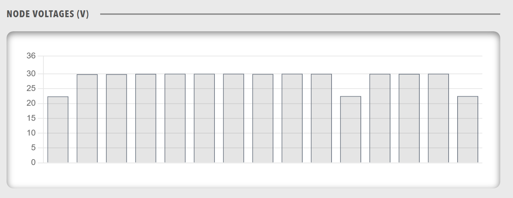

# Panel component
A panel is a titled container within a [panels](Panels.md) grid that holds related content and data visualisations.

<figure markdown>

<figcaption>Panel component displaying a titled container with organised content</figcaption>
</figure>

## When to use

Use a panel for one titled section of data inside a panels grid.
Use a [Group](Group.md) when the components need no title or panel frame.

## Parameters

| Parameter | Type | Required | Default | Description |
|-----------|------|----------|---------|-------------|
| `class` | string | No | None | Style variant of the panel body. `sunken` is the only variant that Profinity defines |
| `title` | string | Yes | None | Title text in the panel header, at the top of the panel |
| `menu` | object | No | None | When present, the panel header shows a static menu icon. The menu items are not displayed |
| `width` | string | No | None | Width in CSS format, for example `100px`, `50%` or `auto`, applied to the panel |
| `height` | string | No | None | Height in CSS format, for example `100px`, `50vh` or `auto`, applied to the body area of the panel |
| `minHeight` | string | No | None | Minimum height of the panel body in CSS format. The body grows with its content and stays at or above this value. The value sets a floor only, so the panel is as tall as its content or this value, whichever is taller |
| `items` | array | Yes | None | Components displayed in the body of the panel |

`id` is accepted but has no effect.

The `sunken` variant suits charts and state diagrams, and it applies to the panel body rather than to the whole panel.
A panel accepts these components in `items`:

- [Chart](../Data/Charts.md)
- [Lamps](../Data/Lamps.md)
- [State](../Data/State.md) diagram
- [Group](Group.md)
- [Readouts](../Data/Readouts.md)
- [Table](../Data/Tables.md)
- [HTML](../Content/HTML.md)
- [Redirect](../Content/Redirect.md)
- [Caption](../Data/Caption.md)

Place any other component inside a `group`.

A panel with a `menu` shows a static menu icon in its header that is display-only, so a panel menu does not provide navigation, actions, or dialogs.
Use the [Titlebar](Titlebar.md) menu or an [Action](../Interactive/Actions.md) component for navigation and actions.

## Example

This example places two readouts in a panel with an automatic height.

``` yaml
dashboard:
  items:
    - row:
        items:
          - panels:
              items:
                - panel:
                    title: "Temperature Sensors"
                    height: "auto"
                    items:
                      - readouts:
                          items:
                            - readout:
                                label: "Sensor 1"
                                value: 22.5
                                unit: "°C"
                                precision: 1
                            - readout:
                                label: "Sensor 2"
                                value: 24.2
                                unit: "°C"
                                precision: 1
```

Panels support different height configurations for flexible layouts.

``` yaml
dashboard:
  items:
    - row:
        items:
          - panels:
              items:
                - panel:
                    title: "Fixed Height Panel"
                    height: "200px"
                    items:
                      - chart:
                          type: "line"
                          value:
                            labels: ["Jan", "Feb", "Mar"]
                            datasets:
                              - label: "Data"
                                data: [10, 20, 30]
                - panel:
                    title: "Viewport Height Panel"
                    height: "50vh"
                    items:
                      - table:
                          tableHeaders:
                            - header:
                                accessorKey: name
                                value: Name
                          value: []
                - panel:
                    title: "Auto Height Panel"
                    height: "auto"
                    items:
                      - readouts:
                          items:
                            - readout:
                                label: "Value"
                                value: 42
```

Panels also support explicit width values to control horizontal sizing within layouts.

``` yaml
dashboard:
  items:
    - row:
        items:
          - panels:
              items:
                - panel:
                    title: "Half Width Panel"
                    width: "50%"
                    height: "auto"
                    items:
                      - readouts:
                          items:
                            - readout:
                                label: "Value"
                                value: 42
                - panel:
                    title: "Fixed Width Panel"
                    width: "480px"
                    height: "auto"
                    items:
                      - html:
                          content: "<p>Fixed width content area</p>"
```

Panels can contain complex nested component structures, in which a `group` holds the components that the panel does not accept directly.

``` yaml
dashboard:
  items:
    - row:
        items:
          - panels:
              items:
                - panel:
                    title: "Motor Controller Overview"
                    height: "auto"
                    items:
                      - group:
                          direction: "horizontal"
                          items:
                            - icon:
                                image: nav_motorcontrollers_active.svg
                            - readouts:
                                items:
                                  - readout:
                                      label: "Bus Voltage"
                                      precision: 1
                                      bind:
                                        - target: value
                                          source: 'DBC/BusMeasurement/BusVoltage'
                                  - readout:
                                      label: "Bus Current"
                                      precision: 1
                                      bind:
                                        - target: value
                                          source: 'DBC/BusMeasurement/BusCurrent'
                      - chart:
                          type: "line"
                          legend: false
                          refreshInterval: 1000
                          bind:
                            - target: value
                              source: 'DBC/BusMeasurement/BusVoltage'
                              seriesMode: timeSeries
                              start: "-5m"
                              stop: "0m"
                      - lamps:
                          items:
                            - lampgroup:
                                items:
                                  - lamp:
                                      color: "green"
                                      label: "Online"
                                      value: 1
                                      bind:
                                        - target: enabled
                                          source: 'DBC/Status/Online'
                                          toType: boolean
                                  - lamp:
                                      color: "red"
                                      label: "Error"
                                      value: 1
                                      bind:
                                        - target: enabled
                                          source: 'DBC/Status/Error'
                                          toType: boolean
```

This example sets a sunken panel with a body height of 60vh and a minimum height of 200px.
It holds lamps, a readout and a chart.

``` yaml
dashboard:
  items:
    - row:
        items:
          - panels:
              items:
                - panel:
                    class: "sunken"
                    title: "System Status"
                    height: "60vh"
                    minHeight: "200px"
                    items:
                      - group:
                          direction: "vertical"
                          items:
                            - lamps:
                                items:
                                  - lampgroup:
                                      items:
                                        - lamp:
                                            color: "green"
                                            label: "Online"
                                            value: 1
                                            bind:
                                              - target: enabled
                                                source: 'DBC/Status/Online'
                                                toType: boolean
                            - readouts:
                                items:
                                  - readout:
                                      label: "Temperature"
                                      bind:
                                        - target: value
                                          source: 'DBC/Temperature/Value'
                            - chart:
                                type: "line"
                                bind:
                                  - target: value
                                    source: 'DBC/Temperature/Value'
                                    seriesMode: timeSeries
                                    start: "-5m"
                                    stop: "0m"
```
