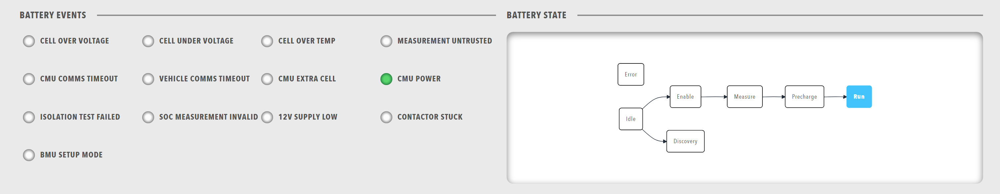

# Row component
A row is a layout container that holds several components and arranges them vertically or horizontally.
Rows are the basic building blocks of dashboard layout.

<figure markdown>

<figcaption>Row layout container organising multiple components in a dashboard</figcaption>
</figure>

## When to use

Use a row to divide a dashboard into logical sections and to control the direction in which the components of a section are laid out.
A row stacks its items vertically unless `direction` is set to `horizontal`, so set `direction: horizontal` to place items side by side.
Use a [Group](Group.md) when a set of related components needs a shared `width`, because a row takes a `height` and not a width.

## Parameters

| Parameter | Type | Required | Default | Description |
|-----------|------|----------|---------|-------------|
| `id` | string | No | None | Set as the `id` attribute of the row element |
| `class` | string | No | None | CSS class added to the row, alongside the horizontal or vertical layout class |
| `direction` | string | No | `vertical` | Layout direction, `vertical` or `horizontal`. Items are stacked from top to bottom unless the value is `horizontal` |
| `height` | string | No | None | Height in CSS format, for example `100px`, `50vh` or `auto`, applied directly to the row |
| `minHeight` | string | No | None | Minimum height in CSS format. The row grows with its content and never shrinks below this value. The value does not stretch the row to fill space |
| `distributeChildren` | boolean | No | `false` | When the row holds several stacked [Panels](Panels.md) grids, shares the height of the row evenly between them instead of letting each grid size to its own content |
| `items` | array | No | None | Components displayed in the row |

The `distributeChildren` setting has no effect unless a `height` or `minHeight` is set on the row itself.
A height on a parent of the row does not count.

## Example

``` yaml
dashboard:
  items:
    - row:
        id: "status-row"
        class: "status-container"
        direction: "horizontal"
        height: "auto"
        items:
          - lamps:
              items:
                - lampgroup:
                    items:
                      - lamp:
                          color: "green"
                          label: "Online"
                          value: 1
                          enabled: true
          - readouts:
              items:
                - readout:
                    label: "Temperature"
                    value: 25.5
                    unit: "°C"
```
