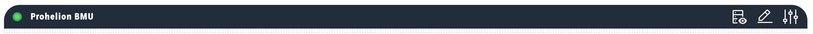

# Core elements

A dashboard is a vertical list of full-width elements.
Each element at the top level is a titlebar, a row, an accordion or a footer.
Anything else, such as a group, a panel or a readout, sits inside one of these.
This page describes the four top-level elements, the `items` property that nests elements, and the layout direction of rows.
The [Motor controller dashboard example](./Motor_Controller_Dashboard_Example.md) shows them all in one dashboard.

## The four top-level elements

The `items` list of `dashboard:` accepts only these four elements, and the order of the list is the order on screen.

A [titlebar](./Component_Reference/Layout/Titlebar.md) is the header of the dashboard.
It typically holds status lamps, navigation menus and the component name.

<figure markdown>

<figcaption>Dashboard titlebar</figcaption>
</figure>

A [row](./Component_Reference/Layout/Row.md) is a layout container that holds components or groups and arranges them horizontally or vertically.
Rows divide the dashboard into logical sections.

<figure markdown>

<figcaption>Row layout container</figcaption>
</figure>

An [accordion](./Component_Reference/Layout/Accordion.md) is a collapsible section for detailed information, settings, or secondary data that users open only when they need it.
It keeps the main dashboard focused on key information.

<figure markdown>

<figcaption>Accordion header</figcaption>
</figure>

A [footer](./Component_Reference/Layout/Footer.md) is a bar at the bottom of the dashboard that a binding on its `visible` target can show or hide.
A menu added to the footer is not displayed, so the footer is not a place for navigation.
Use a footer when the dashboard needs a bar that appears only under some conditions.
For navigation and actions, use the titlebar menu or an [Action](./Component_Reference/Interactive/Actions.md) component.

<figure markdown>

<figcaption>Dashboard footer bar</figcaption>
</figure>

## Nesting with `items`

The `items` property is an array that holds the child elements of a container.
It appears at almost every level of a dashboard: in `dashboard`, `row`, `group`, `panel`, `accordion`, and in containers such as `pill`, `lamps`, `readouts` and `tabs`.
It is always an array, written with `-` list syntax even for one element, and the order of the array is the order on screen.
A row holds groups and components, a group organises related components, and a panel is a titled container.
The HTML and Image components display custom content.

```yaml
dashboard:
  items:                    # Top-level items
    - row:
        items:              # Items within the row
          - group:
              items:        # Items within the group
                - readouts:
                    items:  # Items within the readouts container
                      - readout:
                          label: "Temperature"
                          value: 25.5
```

A larger dashboard nests in the same way:

```text
Dashboard
├── Titlebar
├── Row (vertical)
│   ├── Group
│   │   ├── Component 1 (Readouts)
│   │   ├── Component 2 (Chart)
│   │   └── Component 3 (HTML)
│   └── Group
│       └── Component 4 (Image)
├── Accordion
│   └── Row
│       └── Components
└── Footer
```

Images, stylesheets and HTML templates for a dashboard are stored in the `images`, `styles` and `content` folders of the profile.
Refer to [Store dashboard files in a profile](./Store_Dashboard_Files.md).

## Layout directions

A row stacks its components vertically by default and arranges them side by side when `direction: horizontal` is set.
A group behaves the same way, so both layouts can be mixed within one dashboard.

```yaml
dashboard:
  items:
    - row:
        direction: horizontal
        items:
          - readouts:
              items:
                - readout:
                    label: "Temperature"
                    value: 25.5
          - readouts:
              items:
                - readout:
                    label: "Pressure"
                    value: 1013
```

For a complete dashboard that uses rows, groups, panels, an accordion and a tab, refer to the [Motor controller dashboard example](./Motor_Controller_Dashboard_Example.md).
To learn how components take their values from tags, refer to [Data binding](./Data_Binding/index.md).
For every component, refer to the [Component reference](./Component_Reference/index.md).
