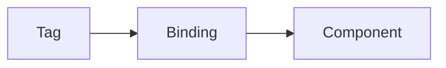

# Data binding

Data binding connects a dashboard component to a *tag*.
A tag is a named value in Profinity, such as a CAN signal, a component property or a derived value.
You can browse every tag in the Tag Explorer.
When the tag changes, the component updates, so a dashboard shows live information without any code to fetch it.

This page covers how a binding names a tag, which tags a dashboard can use, and the binding modes.
For the settings of a binding, refer to the [Binding settings reference](./Binding_Settings_Reference.md).
For scaling, type conversion and text mapping, refer to [Transform and map values](./Transform_and_Map_Values.md).

<figure markdown>

<figcaption>A binding connects a tag to a dashboard component, and the component updates when the tag changes</figcaption>
</figure>

A binding can show the latest value of a tag, plot its recent history, or read its values back from the data log.
The tag is the same in each case, and only the binding settings differ.
Whatever the origin of the value, Profinity presents it as a tag with an address, a value, a quality flag and a timestamp.
One binding therefore works the same way for all of them.

## Understanding tags

A binding names a tag by its *tag path*, which is a list of names separated by `/`, in the same tree that the Tag Explorer displays.
To bind a component, open the Tag Explorer, find the tag, and copy its path into the `source` of the binding.
The Visual Editor does this for you, because its **Binding** section lets you choose the tag from the tree, as described in [Visual Editor](../Build_a_Dashboard.md).
For how Profinity builds and maintains the tag tree, refer to [Tag layer](../../../Tags/index.md).

### Binding source paths

The `source` of a binding is a tag path, and it takes one of two forms:

| Form | Example | Meaning |
|------|---------|---------|
| Relative | `DBC/BusMeasurement/BusVoltage` | A tag of the component that owns the dashboard |
| Absolute | `/Prohelion BMU/DBC/PackStateOfCharge/SOCPercent` | A tag of a named component, which can be a different component |

A path without a leading `/` is relative to the component that owns the dashboard.
The common branches are `DBC/...` and `Properties/...`.
Profinity resolves a relative path under the owning component when the dashboard loads.
A relative path makes a dashboard reusable, because the dashboard does not contain the name of a component.
The component can be renamed, or the dashboard applied to another component with the same tags.
A component dashboard needs a leading `/` to bind to a tag in a different component.

A dashboard that has no owning component, such as a home dashboard, names the component in full.
The path can start with `/`, which is the form the Visual Editor writes, or without it, as in `Prohelion BMU/Properties/StatusColourText` in the Example Profile that ships with Profinity.
If a component is mounted at a nested location in the tag tree, an absolute path includes that location, as described in [Tag tree paths and dashboard binds](../../../Tags/Selecting_Tags/Tag_Tree_Path.md).

!!! info "Dashboards from earlier versions"
    Dashboards written before Profinity 2.3 may use dots instead of slashes, as in `{COMPONENT_NAME}.BusMeasurement.BusVoltage`.
    They may also use the `{COMPONENT_NAME}` placeholder for the owning component, or the `[TimeSeries]` prefix on a source, as in `[TimeSeries].{COMPONENT_NAME}.BusMeasurement.BusCurrent`.
    These dashboards continue to work.
    New dashboards use the slash form shown on this page, a relative path in place of the placeholder, and `seriesMode: timeSeries` in place of the prefix.

## Tags you can bind to

A binding can use any tag in the tree.
The branch that a tag sits under shows where its value comes from, and these are the tags that dashboards use most often.

A component that reads Controller Area Network (CAN) bus messages publishes each signal in its CAN database (DBC) file as a tag, in the form `DBC/<Message>/<Signal>`.
DBC tags suit real-time data, sensor readings and status indicators that the DBC file defines.

- `DBC/BusMeasurement/BusVoltage` is the tag for a signal (`BusVoltage`) of a CAN message (`BusMeasurement`).
- `DBC/Status/LimitBusCurrent` is the tag for a limit flag signal (`LimitBusCurrent`, set when the bus current setpoint is limiting the motor torque) of a CAN message (`Status`).
- `/Prohelion BMU/DBC/PackStateOfCharge/SOCPercent` is the tag for a signal of a named component.

The `Properties/` branch holds the tags that a component calculates or holds beyond its DBC signals.
Which tags exist depends on the component, so find them in the Tag Explorer.
Property tags suit component status, calculated values and data structures that the component defines.

- `Properties/StatusColourText` is the status colour of the component.
- `Properties/BusPower` is the bus power, in watts, that the WaveSculptor22 component calculates as the product of the `BusVoltage` and `BusCurrent` signals. The WaveSculptor22 does not transmit it as a signal.
- `Properties/PackData/BatteryMilliVolts` is the battery voltage data of a Prohelion Battery Management Unit (BMU) component, where nested names are separated by `/`.

A [derived tag](../../../Tags/Derived_Tags/index.md) is a tag whose value Profinity computes from an expression or a script.
A dashboard binds to it exactly as it binds to any other tag.
Use a derived tag when a dashboard needs a value that no device reports, such as a calculated power or a combined status.
The calculation then lives in one place instead of in every dashboard.
Derived tags suit calculated values that several dashboards, rules, or the API also use.

## Binding modes

The mode of a binding decides what the dashboard reads from the tag.
The `source` is a tag path in every mode.
The default mode, `seriesMode: instant` with `store: local`, shows only the latest value of the tag.
Readouts, lamps, and most other components use it, and it is the setting to leave unchanged unless a chart needs history.

### Time series

A chart plots history when its binding sets `seriesMode`, or when it reads logged data with `store: logged`.
The values of `seriesMode` are:

- `timeSeries` plots the recent values of the tag over the window set by `timeRangeStart` and `timeRangeStop`.
- `timeSeriesDelta` plots the change between successive values.
- `instant`, the default, shows only the latest value.

```yaml
dashboard:
  items:
    - row:
        items:
          - chart:
              type: line
              bind:
                - target: value
                  source: DBC/VelocityMeasurement/VehicleVelocity
                  seriesMode: timeSeries
                  timeRangeStart: "-5m"
                  timeRangeStop: "0m"
```

A series binding that sets `timeRangeStop` but omits `timeRangeStart` starts its window 10 minutes before the stop time.
The Visual Editor sets the same length of history when it adds a series.
A binding that sets neither shows only the latest value.
Set both `timeRangeStart` and `timeRangeStop` on a series binding to state the history that the chart shows.
Time values use a relative form, where `-5m` is five minutes before now and `0m` is now.
Time series bindings suit charts, trends and the live history of any numeric tag.

### Logged data

Set `store: logged` to read the values of a tag back from the data log instead of the live values.
A logged binding names a time range and, optionally, how to aggregate the data:

```yaml
dashboard:
  items:
    - row:
        items:
          - chart:
              type: line
              bind:
                - target: value
                  source: DBC/BusMeasurement/BusVoltage
                  store: logged
                  timeRangeStart: "-1h"
                  timeRangeStop: "0m"
                  aggregationWindow: "1m"
                  aggregationFunction: mean
```

Logged data requires data logging to be configured and enabled for the profile, as described in [How to configure data logging](../../../How_To_Guides/Configure_Data_Logging.md).
A logged binding returns no data while logging is not available.
The `aggregationWindow` groups the data into intervals of the given length (for example `10s` or `1m`).
The `aggregationFunction` decides which value represents each interval.
Logged bindings suit historical analysis over periods longer than the live window.

[Tag layer](../../../Tags/index.md) covers the Tag Explorer, [Derived tags](../../../Tags/Derived_Tags/index.md) and [Create collections, rules, and dashboard bindings from tags](../../../Tags/Create_Collections_Rules_and_Bindings_from_Tags.md), which adds tags to a dashboard from the Tag Explorer.
The [Binding settings reference](./Binding_Settings_Reference.md) lists every binding setting.
[Conditional styling](./Conditional_Styling.md) shows how `visible`, `enabled` and `color` bindings change the look of a component.
The annotated [Motor controller dashboard example](../Motor_Controller_Dashboard_Example.md) shows a complete dashboard.
