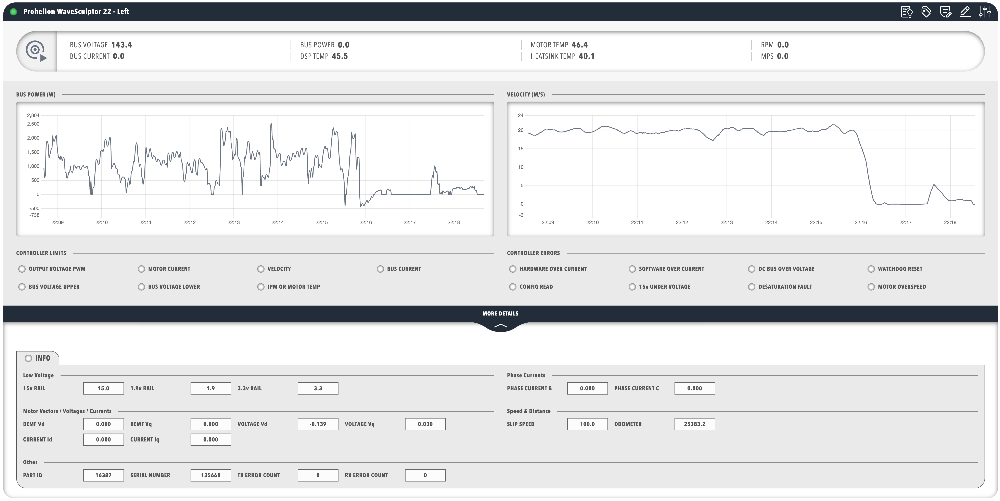

# Motor controller dashboard example

This page lists a complete dashboard for a Prohelion WaveSculptor22 motor controller, explains its five sections, and shows how to adapt it to another system.
The dashboard monitors electrical, thermal, and performance values in real time.

[Download the example dashboard :material-download:](example_dashboard.zip){ .md-button }

Upload `dashboard.yaml` on a WaveSculptor22 or WaveSculptor200 component.
Every message and signal name in the YAML is taken from the [WaveSculptor22 CAN database (DBC) file](../../../../Motor_Controllers/WaveSculptor22/User_Manual/DBC.md).
The [CAN protocol appendix](../../../../Motor_Controllers/WaveSculptor22/User_Manual/Appendix_C.md) of the WaveSculptor22 User Manual describes the same messages.
The dashboard uses rows, groups, panels, an accordion and a tab, and has no titlebar or footer.
For those top-level elements, refer to [Core elements](./Core_Elements.md).
Each component used here has a smaller example of its own in the [Component reference](./Component_Reference/index.md).

<figure markdown>

<figcaption>The example dashboard as it appears for a WaveSculptor22 component. The titlebar across the top is the component's own and is not part of the dashboard YAML.</figcaption>
</figure>

## Tags used

The dashboard binds to tags of a Prohelion WaveSculptor22 motor controller component.
The `DBC/` tags come from the signals in the controller's DBC file, and the component calculates the `Properties/` tags.
The Tag Explorer lists both under the component.

The dashboard binds these tags:

- `BusVoltage` (V) and `BusCurrent` (A) from the `BusMeasurement` message, which the WaveSculptor broadcasts every 200 ms.
- The temperatures `DspBoardTemp`, `MotorTemp` and `HeatsinkTemp` in °C, broadcast every second.
- `MotorVelocity` in rpm and `VehicleVelocity` in m/s, which the `MPS` readout shows.
- The seven limit flags and eight of the nine error flags of the `Status` message, which is broadcast every 200 ms. The `ErrorBadMotorPositionHallSeq` flag is not bound.
- A set of detailed measurements.

The detailed measurements are:

- The phase B and C currents (root mean square (RMS), in A).
- The 15 V, 1.9 V and 3.3 V rails.
- The motor voltage, motor current and back electromotive force (back-EMF) vectors.
- Slip speed (Hz, valid for induction motors only) and odometer (m).
- The device identifier and the serial number.
- The CAN transmit and receive error counts.

## Section-by-section analysis

The dashboard has five sections.
The first row holds a status pill.
The second row holds four panels: two charts, the controller limits, and the controller errors.
The last section is an accordion at the top level.

### Status pill section

The dashboard begins with a pill that carries a motor controller icon, so the component is recognisable at a glance.
The pill groups the bus voltage, bus current, three temperatures and velocities into readouts.
Profinity updates the readouts from the CAN bus data, and the precision of each readout suits its measurement.
Each binding names a tag, and the `DBC/` tags correspond to CAN message signals.

### Performance charts section

The second row holds two line charts, each in its own titled panel.
The bus power chart plots the `Properties/BusPower` tag, which the component calculates as the product of `BusVoltage` and `BusCurrent`, and which the WaveSculptor does not transmit as a signal.
The velocity chart plots the `DBC/VelocityMeasurement/VehicleVelocity` tag in metres per second.
Both bind with `seriesMode: timeSeries` to plot recent history, and both hide the legend.

### Controller limits section

The controller limits panel shows the protection limits in two rows of amber lamps covering voltage, current, velocity, and temperature limits.
Each lamp binds a boolean flag of the `Status` message, so it lights when the limit is active and greys out when it is not.

### Error monitoring section

The controller errors panel shows red lamps for the over current, over voltage, watchdog, configuration, 15 V rail, desaturation, and motor over speed errors.
It does not monitor the bad motor position hall sequence error.
Each lamp lights only while its error is active.
The `WATCHDOG RESET` lamp is a warning more than a fault, because the controller continues to operate and the flag stays set until the next reset or power cycle.

The `CONFIG READ` lamp indicates that default values replaced the stored configuration values.
For more information, refer to the [Observation](../../../../Motor_Controllers/Config_Software/Observation.md) page of the configuration software manual.

### Detailed information section

The last section is the `MORE DETAILS` accordion, which holds a tab labelled `INFO` with panels for low voltage, phase currents, motor vectors, speed and distance, and other data.
The other data includes the identifier, serial number, and CAN error counts.
Keeping the full set of measurements in an accordion leaves the main dashboard with the key metrics.
A user opens the accordion only when the detail is needed.

## Complete dashboard example

The following YAML is the whole dashboard.
Its parts follow the order of the sections in the section-by-section analysis.

``` yaml
version: "2.3"
dashboard:
  items:
    - row:
        direction: vertical
        items:
          - group:
              class: statscontainer
              items:
                - pill:
                    icon:
                      image: nav_motorcontrollers_active.svg
                      recess: false
                      value: 0
                    items:
                      - pillgroup:
                          items:
                            - value:
                                label: BUS VOLTAGE
                                enabled: true
                                precision: 1
                                bind:
                                  - target: value
                                    source: DBC/BusMeasurement/BusVoltage
                            - value:
                                label: BUS CURRENT
                                enabled: true
                                precision: 1
                                bind:
                                  - target: value
                                    source: DBC/BusMeasurement/BusCurrent
                      - pillgroup:
                          items:
                            - value:
                                label: DSP TEMP
                                enabled: true
                                precision: 1
                                bind:
                                  - target: value
                                    source: DBC/DspBoardTempMeasurement/DspBoardTemp
                            - value:
                                label: MOTOR TEMP
                                enabled: true
                                precision: 1
                                bind:
                                  - target: value
                                    source: DBC/HeatsinkMotorTempMeasurement/MotorTemp
                            - value:
                                label: HEATSINK TEMP
                                enabled: true
                                precision: 1
                                bind:
                                  - target: value
                                    source: DBC/HeatsinkMotorTempMeasurement/HeatsinkTemp
                      - pillgroup:
                          items:
                            - value:
                                label: RPM
                                enabled: true
                                precision: 1
                                bind:
                                  - target: value
                                    source: DBC/VelocityMeasurement/MotorVelocity
                            - value:
                                label: MPS
                                enabled: true
                                precision: 1
                                bind:
                                  - target: value
                                    source: DBC/VelocityMeasurement/VehicleVelocity
          - row:
              direction: vertical
              class: trunkpadded
              items:
                - panels:
                    items:
                      - panel:
                          title: BUS POWER (W)
                          items:
                            - chart:
                                type: line
                                legend: false
                                bind:
                                  - target: value
                                    source: Properties/BusPower
                                    seriesMode: timeSeries
                                    timeRangeStart: "-5m"
                                    timeRangeStop: "0m"
                      - panel:
                          title: VELOCITY (M/S)
                          items:
                            - chart:
                                type: line
                                legend: false
                                bind:
                                  - target: value
                                    source: DBC/VelocityMeasurement/VehicleVelocity
                                    seriesMode: timeSeries
                                    timeRangeStart: "-5m"
                                    timeRangeStop: "0m"
                      - panel:
                          title: CONTROLLER LIMITS
                          items:
                            - lamps:
                                items:
                                  - lampgroup:
                                      items:
                                        - lamp:
                                            color: amber
                                            value: 1
                                            label: OUTPUT VOLTAGE PWM
                                            enabled: false
                                            bind:
                                              - target: enabled
                                                source: DBC/Status/LimitOutputVoltagePWM
                                                toType: boolean
                                        - lamp:
                                            color: amber
                                            value: 1
                                            label: MOTOR CURRENT
                                            enabled: false
                                            bind:
                                              - target: enabled
                                                source: DBC/Status/LimitMotorCurrent
                                                toType: boolean
                                        - lamp:
                                            color: amber
                                            value: 1
                                            label: VELOCITY
                                            enabled: false
                                            bind:
                                              - target: enabled
                                                source: DBC/Status/LimitVelocity
                                                toType: boolean
                                        - lamp:
                                            color: amber
                                            value: 1
                                            label: BUS CURRENT
                                            enabled: false
                                            bind:
                                              - target: enabled
                                                source: DBC/Status/LimitBusCurrent
                                                toType: boolean
                                  - lampgroup:
                                      items:
                                        - lamp:
                                            color: amber
                                            value: 1
                                            label: BUS VOLTAGE UPPER
                                            enabled: false
                                            bind:
                                              - target: enabled
                                                source: DBC/Status/LimitBusVoltageUpper
                                                toType: boolean
                                        - lamp:
                                            color: amber
                                            value: 1
                                            label: BUS VOLTAGE LOWER
                                            enabled: false
                                            bind:
                                              - target: enabled
                                                source: DBC/Status/LimitBusVoltageLower
                                                toType: boolean
                                        - lamp:
                                            color: amber
                                            value: 1
                                            label: IPM OR MOTOR TEMP
                                            enabled: false
                                            bind:
                                              - target: enabled
                                                source: DBC/Status/LimitIpmOrMotorTemp
                                                toType: boolean
                      - panel:
                          title: CONTROLLER ERRORS
                          items:
                            - lamps:
                                items:
                                  - lampgroup:
                                      items:
                                        - lamp:
                                            color: red
                                            value: 1
                                            label: HARDWARE OVER CURRENT
                                            enabled: false
                                            bind:
                                              - target: enabled
                                                source: DBC/Status/ErrorHardwareOverCurrent
                                                toType: boolean
                                        - lamp:
                                            color: red
                                            value: 1
                                            label: SOFTWARE OVER CURRENT
                                            enabled: false
                                            bind:
                                              - target: enabled
                                                source: DBC/Status/ErrorSoftwareOverCurrent
                                                toType: boolean
                                        - lamp:
                                            color: red
                                            value: 1
                                            label: DC BUS OVER VOLTAGE
                                            enabled: false
                                            bind:
                                              - target: enabled
                                                source: DBC/Status/ErrorDcBusOverVoltage
                                                toType: boolean
                                        - lamp:
                                            color: red
                                            value: 1
                                            label: WATCHDOG RESET
                                            enabled: false
                                            bind:
                                              - target: enabled
                                                source: DBC/Status/ErrorWatchdogCausedLastReset
                                                toType: boolean
                                  - lampgroup:
                                      items:
                                        - lamp:
                                            color: red
                                            value: 1
                                            label: CONFIG READ
                                            enabled: false
                                            bind:
                                              - target: enabled
                                                source: DBC/Status/ErrorConfigRead
                                                toType: boolean
                                        - lamp:
                                            color: red
                                            value: 1
                                            label: 15v UNDER VOLTAGE
                                            enabled: false
                                            bind:
                                              - target: enabled
                                                source: DBC/Status/Error15vRailUnderVoltage
                                                toType: boolean
                                        - lamp:
                                            color: red
                                            value: 1
                                            label: DESATURATION FAULT
                                            enabled: false
                                            bind:
                                              - target: enabled
                                                source: DBC/Status/ErrorDesaturationFault
                                                toType: boolean
                                        - lamp:
                                            color: red
                                            value: 1
                                            label: MOTOR OVERSPEED
                                            enabled: false
                                            bind:
                                              - target: enabled
                                                source: DBC/Status/ErrorMotorOverSpeed
                                                toType: boolean
    - accordion:
        label: MORE DETAILS
        items:
          - row:
              direction: vertical
              items:
                - tabs:
                    items:
                      - tab:
                          enabled: true
                          header:
                            - lamp:
                                color: disabled
                                value: 1
                                label: INFO
                          items:
                            - panels:
                                items:
                                  - panel:
                                      title: Low Voltage
                                      items:
                                        - readouts:
                                            items:
                                              - readout:
                                                  label: 15v RAIL
                                                  precision: 1
                                                  bind:
                                                    - target: value
                                                      source: DBC/VoltageRail15VMeasurement/Supply15V
                                              - readout:
                                                  label: 1.9v RAIL
                                                  precision: 1
                                                  bind:
                                                    - target: value
                                                      source: DBC/VoltageRail3V31V9Measurement/Supply1V9
                                              - readout:
                                                  label: 3.3v RAIL
                                                  precision: 1
                                                  bind:
                                                    - target: value
                                                      source: DBC/VoltageRail3V31V9Measurement/Supply3V3
                                  - panel:
                                      title: Phase Currents
                                      items:
                                        - readouts:
                                            items:
                                              - readout:
                                                  label: PHASE CURRENT B
                                                  precision: 3
                                                  bind:
                                                    - target: value
                                                      source: DBC/PhaseCurrentMeasurement/PhaseCurrentB
                                              - readout:
                                                  label: PHASE CURRENT C
                                                  precision: 3
                                                  bind:
                                                    - target: value
                                                      source: DBC/PhaseCurrentMeasurement/PhaseCurrentC
                                  - panel:
                                      title: Motor Vectors
                                      items:
                                        - readouts:
                                            items:
                                              - readout:
                                                  label: BEMF Vd
                                                  precision: 3
                                                  bind:
                                                    - target: value
                                                      source: DBC/BackEMFMeasurementPrediction/BEMFd
                                              - readout:
                                                  label: BEMF Vq
                                                  precision: 3
                                                  bind:
                                                    - target: value
                                                      source: DBC/BackEMFMeasurementPrediction/BEMFq
                                              - readout:
                                                  label: MOTOR VOLTAGE Vd
                                                  precision: 3
                                                  bind:
                                                    - target: value
                                                      source: DBC/MotorVoltageVectorMeasurement/Vd
                                              - readout:
                                                  label: MOTOR VOLTAGE Vq
                                                  precision: 3
                                                  bind:
                                                    - target: value
                                                      source: DBC/MotorVoltageVectorMeasurement/Vq
                                              - readout:
                                                  label: MOTOR CURRENT Id
                                                  precision: 3
                                                  bind:
                                                    - target: value
                                                      source: DBC/MotorCurrentVectorMeasurement/Id
                                              - readout:
                                                  label: MOTOR CURRENT Iq
                                                  precision: 3
                                                  bind:
                                                    - target: value
                                                      source: DBC/MotorCurrentVectorMeasurement/Iq
                                  - panel:
                                      title: Speed & Distance
                                      items:
                                        - readouts:
                                            items:
                                              - readout:
                                                  label: SLIP SPEED
                                                  precision: 1
                                                  bind:
                                                    - target: value
                                                      source: DBC/SlipSpeedMeasurement/SlipSpeed
                                              - readout:
                                                  label: ODOMETER
                                                  precision: 1
                                                  bind:
                                                    - target: value
                                                      source: DBC/OdometerBusAhMeasurement/Odometer
                                  - panel:
                                      title: Other
                                      items:
                                        - readouts:
                                            items:
                                              - readout:
                                                  label: PART ID
                                                  bind:
                                                    - target: value
                                                      source: DBC/IDInfo/TritiumID
                                              - readout:
                                                  label: SERIAL NUMBER
                                                  bind:
                                                    - target: value
                                                      source: DBC/IDInfo/SerialNumber
                                              - readout:
                                                  label: TX ERROR COUNT
                                                  bind:
                                                    - target: value
                                                      source: DBC/Status/TxErrorCount
                                              - readout:
                                                  label: RX ERROR COUNT
                                                  bind:
                                                    - target: value
                                                      source: DBC/Status/RxErrorCount
```

## Adapting the dashboard

The bindings in this dashboard follow three patterns, which [Data binding](./Data_Binding/index.md) describes in full:

- A readout bound to a `DBC/` tag shows the latest value.
- A chart bound with `seriesMode: timeSeries` and a `timeRangeStart` and `timeRangeStop` window shows recent history.
- A lamp bound to `enabled` with `toType: boolean` shows a status flag.

The `DBC/` paths are relative to the component that owns the dashboard, so the dashboard works for any component that publishes the same tags, such as a second WaveSculptor22 controller.
The `Properties/` tags depend on the component, and the Tag Explorer lists them under it.
For the Tag Explorer, refer to [Tag layer](../../Tags/index.md).

To adapt the dashboard to another controller, replace each `source` with the path of the matching tag, which you can copy from the Tag Explorer.
Then adjust the measurements, layout, precision, and labels to suit.

The WaveSculptor200 sends the same CAN messages and signals as the WaveSculptor22, so the tags in this dashboard apply to both controllers.

To add sections:

- Copy a panel and bind it to other tags for more charts.
- Add lamps for further limit or error flags.
- Add readouts for system-specific parameters.
- Add [actions](./Component_Reference/Interactive/Actions.md) and [toggles](./Component_Reference/Interactive/Toggles.md) for control.

The [Dashboard visual editor](./Visual_Editor.md) is the quickest way to make these changes.
