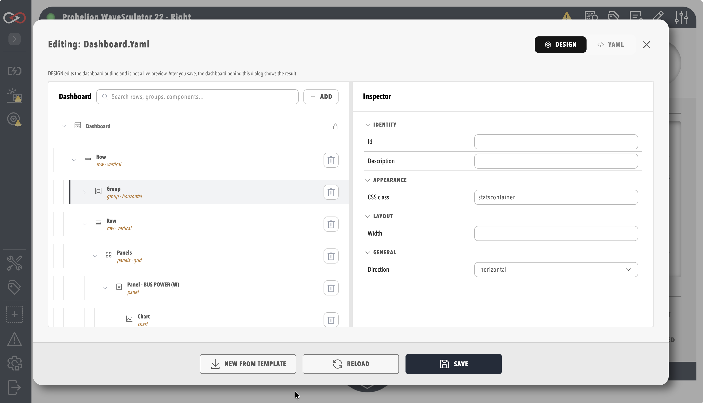
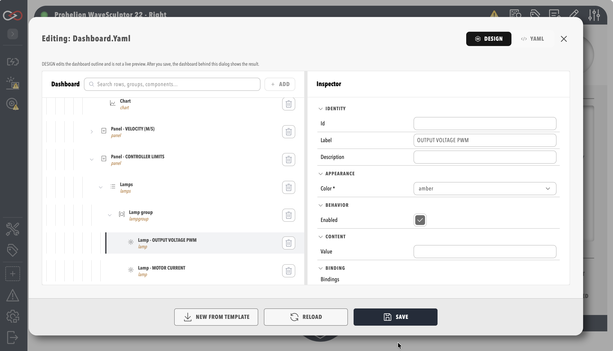

# Dashboard visual editor

The **visual editor** is the primary way to build and change a dashboard.
You add widgets from a list, arrange them in a tree, give them properties in an inspector and bind them to tags, all without writing YAML.
The **YAML** tab is still there as a fallback for anything the visual editor does not cover, and as the reference format when a dashboard is shared or reviewed.
Opening the editor and saving changes needs the **Modify dashboards** permission, and without it the **Edit Dashboard** icon is not shown.

Dashboards created before Profinity 2.3 keep working unchanged, and one opens in the visual editor ready to change.

## Open the visual editor

1. Open a component that uses a custom dashboard, or the profile home page if the profile uses a [profile dashboard](../../Administration/Profile_Dashboard.md).
2. Select the pencil (**Edit Dashboard**) icon in the menu at the right of the dashboard title bar. The editor opens in **DESIGN** mode, which is the visual editor.
3. Optional: select **YAML** to edit the YAML source directly, and **DESIGN** to come back.

<figure markdown>

<figcaption>Dashboard visual editor</figcaption>
</figure>

## The editor layout

| Area | What it does |
|------|--------------|
| **Dashboard tree** | Shows every element of the dashboard, nested as it is in the dashboard. Use the **Search dashboard** box to find an element by name or type. |
| **Inspector** | Shows the properties of the selected element. With nothing selected it shows the **Show header**, **Show actions** and **Show footer** switches for the dashboard. **Show header** adds the title bar, **Show actions** adds the action buttons to it, and **Show footer** adds the footer, except on a dashboard that contains an accordion. With the header off and the actions on, the title bar is transparent and shows only the actions. |
| **Schema validation issues** | Lists anything that does not match the dashboard schema. |
| **Footer buttons** | **NEW FROM TEMPLATE** replaces the dashboard with the template after a confirmation prompt, **RELOAD** loads the saved dashboard again and discards the changes made since it was saved, and **SAVE** stores the dashboard. When an existing profile dashboard (the home dashboard) is edited, a red **DELETE** button also appears, and component dashboards do not offer it. It asks for confirmation, then removes the dashboard file, clears it from the profile settings and returns to the home page. |

## Build a dashboard

To add an element:

1. Select the container to add into, such as a row, group, or pill, or leave the dashboard root selected.
2. Select **Add**. The **Add component** window lists the element types that fit the selection, such as Row, Group, Pill, Readout, Lamp, Chart, and Action.
3. Choose a type. It is inserted as the first child of the selected container and becomes the selected element. With the dashboard root selected, the new element is inserted at the top of the dashboard.

**Add** is unavailable when the selected element cannot hold other elements.
Because a new element always goes first, drag it in the tree to move it to its final position.
Drag an element to reorder it within its parent, or drag it onto another container to move it there, and the tree only allows drops that the dashboard schema permits.

To change an element, select it and edit its properties in the **Inspector**.
Each property uses the control that suits it, such as a drop-down for fixed choices, a check box for on/off values, and pickers for icons and action IDs.
A property the visual editor cannot edit shows a hint to use the **YAML** tab.

To delete an element, select it and delete it from the tree.
A confirmation lists how many nested elements are removed with it.

## Bind tags to an element

An element that can show live data has a **Binding** section in the inspector, and a binding connects one of its properties to a tag.
A single-value element such as a readout or lamp binds one tag, and a chart binds one or more tags.

1. Select the element in the tree, such as a readout, a lamp or a chart.
2. Open the **Binding** section of the inspector and add a binding for each property that the data drives.
3. Choose the tag from the tag tree, which is the same tree as the Tag Explorer.
4. Set the optional transform and default value.

[Data Binding](./Data_Binding/index.md) describes how a binding names a tag and the modes it supports.

<figure markdown>

<figcaption>Binding section of the inspector</figcaption>
</figure>

Building can also start from tags: choosing tags to link to a dashboard opens the **Add component for selected tag(s)** window, which offers only the element types that suit the chosen tags.
Refer to [Tag Linking](../../Tags/Create_Collections_Rules_and_Bindings_from_Tags.md).
Dashboard widgets show live **alert indicators** when bound tags have active rule alerts, as described in [Alerts Log](../../Tags/Alerts.md).

## Validate and save

The editor checks the dashboard against the dashboard schema while the dashboard is edited and lists problems under **Schema validation issues**.
**SAVE** shows a message and does not save while any issues remain, so a saved dashboard always conforms to the schema.
The server also rejects an invalid dashboard submitted through the API.
Closing the editor with unsaved changes asks for confirmation before the changes are discarded.

## When to use the YAML tab

Use the visual editor first, and switch to **YAML** in these cases:

- To edit a property that the inspector marks as "use the YAML tab".
- To copy a dashboard or paste in an example from the [Component Reference](./Component_Reference/index.md) or the [Motor Controller Dashboard Example](./Motor_Controller_Dashboard_Example.md).
- To review a whole dashboard at once or make the same change in many places.
- To repair a dashboard that the visual editor cannot open.

Switching tabs keeps the changes made.
Switching to **DESIGN** needs valid YAML, and if the YAML cannot be parsed the editor shows an error and stays on the **YAML** tab.
Refer to the [Profinity dashboard development guide](./index.md) for the YAML structure.
