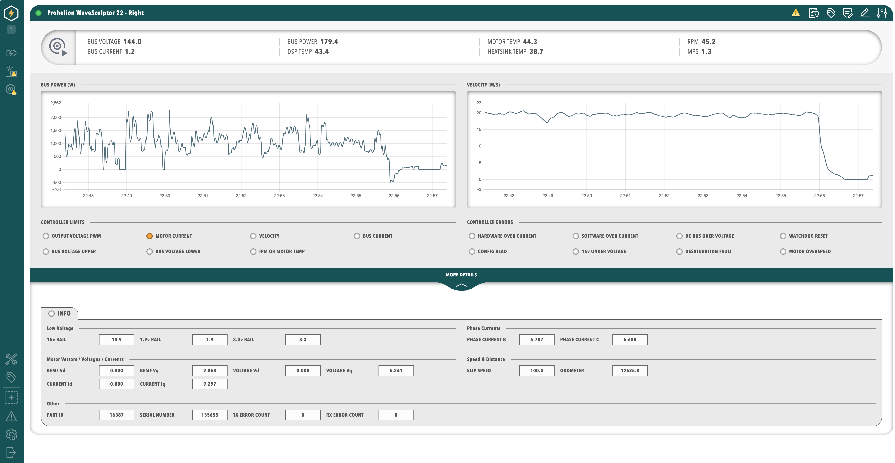

# Themes and branding

Profinity 2.3 applies theme and branding settings from a `theme.yaml` file in the `themes` folder of the [artefacts directory](../../Installation/Artifacts_Directory.md), and the web client shows the colours, logos, and application title from that file in place of the defaults.

!!! warning "Themes need a licence, and distributing a themed Profinity needs an agreement"
    Themes and branding are included in the Desktop licence and above, and an unlicensed instance keeps its `theme.yaml` file but shows the default Profinity appearance.
    You can change the theme for your own use with a licensed instance.
    To distribute a themed Profinity, for example as an original equipment manufacturer (OEM), you need a licence agreement with Prohelion, so contact Prohelion to arrange it before you ship.

## Where the theme is defined

The theme is a file-based setting, so there is no administration screen for it.
Edit `themes/theme.yaml` on the Profinity host, and put logos and icons in the `assets` sub-folder.
Profinity applies the file when it starts and again whenever the file changes.
A missing file leaves the built-in defaults in place, and a file with errors is reported in the [Profinity log](../../Administration/Logs_Config.md) and also falls back to the defaults.
The file holds a `version` plus three optional groups.

| Group | Keys | What they set |
|-------|------|---------------|
| `app` | `title` | The application title shown by the web client. |
| `colors` | `navBackground`, `navForeground`, `primary`, `secondary`, `success`, `warning`, `error` | Navigation fill and foreground, the accent, the secondary colour, and the success, warning, and error colours used by status and charts. |
| `assets` | `logo`, `loginLogo`, `favicon` | The main logo, the logo on the sign-in page, and the browser tab icon. |

Each asset is a single file name that must exist in `themes/assets` with one of the extensions `.svg`, `.png`, `.jpg`, `.jpeg`, `.gif`, `.webp`, or `.ico`.
Colours are hex values, and the three-digit form such as `"#abc"` is expanded to `"#AABBCC"`.
A value that is not a valid colour is reported in the log and the theme falls back to the defaults.
A key you leave out keeps that built-in colour.
`navForeground` colours the text and the icons on navigation surfaces, including the title bar and dialog bars that use the navigation colour.
`primary` colours accent controls such as focus rings, links, and selection.
`success`, `warning`, and `error` colour the status lamps, badges, and chart series that already use those colours.
The lighter wash, the brighter fill, the darker text colour, and the text drawn on a solid status fill are calculated from the colour you set.
They are not keys in `theme.yaml`.
Information banners stay the built-in blue.

## Example `theme.yaml`

This example rebrands Profinity for a fictional OEM.
Place it at `themes/theme.yaml`, and put `acme-logo.svg`, `acme-login.svg`, and `acme-favicon.ico` in `themes/assets`.
Every group and key is optional, so include only what you want to override.

```yaml
version: "2.3"

app:
  title: Acme Monitor

colors:
  navBackground: "#0F5257"
  navForeground: "#FFFFFF"
  primary: "#E07A3F"
  secondary: "#4F6D7A"
  success: "#4CAF7A"
  warning: "#E9B44C"
  error: "#D1495B"

assets:
  logo: acme-logo.svg
  loginLogo: acme-login.svg
  favicon: acme-favicon.ico
```

<figure markdown>

<figcaption>A dashboard with the example theme applied</figcaption>
</figure>

An OEM build can combine custom themes with hidden catalogue entries, as described in [Components and Plugins](../../Administration/Install_and_Manage_Plugins.md), and the settings that control the rest of the system are in [System Configuration](../../Administration/System_Configuration/index.md).
Integrators can read the theme through the [API](../../Integrating_to_Profinity/APIs/Endpoint_Reference.md#themes).
