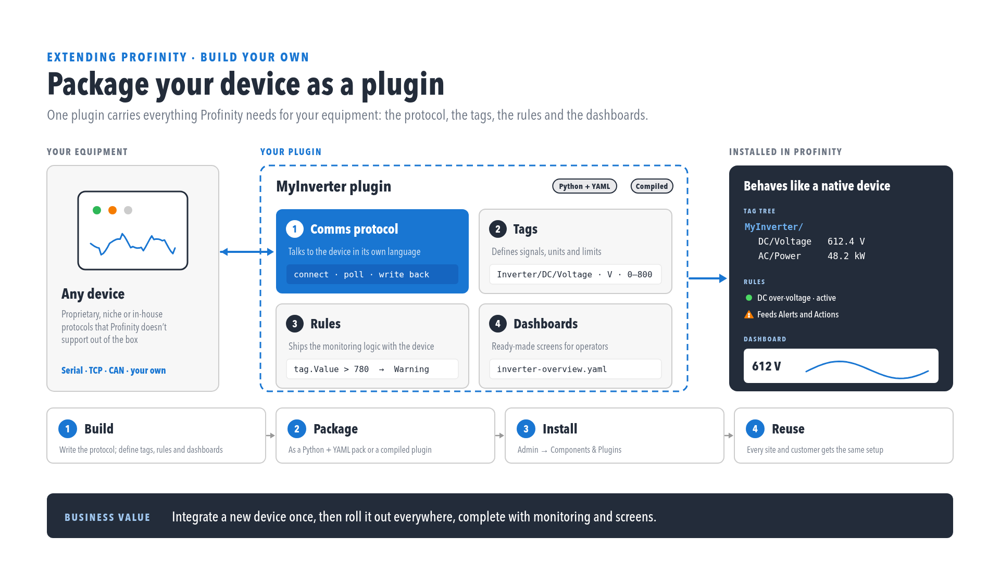

# Component types {#custom-components-and-dll-plugins}

A [Custom Component](index.md) adds to a Profinity profile something Profinity does not already ship: a third-party device, a screen built from existing tags, or a new component type of the author's own.
Once it is in a profile, it is monitored, graphed, logged, and used by rules and scripts in the same way as a built-in component.

There are two ways to create one.
A Custom Component suits a device that can be described with files: a [DBC (CAN database)](../../CAN_Utilities/CAN_Bus_DBC.md) file, a dashboard, scripts, and menu actions, with no compiling.
A dynamic-link library (DLL) plugin suits a component that needs compiled code, and is built as an assembly against the SDK and installed through **Components & Plugins**, where it registers a new component type.
A Custom Component is the first choice, and a DLL plugin is for the cases where files and scripts are not enough.

<figure markdown>

<figcaption>Packaging a device as a plugin</figcaption>
</figure>

## Comparison

| | Custom Component | DLL plugin |
|--|----------------------|----------------|
| Built from | Files and scripts, with no compiling | An assembly compiled by the author |
| Primary files | DBC, dashboard YAML, `actions.yaml`, scripts, maps | A `.dll` plus an optional `dependencies/` folder, in a `.nupkg` or zip |
| Packaging | Optional `profinity-component-pack` `.zip` or `.nupkg` | A `.nupkg` or zip uploaded in **Components & Plugins** |
| Install path | Profile component folder | `{Artifacts}/plugins/{id}/` |

A Custom Component is built from a DBC, a dashboard, rules, `actions.yaml`, a main script, `settings_map.yaml`, `firmware_map.yaml`, `firmware.yaml` and, in a pack, `component_metadata.yaml`, all of which are documented in [Custom Components](index.md).
For the dashboard, refer to the [Dashboard visual editor](../../Customising_Profinity/Dashboards/Visual_Editor.md).
Packing is optional and uses the [Component Pack CLI](./Component_Pack_CLI.md), which is part of the [Profinity SDK](../SDK.md) kit.

A DLL plugin is a C# assembly packed as a `.nupkg` or zip and installed through **Components & Plugins** (refer to [DLL Plugins](../Plugins/index.md)).
Plugins register new component types at runtime.
