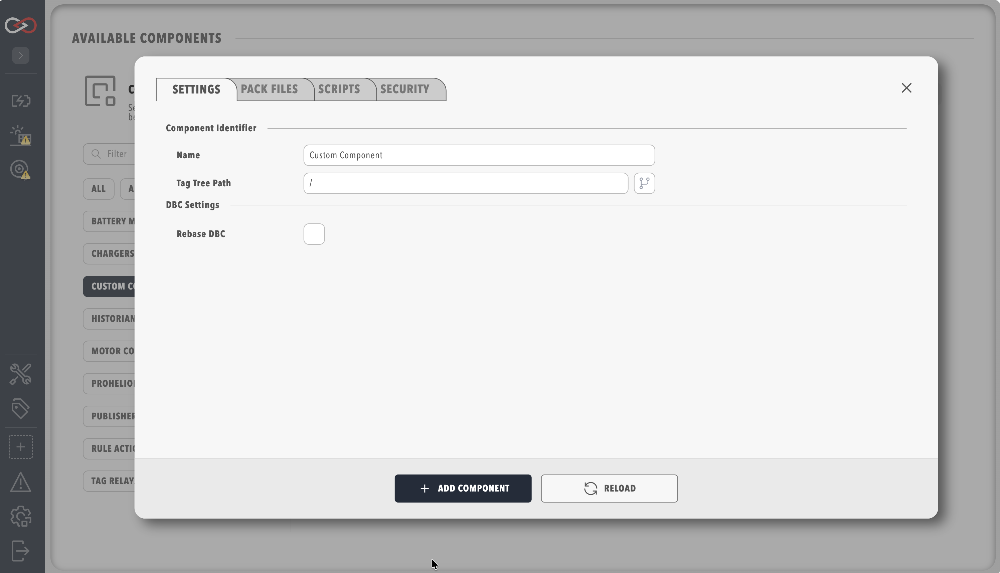

# Custom Component files

Each file on a [Custom Component](index.md) is optional while the component lives in one profile, and a pack requires four of them: `component_metadata.yaml`, `settings_map.yaml`, `firmware_map.yaml`, and `actions.yaml`.

<figure markdown>

<figcaption>Custom Component settings with pack files and scripts</figcaption>
</figure>

Settings for an authored component are arranged as **Settings**, **Pack files**, **Scripts**, and **Security**, with **Pack files** grouping the uploads into **Device**, **Presentation**, **Behaviour**, **Maps**, and **Firmware**, **DBC Settings** holding **Rebase DBC** and **Rebase Address**, and **Scripts** holding **Main Script (Optional)** and **Auto Start Main Script**.
`component_metadata.yaml` is not an upload, and it is written in the component folder when the component is packed.
None of these files is required for the component to run in a profile, and if no dashboard is uploaded Profinity writes a starter dashboard named after the component.

| File | Upload field | Required to pack | Role |
|------|--------------|------------------|------|
| [DBC](DBC_Dashboard_and_Rules.md#dbc-file) (`.dbc`) | **Upload DBC File (Optional)** | No | CAN message and signal database for Messages and Signals, and for dashboard bindings that read CAN signals |
| [Dashboard](DBC_Dashboard_and_Rules.md#dashboard) (`.yaml`) | **Upload Dashboard (Optional)** | No | The component page |
| [Rules YAML](DBC_Dashboard_and_Rules.md#rules) | **Rules YAML file (Optional)** | No | Rules evaluated when this component's tags change |
| [`actions.yaml`](Menu_Actions.md) | **Actions YAML file (Optional)** | Yes | Menu actions: a button, a service toggle, or Connect / Disconnect for the main script |
| [Main script](Main_Script.md) (`.cs`, `.py`, or `.lua`) | **Main Script (Optional)** on **Scripts** | No | Long-running service that publishes tags |
| [`settings_map.yaml`](Settings.md) | **Settings Map YAML file (Optional)** | Yes | Extra settings fields shown on the component |
| [`firmware_map.yaml`](Firmware_Maps.md) | **Firmware Map YAML file (Optional)** | Yes | Firmware settings fields shown on the component |
| [`firmware.yaml`](Firmware_Actions.md) | **Firmware Actions YAML file (Optional)** | No | Scripts for load, save, and any further firmware actions |
| [`component_metadata.yaml`](Component_Metadata.md) | Written in the component folder | Yes | Catalogue name, description, and which files the pack binds |

Every Profinity YAML document in that set carries `version: "2.3"`, and a component can mix script languages because Profinity runs each script from its file extension: `.cs`, `.py`, or `.lua`.
`profinity-component-pack validate` and `pack` stop with `Missing required file:` followed by the file name when any of the four pack files is absent, but the component still runs in a profile without those files.
The keys are on [Component metadata](Component_Metadata.md), and the pack commands are on [Component Pack CLI](../SDK/Component_Pack_CLI.md).

An instance added from a pack hides **Pack files** and **Scripts**, so the operator then edits **Name**, **Tag tree path**, menu placement, and the fields from `settings_map.yaml`.
Refer to [Using a Custom Component](../../Components/Custom_Components/Using_a_Custom_Component.md).
