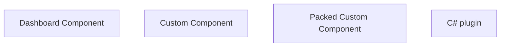

# Custom Components {#custom-components-and-dll-plugins}

Profinity provides four ways to create a custom component, from a simple dashboard through to a compiled C# plugin: a [Dashboard Component](../../Components/Dashboard/Dashboard_Component.md) bound only to tags that already exist, a Custom Component built from files and scripts in a profile, that same Custom Component packed so another installation can add it by name, and a full [plugin](../SDK/Developing_Plugins.md) written in C#, compiled against the [Profinity SDK](../SDK/index.md) and installed through **Components & Plugins**.
Once any of them is in a profile, it is monitored, graphed, logged, and used by rules and scripts in the same way as a built-in component.

A Dashboard Component is enough when the page only needs existing tags.
A Custom Component is enough when the behaviour can be described with files, and a packed Custom Component is that same component made installable on another system.
A dynamic-link library (DLL) plugin is used when files and scripts are not enough.

<figure markdown>

<figcaption>The four ways to create a custom component</figcaption>
</figure>

## Comparison

| | Dashboard Component | Custom Component | Packed Custom Component | C# plugin |
|--|---------------------|------------------|-------------------------|-----------|
| Built from | Dashboard YAML | Files and scripts in a profile | The same files, plus `component_metadata.yaml` | An assembly compiled by the author |
| Typical use | A screen of existing tags | A new component in one profile | The same component on other installations | When files and scripts are not enough |
| DBC, scripts, and maps | None | Optional | Optional | As the assembly implements them |

To make a first Custom Component, follow [Make your first Custom Component](First_Custom_Component.md).
This section is the reference for a Custom Component: the files that make one up, including `component_metadata.yaml` which names a pack.
Packing that folder is done with the [Component Pack CLI](../SDK/Component_Pack_CLI.md) in the SDK.
Refer to [How to create a Custom Component](../../How_To_Guides/Create_Custom_Component.md) to attach optional files, and to [Using a Custom Component](../../Components/Custom_Components/Using_a_Custom_Component.md) for the component once it is there.
For the dashboard itself, refer to the [Dashboard visual editor](../../Customising_Profinity/Dashboards/Visual_Editor.md).
A DLL plugin is covered on [Developing Plugins](../SDK/Developing_Plugins.md).

The DBC file and the dashboard sit in the component, and the Component Engine under it manages them.
Component metadata names the DBC file, the dashboard, and the main script for a pack.
The main script reads the settings map.
Menu actions name the action scripts.
The firmware scripts named in the firmware actions read the firmware map.

<figure>
<svg class="cc-diagram" viewBox="0 0 720 714" role="img" aria-labelledby="cc-diagram-caption">
<defs>
<marker id="cc-arrow" viewBox="0 0 10 10" refX="9" refY="5" markerWidth="7" markerHeight="7" orient="auto-start-reverse"><path d="M 0 0 L 10 5 L 0 10 z"></path></marker>
</defs>
<rect class="cc-diagram__group" x="0" y="0" width="720" height="572"></rect>
<text class="cc-diagram__heading" x="360" y="22" text-anchor="middle">Custom Component</text>
<a href="Component_Metadata.html"><rect class="cc-diagram__node cc-diagram__node--config" x="145" y="36" width="430" height="42"></rect><text class="cc-diagram__label" x="360" y="62" text-anchor="middle">Component metadata</text></a>
<a href="DBC_Dashboard_and_Rules.html#dbc-file"><rect class="cc-diagram__node cc-diagram__node--dbc" x="40" y="98" width="170" height="42"></rect><text class="cc-diagram__label" x="125" y="124" text-anchor="middle">DBC file</text></a>
<a href="DBC_Dashboard_and_Rules.html#dashboard"><rect class="cc-diagram__node cc-diagram__node--dashboard" x="510" y="98" width="170" height="42"></rect><text class="cc-diagram__label" x="595" y="124" text-anchor="middle">Dashboard</text></a>
<rect class="cc-diagram__section" x="40" y="156" width="640" height="100"></rect>
<a href="Main_Script.html"><rect class="cc-diagram__node cc-diagram__node--script" x="56" y="185" width="190" height="42"></rect><text class="cc-diagram__label" x="151" y="211" text-anchor="middle">Main script</text></a>
<a href="Settings.html"><rect class="cc-diagram__node cc-diagram__node--map" x="410" y="185" width="230" height="42"></rect><text class="cc-diagram__label" x="525" y="211" text-anchor="middle">Settings map</text></a>
<rect class="cc-diagram__section" x="40" y="272" width="640" height="112"></rect>
<text class="cc-diagram__heading" x="360" y="294" text-anchor="middle">Actions</text>
<a href="Menu_Actions.html"><rect class="cc-diagram__node cc-diagram__node--script" x="56" y="312" width="190" height="42"></rect><text class="cc-diagram__label" x="151" y="338" text-anchor="middle">Action scripts</text></a>
<a href="Menu_Actions.html"><rect class="cc-diagram__node cc-diagram__node--config" x="430" y="312" width="190" height="42"></rect><text class="cc-diagram__label" x="525" y="338" text-anchor="middle">Menu actions</text></a>
<rect class="cc-diagram__section" x="40" y="400" width="640" height="156"></rect>
<text class="cc-diagram__heading" x="360" y="422" text-anchor="middle">Firmware</text>
<a href="Firmware_Actions.html"><rect class="cc-diagram__node cc-diagram__node--script" x="56" y="440" width="200" height="42"></rect><text class="cc-diagram__label" x="156" y="466" text-anchor="middle">Firmware scripts</text></a>
<a href="Firmware_Maps.html"><rect class="cc-diagram__node cc-diagram__node--map" x="400" y="440" width="230" height="42"></rect><text class="cc-diagram__label" x="515" y="466" text-anchor="middle">Firmware map</text></a>
<a href="Firmware_Actions.html"><rect class="cc-diagram__node cc-diagram__node--config" x="400" y="498" width="230" height="42"></rect><text class="cc-diagram__label" x="515" y="524" text-anchor="middle">Firmware actions</text></a>
<rect class="cc-diagram__group" x="0" y="588" width="720" height="64"></rect>
<text class="cc-diagram__heading" x="360" y="626" text-anchor="middle">Component Engine</text>
<rect class="cc-diagram__node cc-diagram__node--script" x="8" y="668" width="18" height="18"></rect><text class="cc-diagram__key" x="32" y="682">Script</text>
<rect class="cc-diagram__node cc-diagram__node--map" x="110" y="668" width="18" height="18"></rect><text class="cc-diagram__key" x="134" y="682">Map</text>
<rect class="cc-diagram__node cc-diagram__node--config" x="200" y="668" width="18" height="18"></rect><text class="cc-diagram__key" x="224" y="682">Configuration metadata</text>
<rect class="cc-diagram__node cc-diagram__node--dbc" x="470" y="668" width="18" height="18"></rect><text class="cc-diagram__key" x="494" y="682">DBC</text>
<rect class="cc-diagram__node cc-diagram__node--dashboard" x="570" y="668" width="18" height="18"></rect><text class="cc-diagram__key" x="594" y="682">Dashboard</text>
<path class="cc-diagram__edge" d="M 20 588 L 20 119 L 40 119"></path>
<path class="cc-diagram__edge" d="M 20 206 L 56 206"></path>
<path class="cc-diagram__edge" d="M 20 333 L 56 333"></path>
<path class="cc-diagram__edge" d="M 20 461 L 56 461"></path>
<path class="cc-diagram__edge" d="M 700 588 L 700 119 L 680 119"></path>
<path class="cc-diagram__edge" d="M 210 119 L 510 119"></path>
<path class="cc-diagram__edge" d="M 410 206 L 246 206"></path>
<path class="cc-diagram__edge" d="M 400 461 L 256 461"></path>
</svg>
<figcaption id="cc-diagram-caption">The Component Engine sits under the component. It manages the DBC file and the dashboard, and it runs the scripts. Component metadata names the DBC file, the dashboard, and the main script for a pack. The main script reads the settings map. The dashboard binds signals from the DBC file. Firmware actions name the firmware scripts. Those scripts read the firmware map.</figcaption>
</figure>

- [Custom Component files](Files.md) lists every file, which ones a pack requires, and which upload field holds each one.
- [DBC, dashboard, and rules](DBC_Dashboard_and_Rules.md) covers the CAN database, the component page, and tag rules.
- [Settings](Settings.md) covers `settings_map.yaml`, the extra fields on the settings dialog.
- [Main script](Main_Script.md) covers the service that publishes the component's tags.
- [Menu actions](Menu_Actions.md) covers `actions.yaml`, including **Connect / Disconnect**.
- [Firmware maps](Firmware_Maps.md) covers `firmware_map.yaml`, the firmware fields on the component.
- [Firmware actions](Firmware_Actions.md) covers `firmware.yaml`, which names the load, save, and other firmware scripts.
- [Component metadata](Component_Metadata.md) covers `component_metadata.yaml`, which names the pack in the catalogue.
- [Component Pack CLI](../SDK/Component_Pack_CLI.md) covers the `profinity-component-pack` commands that pack and install that folder.
