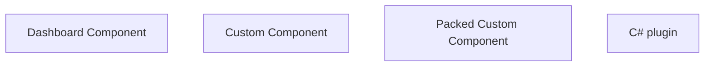
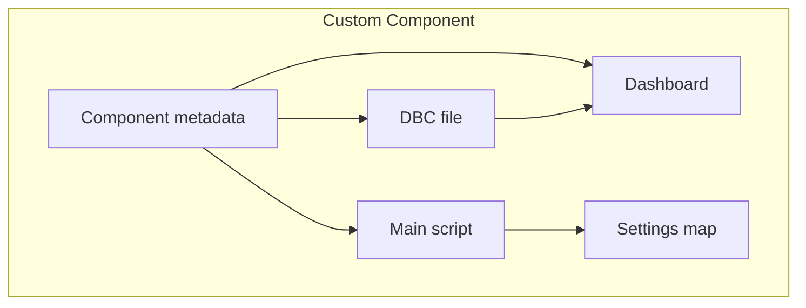
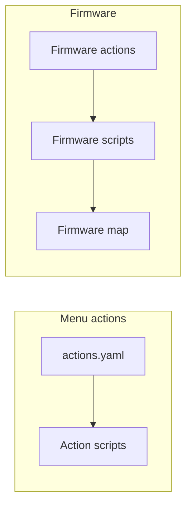

# Custom Components {#custom-components-and-dll-plugins}

Profinity provides four ways to create a custom component, from a simple dashboard through to a compiled C# plugin:

- A [Dashboard Component](../../Components/Dashboard/Dashboard_Component.md) bound only to tags that already exist.
- A Custom Component built from files and scripts in a profile.
- That same Custom Component packed, so another installation can add it by name.
- A full [plugin](../SDK/Developing_Plugins.md) written in C#, compiled against the [Profinity SDK](../SDK/index.md), and installed through **Components & Plugins**.

Once any of them is in a profile, it is monitored, graphed, logged, and used by rules and scripts in the same way as a built-in component.

A Dashboard Component is enough when the page only needs existing tags.
A Custom Component is enough when files can describe the behaviour.
A packed Custom Component is that same component made installable on another system.
A dynamic-link library (DLL) plugin is used when files and scripts are not enough.

<figure markdown>

<figcaption>The four ways to create a custom component</figcaption>
</figure>

## Comparison

| | Dashboard Component | Custom Component | Packed Custom Component | C# plugin |
|--|---------------------|------------------|-------------------------|-----------|
| Built from | Dashboard YAML | Files and scripts in a profile | The same files, plus `component_metadata.yaml` | An assembly compiled by the author |
| Typical use | A screen of existing tags | A new component in one profile | The same component on other installations | When files and scripts are not enough |
| CAN database (DBC), scripts, and maps | None | Optional | Optional | As the assembly implements them |

To make a first Custom Component, follow [Make your first Custom Component](First_Custom_Component.md).
This section is the reference for a Custom Component: the files that make one up, including `component_metadata.yaml`, which names a pack.
To pack that folder, use the [Component Pack CLI](../SDK/Component_Pack_CLI.md) in the SDK.
Refer to [Using a Custom Component](../../Components/Custom_Components/Using_a_Custom_Component.md) to add one to a profile and attach optional files.
For the dashboard itself, refer to the [Visual Editor](../../Customising_Profinity/Dashboards/Build_a_Dashboard.md).
For a DLL plugin, refer to [Developing Plugins](../SDK/Developing_Plugins.md).

Component metadata names the DBC file, the dashboard, and the main script for a pack.
The main script reads the settings map, and the dashboard binds signals from the DBC file.
Menu actions name the action scripts.
The firmware scripts named in the firmware actions read the firmware map.
Profinity manages the DBC file and the dashboard, and runs the scripts.

<figure markdown>

<figcaption>Component metadata names the DBC file, the dashboard, and the main script. The dashboard binds signals from the DBC file, and the main script reads the settings map</figcaption>
</figure>

<figure markdown>

<figcaption>Menu actions name the action scripts. Firmware actions name the firmware scripts, and those scripts read the firmware map</figcaption>
</figure>

- [Custom Component files](Files.md) lists every file, which ones a pack requires, and which upload field holds each one.
- [DBC, dashboard, and rules](DBC_Dashboard_and_Rules.md) covers the CAN database, the component page, and tag rules.
- [Settings](Settings.md) covers `settings_map.yaml`, the extra fields on the settings dialog.
- [Main script](Main_Script.md) covers the service that publishes the component's tags.
- [Menu actions](Menu_Actions.md) covers `actions.yaml`, including **Connect / Disconnect**.
- [Firmware maps](Firmware_Maps.md) covers `firmware_map.yaml`, the firmware fields on the component.
- [Firmware actions](Firmware_Actions.md) covers `firmware.yaml`, which names the load, save, and other firmware scripts.
- [Component metadata](Component_Metadata.md) covers `component_metadata.yaml`, which names the pack in the catalogue.
- [Component Pack CLI](../SDK/Component_Pack_CLI.md) covers the `profinity-component-pack` commands that pack and install that folder.
