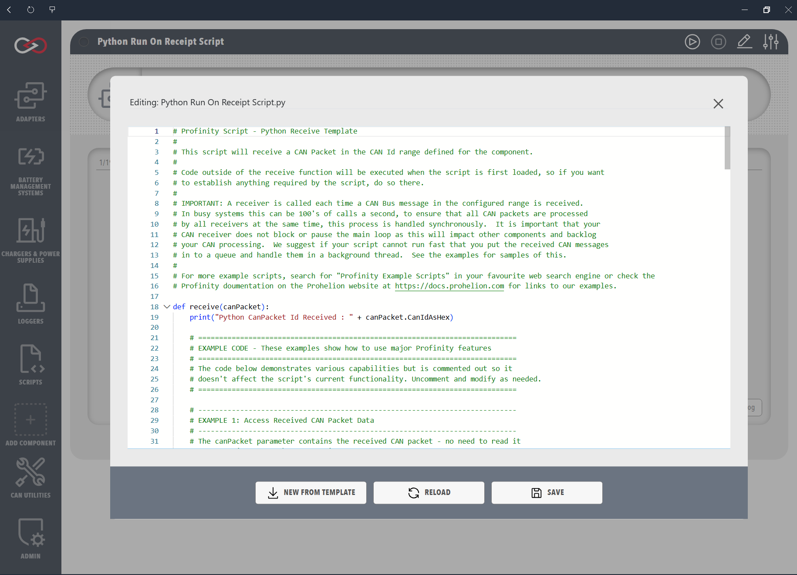

# Receive scripts

Receive scripts handle incoming CAN (Controller Area Network) messages in real time.
A script in Run On Receipt of CAN Message mode runs automatically when a matching CAN packet is received, and gets the packet as an argument, which suits CAN bus monitoring, protocol implementation and any case where an immediate response to a CAN message is needed.
The script implements a `Receive` method (C#) or a `receive` function (Python and Lua).

## Settings

Three settings decide which packets reach the script.

| Setting | Meaning |
|---------|---------|
| **Base Address** | The base CAN address of the device, entered in hexadecimal. |
| **Address Range** | The range of packet addresses the device sends, entered in hexadecimal. |
| **Milliseconds Valid** | How long traffic from the device counts as valid before the connection is assumed lost. The default is 5000 and the range is 0 to 60000. |

<figure markdown>

<figcaption>Receive Script Editor and CAN Packet Trigger Configuration</figcaption>
</figure>

## Example

The example is the minimum implementation of a Receive script in each supported language.
It implements the `Receive` handler, reads the CAN ID of the incoming packet in hexadecimal format with `CanIdAsHex`, and writes it to the Profinity console.

=== "C#"

    ```csharp
    using System;
    using Profinity.Sdk.Models.CANBus;

    public class CSharpReceiveExample : ProfinityScript, IProfinityReceiverScript
    {
        public void Receive(CanBusPacket canPacket)
        {
            Profinity.Console.WriteLine("CSharp CanBusId Received : " + canPacket.CanIdAsHex);
        }
    }
    ```

=== "Python"

    ```python
    def receive(canPacket):
        print("Python CanPacket Id Received : " + canPacket.CanIdAsHex)
    ```

=== "Lua"

    ```lua
    function receive(canPacket)
        print('Lua CanPacket Id Received : ' .. canPacket.CanIdAsHex)
    end
    ```

## Behaviour

Receive scripts run synchronously for each matching CAN packet, which on a busy bus can mean many invocations per second.
The `Receive` or `receive` handler should stay short and avoid blocking calls such as `time.sleep` in Python, `Thread.Sleep` in C#, long calculations, locks, and slow input or output, because a slow handler delays other work.

The **Trigger Overlap** setting decides what happens to a packet that arrives while the handler is still running.
**Drop** (the default) discards the packet.
**Queue** keeps a short backlog of up to **Queue Depth** packets (a default of 8, from 1 to 100) and runs them afterwards, which is the setting the shipped receive templates recommend.

Heavier processing belongs in a [Service Script](ServiceScripts.md), with the handler passing a small amount of data to a queue.
