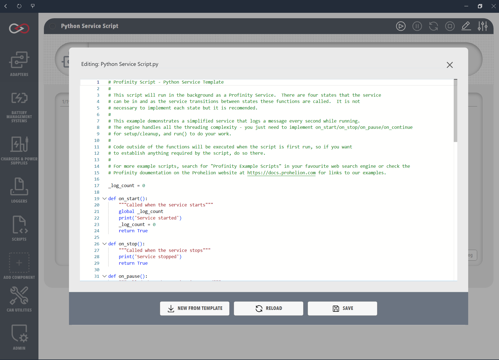

# Service scripts

Service scripts are designed for continuous, long-running operations that keep state and respond to system events.
They have a full lifecycle of start, stop, pause, and continue, which suits monitoring, continuous data logging and other work that must run reliably for extended periods.
A user controls a service from the script component's menu with **Start Service**, **Pause Service**, **Continue Service** and **Stop Service**.
The component shows its status as Running, Paused, or Stopped.

A [Custom Component](../../Custom_Components/index.md) main script is a service script.
**Auto Start Main Script**, or **Connect / Disconnect**, starts and stops it, and the script reads `settings_map.yaml` through [Component and firmware settings](../Script_Operations/Settings.md).

## Settings

| Setting | Description |
|---------|-------------|
| **Auto Start Script** | When on, the service starts by itself. |
| **Maximum Run Time (seconds)** | Cancels a run that takes too long. |

<figure markdown>

<figcaption>Service Script Editor</figcaption>
</figure>

## Which lifecycle methods are required

Only `OnStart()` (C#) or `on_start` (Python and Lua) is required.
In C#, `OnStop`, `OnPause`, `OnContinue` and `Run` are virtual, so a service overrides the ones it needs.
In Python and Lua, the other functions (`on_stop`, `on_pause`, `on_continue` and `run`) are used only when the file defines them.
The `on_stop()` function or `OnStop()` method is called both when the service is stopped by hand and when Profinity shuts down.

## Example

Each example implements the start, stop, pause, and continue methods, although only the start method is required, and a `Run()` or `run()` that loops until `Profinity.ScriptCancelled` is set.
In C#, extend `ProfinityBaseService`, which makes only `OnStart` mandatory, because a class that extends `ProfinityScript` and implements `IProfinityServiceScript` directly must implement all five methods.
The loop sleeps between iterations with `time.sleep` (Python), `Thread.Sleep` (C#) or `sleep` (Lua), and the Python version declares `global` for the shared run counter.
These match Profinity's built-in Python, C# and Lua service templates, which show both single-step and loop-style `run` patterns.

=== "C#"

    ```csharp
    using System;
    using System.Threading;

    public class CSharpServiceTest : ProfinityBaseService
    {
        private int _runCount = 0;

        public override bool OnStart()
        {
            Profinity.Console.WriteLine("Started CSharp Service");
            _runCount = 0;
            return true;
        }

        public override bool OnStop()
        {
            Profinity.Console.WriteLine("Stopped CSharp Service");
            return true;
        }

        public override bool OnPause()
        {
            Profinity.Console.WriteLine("Paused CSharp Service");
            return true;
        }

        public override bool OnContinue()
        {
            Profinity.Console.WriteLine("Continue CSharp Service");
            return true;
        }

        public override bool Run()
        {
            while (!Profinity.ScriptCancelled)
            {
                _runCount++;
                Profinity.Console.WriteLine("Run #" + _runCount);
                Thread.Sleep(100);
            }
            return true;
        }
    }
    ```

=== "Python"

    ```python
    import time

    _run_count = 0

    def on_start():
        global _run_count
        print("Python Service Started!")
        _run_count = 0
        return True

    def on_stop():
        print("Python Service Stopped!")
        return True

    def on_pause():
        print("Python Service Paused!")
        return True

    def on_continue():
        print("Python Service Continued!")
        return True

    def run():
        global _run_count
        while not Profinity.ScriptCancelled:
            _run_count += 1
            print(f"Run #{_run_count}")
            time.sleep(0.1)
        return True
    ```

=== "Lua"

    ```lua
    local run_count = 0

    function on_start()
        print('Started Lua Service')
        run_count = 0
        return true
    end

    function on_stop()
        print('Stopped Lua Service')
        return true
    end

    function on_pause()
        print('Paused Lua Service')
        return true
    end

    function on_continue()
        print('Continue Lua Service')
        return true
    end

    function run()
        while not Profinity.ScriptCancelled do
            run_count = run_count + 1
            print('Run #' .. run_count)
            -- sleep(seconds) is clamped to 30 seconds per call, so a longer wait
            -- is expressed as repeated calls rather than one large value
            sleep(0.1)
        end
        return true
    end
    ```

## Behaviour

### Cooperative cancellation

Long-running work in `Run()` or `run()` should observe `Profinity.ScriptCancelled`, so that loops exit and release resources promptly.
`Profinity.ScriptCancelled` becomes `true` when the service is stopped or paused, or when Profinity is shutting down.
A `run()` function with its own `while` loop tests `not Profinity.ScriptCancelled` (or `!Profinity.ScriptCancelled` in C#) in the loop condition, and may break out before slow steps.
When the service is paused, cancellation is signalled so an inner loop can finish, and when the service continues Profinity calls `run()` again.
In Python, the service body uses `import time` for `time.sleep`.
In C#, `Thread.Sleep` needs `using System.Threading;`.
In Lua, the `sleep(seconds)` global is limited to 30 seconds per call, so a longer wait is written as repeated calls.

### Python module-level variables

The lifecycle functions are separate functions.
Python treats a counter or other mutable value as a local variable when it is kept in a module-level name and assigned inside those functions.
To avoid this, declare `global _my_var` in each function that assigns to it.
Leaving out `global` is a common mistake when state is reset in `on_start` and updated in `run()`.
