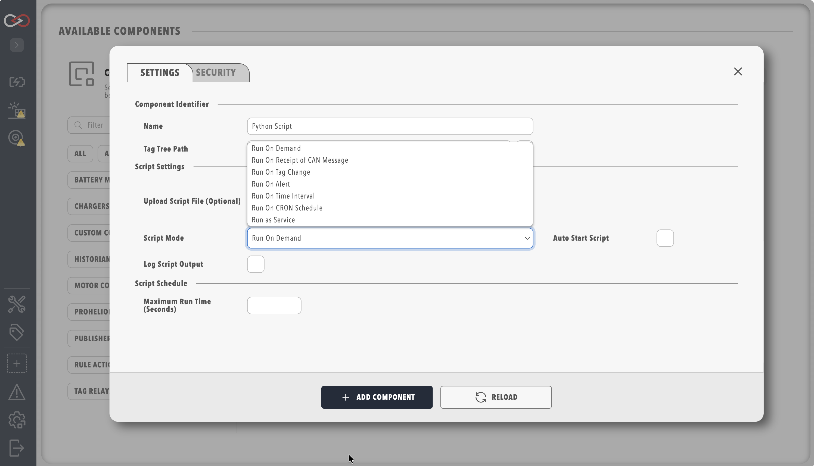

# Script types

Profinity supports seven script modes, each with its own trigger and execution context: Run On Demand, Run On Receipt of CAN Message, Run On Tag Change, Run On Alert, Run On Time Interval, Run On CRON Schedule and Run as Service.
The **Script Mode** setting selects the mode.
This page explains the differences between the modes and when to use each one.
A [Custom Component](../../Custom_Components/index.md) main script is a service script, and a firmware load, save, or action script runs once.

<figure markdown>

<figcaption>Script Mode Selection and Configuration in the Profinity UI</figcaption>
</figure>

## Choosing a mode

| Script type | Mode | Use it for |
|-------------|------|------------|
| [Run Script](./Run_Scripts.md) | Run On Demand | Short jobs that need little state, such as one-time operations, testing, and troubleshooting. The operator starts the script. |
| [Run Script](./Run_Scripts.md) | Run On Time Interval | Work that starts at a fixed interval, for example every 5 minutes or every hour. |
| [Run Script](./Run_Scripts.md) | Run On CRON Schedule | Time-of-day, weekly, and monthly work. The script starts from a Quartz cron expression. |
| [Receive Script](./Receive_Scripts.md) | Run On Receipt of CAN Message | Answering a packet with a reply message. The script runs each time a matching CAN packet arrives. |
| [Service Script](./Service_Scripts.md) | Run as Service | Continuous monitoring and other work that runs for a long time. The script implements a full lifecycle (start, stop, pause, and continue). |
| [Tag Change Script](./Tag_Change_Scripts.md) | Run On Tag Change | Computed tags, reacting to another component's output and chained automation without polling. The script runs each time a watched tag changes. |
| [Rule Script](./Rule_Scripts.md) | Run On Alert | Notifications and side effects beyond the built-in rule actions. The script runs when a rule names it as an action. |

A Run Script is not the right choice for continuous monitoring or real-time responses, and a Service Script is not the right choice for one-off or manual tasks.
A Receive, Tag Change or Rule Script handler should return quickly, because a new event that arrives while it is still running is handled according to **Trigger Overlap**.

## Custom Component scripts

A Custom Component script is a file named on the component.
**Script Mode** applies to a script component.

| Script | Runs as |
|--------|---------|
| Main script | [Service scripts](./Service_Scripts.md), started by **Auto Start Main Script** or **Connect / Disconnect** |
| `toggle` in `actions.yaml` | Service script |
| `button` in `actions.yaml` | Once, when the operator chooses the menu item |
| `loadScript` in `firmware.yaml` | Once, when firmware is loaded |
| `saveScript` in `firmware.yaml` | Once, when firmware is saved |
| An entry under `actions` in `firmware.yaml` | Once, with an action context |

`Profinity.Action` is set only for an entry under `actions`.
Which values each script reads or writes is on [Component and firmware settings](../Script_Operations/Settings.md).
The settings map layout is on [Settings](../../Custom_Components/Settings.md), the firmware map layout is on [Firmware maps](../../Custom_Components/Firmware_Maps.md), and `firmware.yaml` is on [Firmware actions](../../Custom_Components/Firmware_Actions.md).
The action object is on [Action context](../Script_Operations/Action.md).

## Script settings

Each script component has the following settings.
The schedule, receive, and tag change settings appear only for the mode that uses them.

| Setting | Applies to | Meaning |
|---------|------------|---------|
| **Script Mode** | All | The mode the script runs in |
| **Auto Start Script** | All | Starts the script when Profinity starts. Off by default |
| **Log Script Output** | All | Writes the script's console output to the script log. Off by default |
| **Trigger Overlap** | Run On Receipt of CAN Message, Run On Tag Change, Run On Alert | What happens to an event that arrives while the handler is still running. **Drop** (the default) discards it, and **Queue** keeps a short backlog and runs it afterwards |
| **Queue Depth** | Trigger Overlap set to **Queue** | How many events may wait, from 1 to 100, with a default of 8. Further events are dropped |
| **Time Interval** and **Time Interval Unit** | Run On Time Interval | How often the script runs, in seconds, minutes, hours, or days |
| **Cron Schedule** | Run On CRON Schedule | The Quartz cron expression that decides when the script runs |
| **Maximum Run Time (seconds)** | All | The time one run may take before it is cancelled. Blank means no limit. Trigger handlers stop only when the script checks `Profinity.ScriptCancelled` |
| **Base Address**, **Address Range** and **Milliseconds Valid** | Run On Receipt of CAN Message | The CAN addresses the script receives, in hexadecimal, and how long traffic from the device counts as valid. **Milliseconds Valid** defaults to 5000 and accepts -1 to 60000, where -1 means traffic never expires |
| **Tag Paths** and **Collections** | Run On Tag Change | The tags and tag collections that trigger the script |

## Keeping scripts healthy

A script runs inside the Profinity engine, so a loop, lock, or open connection that is never released slows every other component.
A script should be reviewed whenever Profinity performs badly while that script is running.

!!! info "Scripts run inside Profinity"
    Inefficient code, leaked memory or leaked resources run inside the Profinity engine and affect it directly.

Keep each script short, release anything it opens when the script stops, and set **Maximum Run Time (seconds)** on any script that could stall.
A Tag Change, Receive, or Rule Script handler stops at **Maximum Run Time (seconds)** only when the script checks `Profinity.ScriptCancelled`, so a long handler should check it regularly.
A script that fails should write the failure to the Profinity Logs, with **Log Script Output** switched on while the script is being developed, so that a failed scheduled run can be traced afterwards.
For event-driven scripts, use **Queue** with a small **Queue Depth** when no event may be lost and **Drop** when only the newest state matters.

State follows the same rule.
Use `State` for values that belong to one script, and use `GlobalState` only for values that several scripts share, and remove a value once nothing needs it.
Refer to [State](../Script_Operations/State.md) for how each scope behaves.
