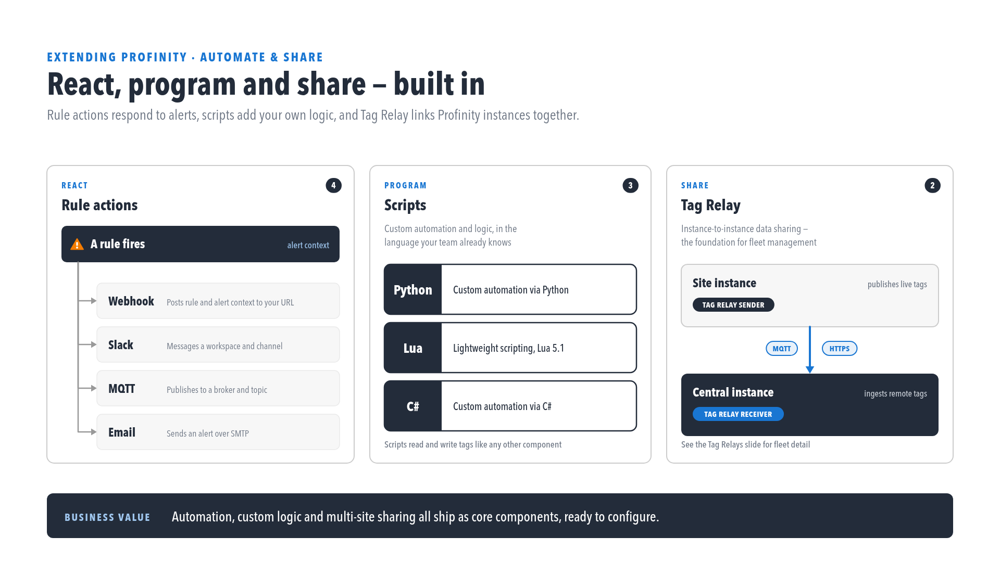
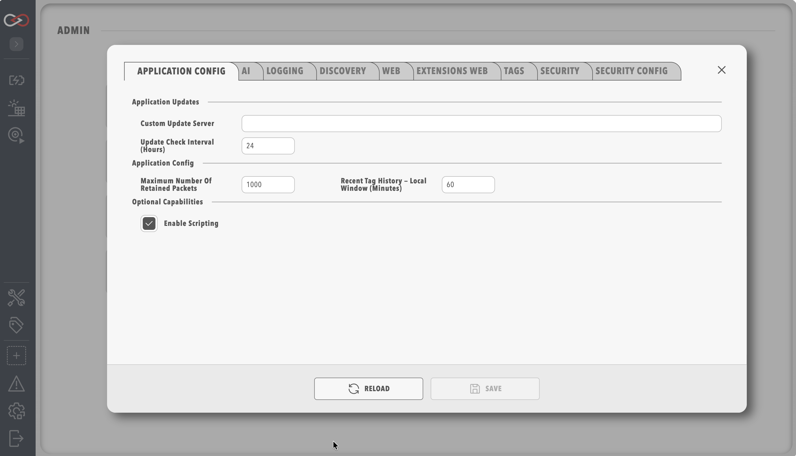

# Profinity Scripting

Profinity scripting automates tasks, processes CAN messages and creates custom operations in C#, Python or Lua.

!!! info "Licence required"
    Scripting requires the **Scripting** licensed feature, included in the **Desktop**, **Server**, and **Enterprise** editions.
    An unlicensed instance cannot add or run scripts.
    Refer to [Licensing](../../Administration/Licensing.md) for what each edition includes.

<figure markdown>

<figcaption>Rule actions, scripts, and Tag Relay, all built in</figcaption>
</figure>

## Scripts run with the permissions of Profinity

!!! warning "Profinity scripts execute with the same security permissions as Profinity itself"
    Because Profinity Scripting runs inside the Profinity engine, any script executes with the same operating system security permissions as Profinity itself, so an administrator must review what each script does before it is enabled.

To keep the Profinity environment secure, scripting is disabled until it is explicitly enabled.
To enable Profinity Scripting, open [Application Config](../../Administration/System_Configuration/Application_Config.md) and turn on **Enable Scripting**.

<figure markdown>

<figcaption>Profinity System Configuration</figcaption>
</figure>

## Script types

Profinity has five script types, which between them cover seven values of the **Script Mode** setting: Run On Demand, Run On Receipt of CAN Message, Run On Tag Change, Run On Alert, Run On Time Interval, Run On CRON Schedule and Run as Service.
[Run Scripts](./Script_Types/Run_Scripts.md) cover manual and scheduled operations (the Run On Demand, Run On Time Interval and Run On CRON Schedule modes), [Receive Scripts](./Script_Types/Receive_Scripts.md) handle incoming CAN messages, [Service Scripts](./Script_Types/Service_Scripts.md) run continuously, [Tag Change Scripts](./Script_Types/Tag_Change_Scripts.md) react when a watched tag changes, and [Rule Scripts](./Script_Types/Rule_Scripts.md) handle a rule firing.
The [Script Types](./Script_Types/index.md) page describes each mode and when to use it.

New in Profinity 2.3: a script set to **Run On Alert** mode can be named as a rule action and receives the firing context, including `TriggeredTags`.
Refer to [Rule Scripts](./Script_Types/Rule_Scripts.md) and [Actions](../../Tags/Rules/Actions/index.md).

## Supported languages

A script can be written in C#, Python or Lua, and each language supports the same set of script types (Run, Receive, Service, Tag Change and Rule Script).
C# suits complex, type-safe operations, Python suits data handling and quick edits, and Lua suits lightweight scripts.
Refer to [Supported Languages](./Supported_Languages/index.md) for the comparison.

## Operations

Profinity provides five built-in operations to every script through the `Profinity` object: [CAN Bus](./Script_Operations/CANBus.md) for CAN communication, [DBC](./Script_Operations/DBC.md) for Message and Signal handling, [State](./Script_Operations/State.md) for data that survives between runs, [Console](./Script_Operations/Console.md) for output and logging, and [Tags](./Script_Operations/Tags.md) for reading and writing tag values.
Scripts that belong to a Custom Component can also read the component and firmware settings.
A script that a Custom Component runs from a firmware action also receives an [action context](./Script_Operations/Action.md), with the action name, any uploaded file, and progress reporting.
The [Supported Operations](./Script_Operations/index.md) page describes each in more detail.

## Next steps

Writing and testing a script on a developer machine, before it is copied into a profile, is covered on the [Profinity SDK](../SDK.md) page.
[Supported Languages](./Supported_Languages/index.md) helps with choosing a language, [Script Types](./Script_Types/index.md) with choosing a script style, and [Supported Operations](./Script_Operations/index.md) lists what a script can do.
A first script is built in [How to Write Your First Script](../../How_To_Guides/Write_Your_First_Script.md).
