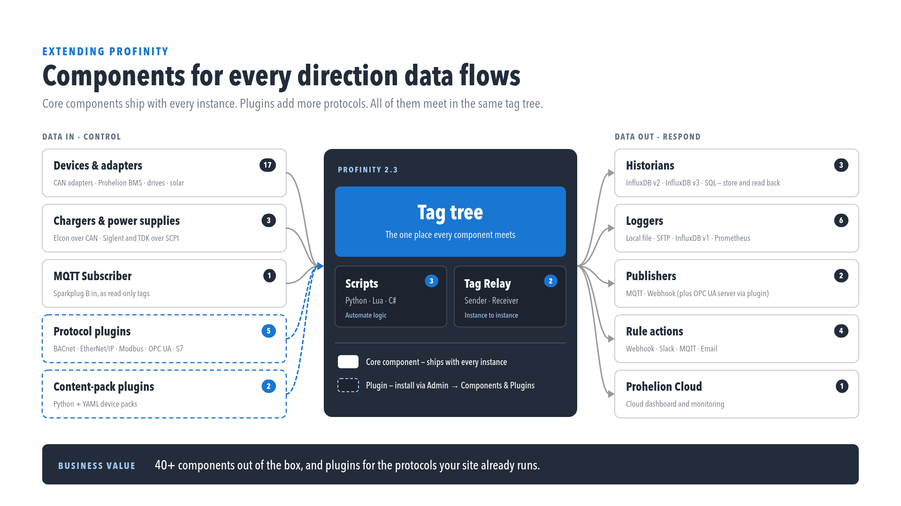

# Developing with Profinity

When configuration is not enough, Profinity can be extended with code.
A script runs inside Profinity, a Custom Component allows a developer to create a new component from files, a compiled plugin adds a new component type, and the Profinity SDK develops and packages all three.

<figure markdown>

<figcaption>Core components, plugins, and the data flowing in and out of the tag tree</figcaption>
</figure>

- [Scripting](./Scripting/index.md) automates tasks and creates custom operations in C#, Python or Lua. A script can react to a tag, a CAN message, a rule or a schedule, run continuously as a service, and write results back to tags.
- [Custom Components](./Custom_Components/index.md) covers the four ways to create a custom component, from a Dashboard Component through to a compiled C# plugin, and then the files that make a Custom Component, using an optional [DBC (CAN database)](../CAN_Utilities/CAN_Bus_DBC.md) file, a dashboard, scripts, actions, and settings maps. Using one in a profile is covered on [Using a Custom Component](../Components/Custom_Components/Using_a_Custom_Component.md) under Components.
- [Profinity SDK](./SDK/index.md) covers the developer kit Prohelion provides to approved developers, with frameworks for plugins, Custom Components, and scripts.
    - [Developing Plugins](./SDK/Developing_Plugins.md) covers a compiled plugin, built on the same framework as Prohelion's own components. An administrator installs it in **Components & Plugins**.
    - [Component Pack CLI](./SDK/Component_Pack_CLI.md) covers the `profinity-component-pack` tool for validating, packing, and installing Custom Component bundles.
    - [Test a script outside Profinity](./SDK/Test_a_Script.md) covers `profinity-script`, which creates a script and runs it before the file is copied into a profile.

Scripting requires a **Desktop**, **Server** or **Enterprise** licence, and an unlicensed instance cannot add or run scripts.
Refer to [Licensing](../Licensing.md).

## Choosing between a script, a Custom Component and a plugin

A script suits logic that runs inside an existing profile, such as reacting to a tag change, answering a CAN message or running on a schedule.
[Custom Components](./Custom_Components/index.md) sets out the four ways to create a custom component: a Dashboard Component for a screen of existing tags, a Custom Component built from files, that same component packed for other installations, and a compiled C# plugin when files and scripts are not enough.

## Where next

To make a first Custom Component, follow [Make your first Custom Component](./Custom_Components/First_Custom_Component.md).
To call Profinity from another system rather than run code inside it, refer to [Integrating to Profinity](../Integrating_to_Profinity/index.md).
For dashboards, theming, and hosting, refer to [Customising Profinity](../Customising_Profinity/index.md).
Rule actions that run scripts are covered in [Actions](../Tags/Rules/Actions/index.md).
