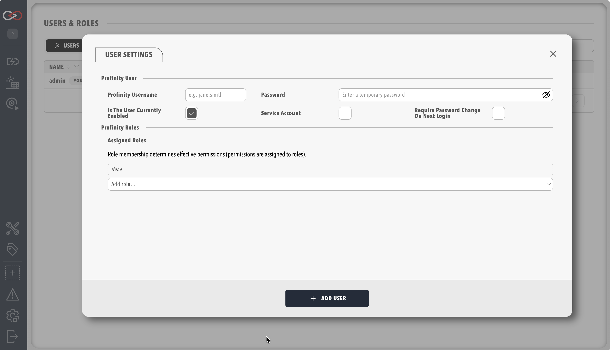

# Create a user

Create a user account for each person who signs in to Profinity, and give it the roles that match their job.
You need the **Security administration** permission and the **Profinity Server** licensed feature, which the **Server** and **Enterprise** editions include.
Without the feature there are no user accounts or roles.
A Desktop installation runs as a single built-in desktop user, and **Users & Groups** shows that user and group administration requires a Server licence.
[Licensing](../Licensing.md) lists what each edition includes.

1. In the side menu, select **ADMIN**, then **Users & Groups**.
2. Select **+ Add user**.
3. Enter a username and an initial password for local sign-in.
4. Under **Assigned roles**, choose one or more roles.
    Only **Administrators** exists on a new installation, so create the other roles first, as described in [Roles and permissions](../Administration/Users_and_Access/Roles_and_Permissions.md).
5. Save the user.

<figure markdown>

<figcaption>The Add user panel</figcaption>
</figure>

Profinity creates the account and its login details, and the new user can sign in with the username and initial password.
If you are not sure which roles to assign, read [Choose roles](#choose-roles) first.

## Choose roles

A role is a named set of permissions, and a person can hold more than one.
A user can only do what their roles allow, so give each person the smallest set of roles that lets them do their job.
A good starting point is three roles:

| Role | For people who | Typical access |
|------|----------------|----------------|
| **Viewer** | Watch the system but never change it | View data, tags, alerts, and dashboards |
| **Operator** | Run a vehicle, bench, or pack each day | Everything a Viewer can do, plus running component actions and controlling charging |
| **Engineer** | Set up and tune a system | Everything an Operator can do, plus changing profiles, components, dashboards, and firmware |

The default **Administrators** role includes every permission, so assigning it gives that person the access of every other role.
Keep it for the few people who manage the installation.

[Roles and permissions](../Administration/Users_and_Access/Roles_and_Permissions.md) explains how to create these roles and lists every permission.
[Managing users](../Administration/Users_and_Access/Manage_Users.md) covers password resets and service accounts.
