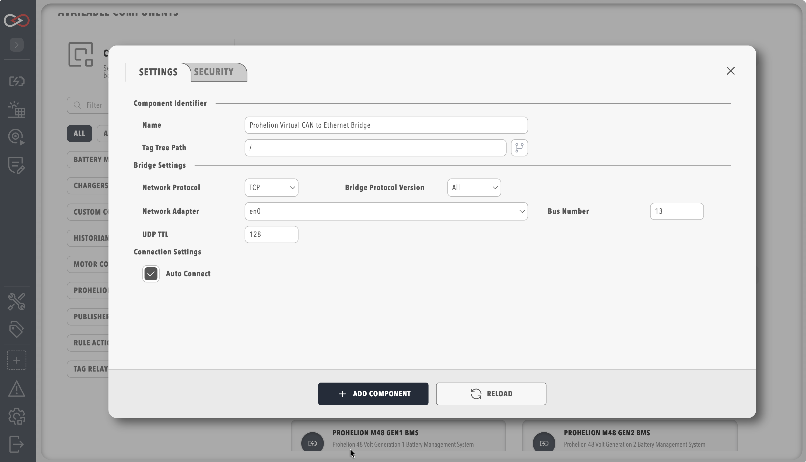

# How to add a component to your profile

Add a component to the active [profile](../Getting_Started/Profiles.md) from the sidebar or homepage to monitor a CAN bus device, then check its status and connect it.
You need Profinity V2 installed and running, a loaded profile, and the **Modify components** permission, which allows components to be added ([Roles and Permissions](../Administration/Users_and_Access/Roles_and_Permissions.md)).
Some component types also need a licence that includes the feature behind them, because a component type that is not licensed shows as unavailable, such as a historian.
[Licensing](../Administration/Licensing.md) lists which features each edition includes.

Add a protocol adapter first.
A protocol adapter allows Profinity to receive data from external systems, and without incoming data Profinity is limited in what it is able to show and do.
For CAN bus networks, the supported adapters, including the Prohelion and Tritium CAN to Ethernet bridges, are described in [CAN Bus Adapters](../Components/CAN_Bus_Protocols/CAN_Bus_Adapters.md), and a step-by-step procedure is given in [How to Connect to CAN Bus](./Connect_to_CAN_Bus.md).
For industrial systems, Profinity also supports BACnet, EtherNet/IP, Modbus, OPC UA, and S7, described in [Industrial protocols](../Components/Industrial_Protocols/index.md).

## Add the component

The **ADD COMPONENT** page groups the component types by category.
The filter options are on the left-hand side of the page, and the **COMPONENT TYPES** filter limits the list to one category:

- **Adapters**, including the [CAN Bus Adapters](../Components/CAN_Bus_Protocols/CAN_Bus_Adapters.md), which are also shown at the top of the screen when discovered
- **Battery Management Systems**, **Chargers & Power Supplies**, **Motor Controllers** and **MPPTs** for devices such as a Battery Management Unit (BMU), a motor controller or a Maximum Power Point Tracker (MPPT)
- **[Custom Component](../Components/Custom_Components/Using_a_Custom_Component.md)** for a device that Profinity does not already ship
- **[Loggers](../Components/Loggers/index.md)** (CAN File, TAG File, InfluxDB v1 and Prometheus)
- **[Historians](../Components/Historians/index.md)** (InfluxDB v2, InfluxDB v3 and TAG SQL)
- **[Publishers & Subscribers](../Components/Publishers_and_Subscribers/MQTT_Publisher.md)** (Message Queuing Telemetry Transport (MQTT) and Webhook)
- **Scripts**, for scripts that run inside Profinity

To add a component:

1. Select **+ ADD COMPONENT** in the sidebar or on the homepage. A page opens that lists every component type that can be added, including hardware devices, data loggers and custom scripts. Some CAN bus adapters in Profinity can be auto-discovered, and a discovered adapter that is available in your configuration is shown at the top of the screen.
2. Select the type to add. Profinity prompts for a **Component Name**, which must be unique in the profile, a **CAN ID** or address where the device needs one, the setting that starts the component automatically, and any settings specific to that component type. The properties required differ for each component.
3. Select **ADD COMPONENT** at the bottom of the dialog, which reads **SAVE** when the settings of an existing component are being changed. The component's icon appears in the sidebar.

<figure markdown>

<figcaption>Add a new component to the profile</figcaption>
</figure>

<figure markdown>

<figcaption>Example of defining component properties</figcaption>
</figure>

The start setting is **Auto Connect** on every component that connects to a broker, device, server, or database.
With it on, the component connects when the profile loads.
With it off, the component waits until you switch it on with its **Connect** or **Start** action, and it stays off until you do.

Hovering the mouse over a component icon in the sidebar presents a list of all devices associated with the current profile that match that component type.
You can change the properties later by opening the **Change Settings** menu from the component's dashboard.
More information about specific component properties and how to correctly configure each component is in the dedicated component sections.

Multiple components of the same type can be added to a profile, but each must have a unique name.
A device that listens on a range of CAN addresses must not use a range that overlaps the range of another such device in the profile, because Profinity refuses the component otherwise.
Some component types can be added to a profile only once.
If the profile already has a component with the same name as the one being added, a digit is added to the new component name to keep the component names in the profile unique.

## Check the component status

Each component has a coloured indicator on its icon that displays the operational status of the device.

| Colour   | Meaning                                                                          |
|----------|----------------------------------------------------------------------------------|
| Green    | The device is available, sending valid data and is in a valid state              |
| Yellow   | The device is available, but is either not sending data or is in a warning state |
| Red      | The device is in an error state                                                  |
| Grey     | The device is not available, not connected or not visible on the network         |

A red indicator means an error state, so check the [logs](../Administration/Logs_Config.md).
A component that stays red or grey after it is added usually has an adapter that is not connected or a CAN bus that is not delivering data.
The [troubleshooting section of How to Connect to CAN Bus](./Connect_to_CAN_Bus.md#troubleshooting) covers the usual causes and fixes.

## Connect the component

A component that holds a connection, such as an adapter, shows a **Connect** button on its dashboard.
A component that starts automatically needs no click.
To connect the component:

1. Click the component in the sidebar.
2. Click **Connect**.
3. Wait for the status to turn green, then confirm that data is appearing.

## Remove a component

If a component is no longer required, you can remove it:

1. Open the component settings, which is the three bar icon at the top right of the component dashboard.
2. Select delete.

<figure markdown>

<figcaption>A dashboard showing the three bar settings icon (top right)</figcaption>
</figure>
