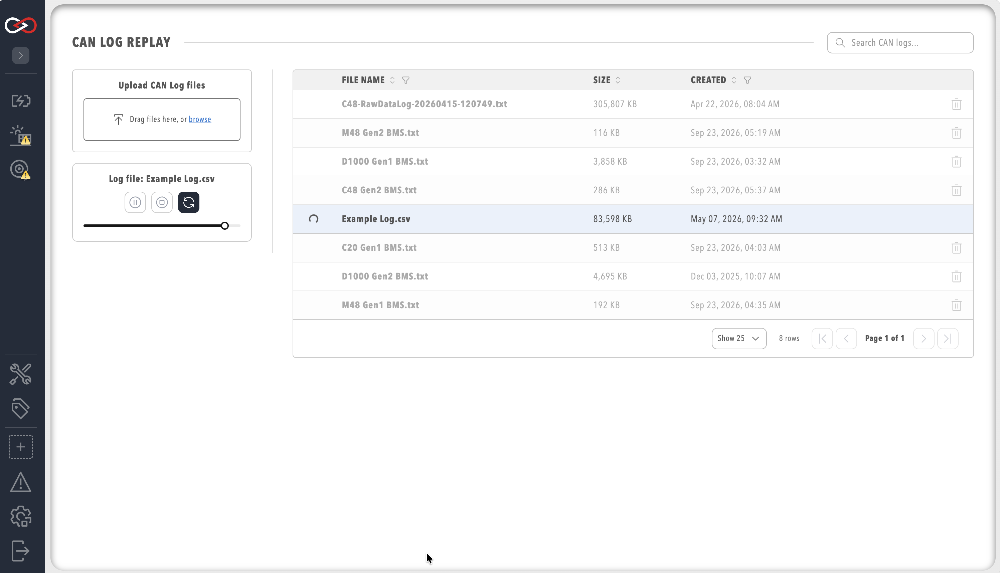

# How to replay CAN bus logs

Replay recorded CAN bus messages to test dashboards, rules, and custom components without live CAN bus data, or to debug a component configuration against a recording.
The CAN Data Log Replayer replays log files that were recorded earlier in Profinity.
For how to record a log, refer to [Log / replay CAN bus messages](../CAN_Utilities/Logging_Replaying_CAN_Bus_Messages.md).

Before you start, you need:

- Profinity V2 installed and running.
- A recorded CAN bus log file from a [File Logger](../Components/Loggers/CAN_File_and_SFTP_Loggers.md) or an SSH File Transfer Protocol (SFTP) logger, or the `example_log.csv` supplied with Profinity. Logs from InfluxDB or Prometheus cannot be replayed, so use a File or SFTP logger to record logs for later replay.
- The **Replay CAN logs** permission (refer to [Roles and Permissions](../Administration/Users_and_Access/Roles_and_Permissions.md)), which provides the **CAN LOG REPLAY** side-menu entry and also turns on **View CAN data**.
- A profile whose components match the recording. `example_log.csv` carries the CAN traffic of the Example Profile's components, so load the Example Profile first (refer to the [Quick Start Guide](../Getting_Started/Quick_Start.md)), because only components whose CAN addresses match the logged messages receive data.
- Optional for testing: a [CAN bus adapter](../Components/CAN_Bus_Protocols/CAN_Bus_Adapters.md) connected.

## Replay a log

!!! warning "Replay mixes with live traffic"
    Replayed messages are processed by Profinity as if they had been received from the bus, so tags, dashboards, rules, and alerts react to them alongside any live traffic from a connected adapter. Disconnect the adapter, or isolate the live hardware from the bus, before replaying a log, or the live and replayed values compete.

The replayer lists only the `can_bus_logs/replay/` folder in the [artefacts directory](../Installation/Artifacts_Directory.md), which sits in a different place on each platform.
To replay a log:

1. Select **CAN UTILITIES** in the side menu, then **CAN LOG REPLAY**. This opens the CAN Data Log Replayer and lists the available log files.
2. If the log file is not listed, for example a file recorded earlier or on another Profinity instance, copy it into the `can_bus_logs/replay/` folder, or use the **Upload CAN Log files** control and select the file. The file then appears in the list.
3. Select the log file in the list and select **Play** to start the replay. Replayed messages appear in the [CAN Activity panel](./Send_Receive_CAN_Bus.md), components receive them, dashboards update, and the slider shows the position in the log.

An uploaded file must have a `.csv` or `.txt` extension, otherwise the upload is refused with "Your file must have an extension of .txt or .csv".
The upload is also refused if a log with the same name already exists, so delete the existing log first or rename the new one.

<figure markdown>

<figcaption>CAN Data Log Replayer</figcaption>
</figure>

## Control the replay

While a replay plays, the position slider moves to a different point in the log, and you can use it to move the replay to any position in the log.
**Pause** suspends the replay so that it can be resumed later, and **Play** resumes it.
**Stop** ends the replay, and **Loop** replays the log continuously.
The trashcan icon deletes a log file from the list, which is separate from controlling a replay.

## If nothing happens

Only a CAN message log recorded by a File or SFTP logger can be replayed, so an uploaded file of another kind does not play.
If the **CAN LOG REPLAY** entry is missing from the side menu, the signed-in user lacks the **Replay CAN logs** permission.
If the replay runs but the dashboards stay empty, no component in the active profile listens to the replayed CAN IDs, so load the profile that the log was recorded against.
Recorded tag values are replayed separately with **TAG LOG REPLAY**, described in [Replay a tag log](../Tags/Replay_a_Tag_Log.md).

To check a Custom Component against its DBC file with recorded messages, refer to [How to Create a Custom Component](./Create_Custom_Component.md).
