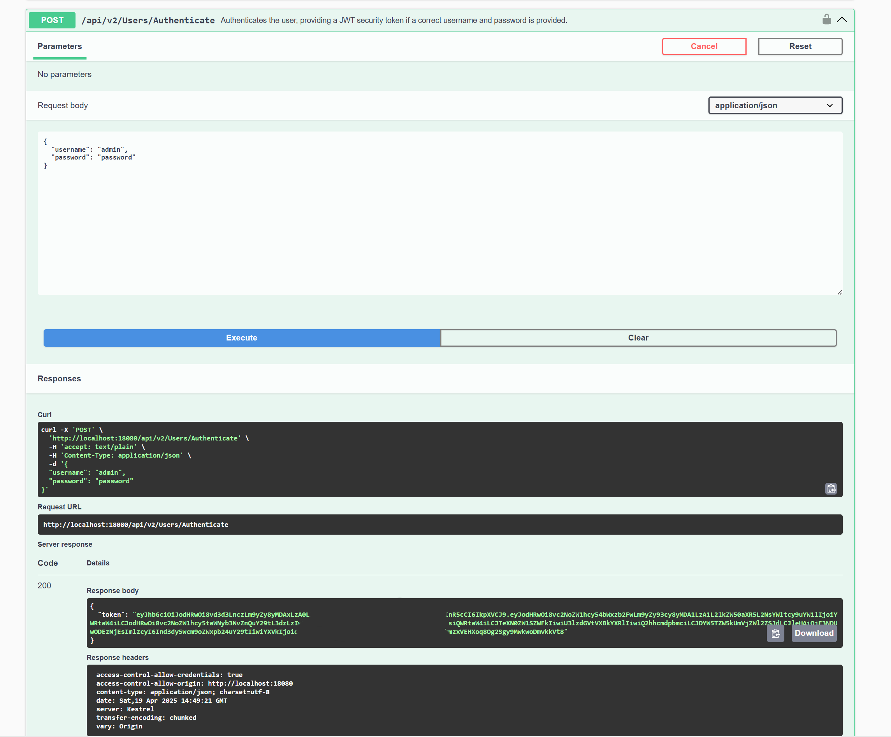
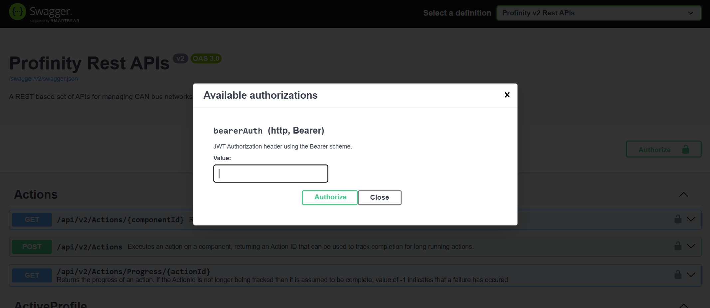

# Authenticate to the Profinity REST API

Profinity APIs require a Bearer token, which is either a service account token or a token returned by signing in with a username and password.
Either way, use an account that is dedicated to the client and holds only the permissions the client needs.
For a guided first call, refer to [Make your first API call](../First_API_Call.md).

## Use a service account token

A [service account](../../Administration/Users_and_Access/Service_Accounts.md) token is generated on the account's **User Actions** tab in **Users & Groups**, and it is already a Bearer token.
A client that has one skips the `/api/v2/Users/Authenticate` call and passes the token directly in each request.
In Swagger, paste the token into the **Authorize** dialog.
The token never expires and has no refresh token, so it suits a client that runs for a long time or unattended.
It stays valid until an administrator generates a new one, changes the account's roles, or disables the account.

## Sign in with a username and password

To test the APIs from the Swagger page without a service account token, execute a call against `/api/v2/Users/Authenticate` on that page.
Then apply the returned token with the **Authorize** button of the Swagger page.

To get a token from any other client:

1. Send a POST request to `http://localhost:18080/api/v2/Users/Authenticate`.
   Put the username and password of the Profinity user that the API calls run as in the JSON body, for example:

    ```json
    {
      "username": "<username>",
      "password": "<password>"
    }
    ```

    Replace `<username>` and `<password>` with the credentials of that user.

2. Read the response.
   If the username and password are valid, Profinity responds to a non-browser client with a JSON body.
   The body carries the access `token`, a `refreshToken` (omitted for service accounts, whose tokens do not expire), the `username`, an `id` and the user's `permissions`.
   This example abbreviates the `permissions` list:

    ```json
    {
        "token": "eyJhbGciOi...",
        "refreshToken": "...",
        "username": "<username>",
        "id": "<username>",
        "permissions": ["TagView", "..."]
    }
    ```

!!! warning "Use HTTPS to protect passwords"
    Calling this API over an HTTP connection can expose the password to network scanning.
    Custom applications running on the Profinity server can use the `localhost` address, which does not carry this risk.
    An application that calls Profinity across a network uses HTTPS for all API usage.

<figure markdown>

<figcaption>Generating a Bearer token on the Swagger page</figcaption>
</figure>

A browser client receives the same session as cookies and a body without the token.
A user who must complete two-factor authentication or change a password first receives a `preAuthToken` instead of a `token`, with `requiresTwoFactor` or `requiresPasswordChange` set.
Complete the sign-in through `/api/v2/Users/Authenticate/TwoFactor` or `/api/v2/Users/Current/ChangePassword`.
A token that is still valid can be renewed with `GET /api/v2/Users/Refresh`.

## Pass the token in requests

Pass the service account token, or the contents of the `token` field, in each request as a Bearer token.
The documentation of the client-side tool calling Profinity describes how to do this for that tool.
From a command line, this request returns the latest sample of a tag:

```bash
curl -H "Authorization: Bearer <token>" http://localhost:18080/api/v2/Tags/Sample/<full-tag-path>
```

Replace `<token>` with the token and `<full-tag-path>` with the full path of the tag.

In Swagger, select the **Authorize** button and paste in the generated token:

<figure markdown>

<figcaption>Entering the token in Swagger</figcaption>
</figure>

A request that returns data shows the token works.

## Fix 401 and 403 responses

A call with a missing or expired token is answered with 401.
A call from a user that lacks the permission the route needs is answered with 403.
When a client that signed in with a username and password starts receiving 401, it signs in again or renews the token with `GET /api/v2/Users/Refresh`.
A client that uses a service account token and starts receiving 401 needs the current token from an administrator, because the old token stops working when a new one is generated or the account's roles change.

To read tag data with the token, refer to [Read real-time and historical tag data](Read_Tag_Data.md).
