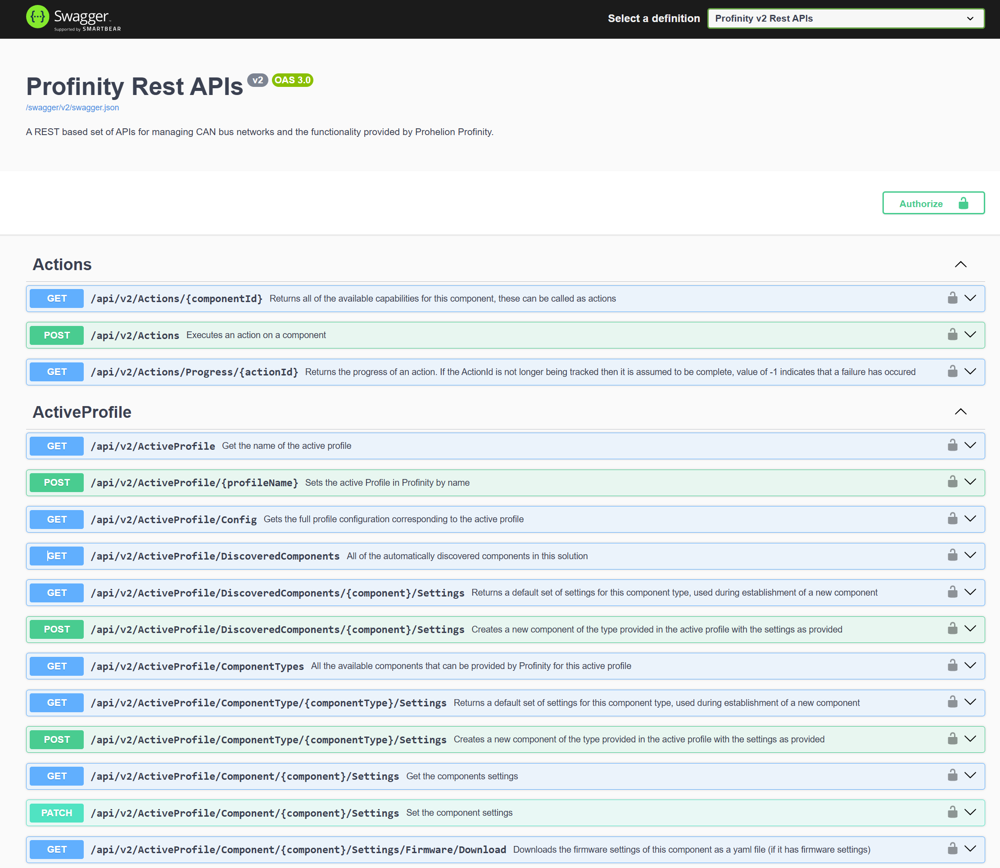

# Profinity REST APIs

Profinity V2 is built around its own Representational State Transfer (REST) APIs, which exchange JSON and are secured with Bearer tokens.
Custom applications use the APIs to add capabilities to a solution, to provide custom user interfaces, or to extend the out-of-the-box functionality.
A custom user interface can be hosted either externally or within Profinity itself (refer to [Hosting](../../Customising_Profinity/Hosting/index.md)).

As of Profinity 2.3, `/api/v2` is the published shape of the REST API.
Errors are returned as `application/problem+json` documents.
Areas that are still being developed, such as firmware, can change between releases, so test a client built on them against each new release.

!!! warning "API users can damage equipment"
    The Profinity APIs support security and can be encrypted, but an API user can change system and equipment state.
    Grant API access only to the users and applications that need it, and limit what each of them can do, so that nobody can accidentally damage the environment or equipment.

The APIs are running whenever Profinity is running.
The main Profinity host always publishes the API and Swagger.
The **Enable Profinity API** and **Enable Swagger on API** settings apply only to the Profinity Web server for extensions (refer to [Extensions Web](../../Administration/System_Configuration/Extensions_Web.md)).

[Swagger](https://swagger.io) is the interactive API page on your Profinity instance.
Open it by adding `/swagger` to the URL that Profinity is running on.
For example, if Profinity is running on `localhost:18080`, the Swagger page is at `http://localhost:18080/swagger`.
The OpenAPI document is served at `/swagger/v2/swagger.json`.
API tools and AI skills can import it to generate a client or to read the available routes and models.

<figure markdown>

<figcaption>Showing the Profinity APIs</figcaption>
</figure>

- [Make your first API call](../First_API_Call.md): sign in and request the latest sample of a tag with `curl`.
- [Authenticate to the Profinity REST API](API_Authentication.md): get a Bearer token from a service account or a sign-in, pass it in requests, and handle 401 and 403 responses.
- [Read real-time and historical tag data](Read_Tag_Data.md): query logged values from InfluxDB, poll for changes, and read the latest value of one tag or signal.
- [Endpoint Reference](Endpoint_Reference.md): look up the routes for alerts, collections, derived tags, Profinity AI chat, security, account resets, tag relay and themes.
