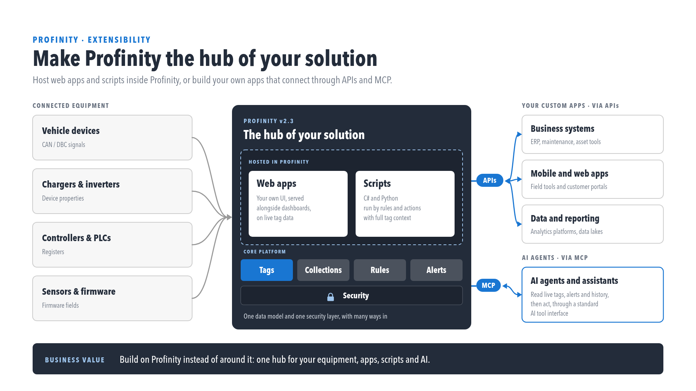

# Integrating to Profinity

Connected equipment feeds into Profinity, which hosts web apps and scripts on top of its core platform (Tags, Collections, Rules, Alerts) behind Security.
Profinity exposes that platform through Representational State Transfer (REST) [APIs](./APIs/index.md) to business systems and applications.
It exposes the platform to AI agents through the [Model Context Protocol (MCP)](./MCP_Server/index.md).

<figure markdown>

<figcaption>Profinity as the Hub of a Solution</figcaption>
</figure>

## APIs

Profinity provides REST interfaces to integrate with and extend its functionality.
The [APIs](./APIs/index.md) are secured with Bearer tokens and use JSON, so custom applications can be built on them, or existing applications extended with them.
They expose both real-time and historical data.
They connect Profinity to other systems, to custom dashboards and to new applications built on Profinity's data.

[Swagger](https://swagger.io/) is the interactive API page on your Profinity instance, which documents the available APIs and how to call them.
The OpenAPI document that tools can import is at `/swagger/v2/swagger.json`.
The [Endpoint Reference](./APIs/Endpoint_Reference.md) lists the routes that complement the screens described elsewhere in the documentation.
To make a first authenticated call, follow [Make your first API call](./First_API_Call.md).

## MCP server

Profinity includes an [MCP server](./MCP_Server/index.md), which lets AI assistants (such as [AI Chat](../Profinity_AI/AI_Chat.md)) and other MCP-aware tools query system data and metadata.
The server exposes ten read-only tools for tag discovery, tag values and history, and alert state, over Streamable HTTP at `/api/v2/Ai/Mcp`.
An MCP client can use it to answer questions about live tags and alerts, to pull history into an analysis tool, or to feed a monitoring or reporting system.
It works with the permissions of the account it authenticates as.
Refer to [MCP Server](./MCP_Server/index.md) for how to connect and authenticate, and to the [MCP tool reference](./MCP_Server/Tool_Reference.md) for the full list of tools.

## Other ways to move data

APIs and MCP are for systems that call Profinity.
Data can also be pushed out of or into a Profinity instance without a custom client.
The [MQTT Publisher](../Components/Publishers_and_Subscribers/MQTT_Publisher.md) and [Webhook Publisher](../Components/Publishers_and_Subscribers/Webhook_Publisher.md) components send tag values to other systems.
The [MQTT Subscriber](../Components/Publishers_and_Subscribers/MQTT_Subscriber.md) component brings values in.
[Tag relay](../Tags/Tag_Relay.md) shares live tags between Profinity instances, and the receiving instance needs the **Receive external tags** permission.

## Scripting vs APIs

Profinity offers two ways to extend its capabilities to meet the requirements of an application: [Scripting](../Developing_with_Profinity/Scripting/index.md) and APIs.
The table compares them.

| Scripting                                                                | APIs                                                                           |
| ------------------------------------------------------------------------ | ------------------------------------------------------------------------------ |
| Scripts support C#, Python and Lua                                       | Any programming language that can call REST APIs and JSON can be used          |
| Scripts are built in to Profinity and need no external frameworks or hosting | APIs are called from outside Profinity, in a custom environment, app, or cloud |
| Scripts can be developed quickly to solve simple problems                | Applications can be as rich and complex as required and still use Profinity    |
| Scripts can run without a user interface, on a schedule or triggered by CAN              | The application supplies its own logic for how it uses the API                 |
| Scripts run inside Profinity                                             | Scripted API clients run outside Profinity and can be distributed              |

For compiled integrations and packaged components, refer to [Developing with Profinity](../Developing_with_Profinity/index.md).
