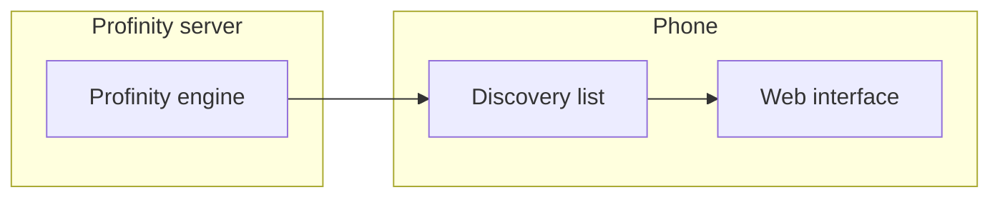

# Profinity Mobile

Profinity Mobile is a companion app for iOS and Android that connects to a Profinity engine over HTTPS and shows the web interface inside the app.
UDP (User Datagram Protocol) heartbeat discovery lets phones on the same local area network (LAN) find servers without typing URLs.

<figure markdown>

<figcaption>The Profinity engine broadcasts a UDP heartbeat that fills the discovery list in Profinity Mobile, and the app then connects to the chosen server over HTTPS and shows its web interface</figcaption>
</figure>

To set up discovery and connect a phone, refer to [Connect Profinity Mobile to a server](Connect_Profinity_Mobile_to_a_Server.md).
If no servers appear, refer to [Troubleshoot Profinity Mobile](Troubleshoot_Profinity_Mobile.md).

## Install the app

Prohelion does not publish the app in the public app stores.
Contact Prohelion at the [Prohelion Website](https://www.prohelion.com) to receive the installation files.
Prohelion supplies the app as source code, and the organisation that distributes it builds and signs its own iOS and Android binaries, as described in [OEM White-Label Mobile Builds](OEM_White_Label.md).

## Login modes

The **Password** mode is the standard Profinity web sign-in page, which the app opens inside the app and which follows the site's Local or SSO (single sign-on) sign-in method and shows the two-factor prompt when the site requires it.
The app can save the username and password in the phone's secure storage.
The **Kiosk** mode logs in automatically with a configured kiosk user (refer to [Kiosk Mode](../Administration/Kiosk_Mode.md)).
The app has no mode switch, because Kiosk Mode is a setting of the server, and the web sign-in page signs in automatically when the active profile has it enabled.
