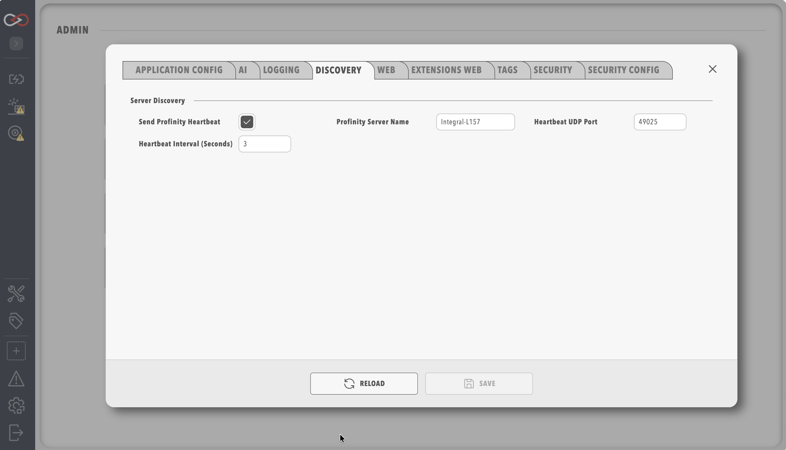

# Profinity Mobile

Profinity Mobile is a companion app for iOS and Android that connects to a Profinity engine over HTTPS and shows the web interface inside the app.
UDP (User Datagram Protocol) heartbeat discovery lets phones on the same local area network (LAN) find servers without typing URLs.

## Install the app

Prohelion does not publish the app in the public app stores.
Contact Prohelion at the [Prohelion Website](https://www.prohelion.com) to receive the installation files.
Prohelion supplies the app as source code, and the organisation that distributes it builds and signs its own iOS and Android binaries, as described in [OEM White-Label Mobile Builds](OEM_White_Label.md).

## Enable server discovery on the engine

Phones find a server only while it broadcasts a heartbeat, so check these settings on the Profinity server first.
Heartbeats are sent only while the web server is running and the machine has at least one network address other than loopback.
Phones reach the server only when remote web access is available, which needs the **Profinity Server** licensed feature (refer to [Licensing](../Administration/Licensing.md)).

1. On the Profinity server, select **ADMIN** in the side menu, then [**System Configuration**](../Administration/System_Configuration/index.md), then the **Discovery** tab.
2. Check the four settings described in [Discovery](../Administration/System_Configuration/Discovery.md).

| Setting | Description |
|---------|-------------|
| **Profinity Server Name** | The friendly name shown in the mobile list, which defaults to the host name of the machine (for example `Workshop-Profinity`) |
| **Send Profinity Heartbeat** | Turns the broadcast on or off, and is on by default |
| **Heartbeat UDP port** | The UDP port of the broadcast, 49025 by default |
| **Heartbeat interval (seconds)** | The time between broadcasts, from 1 to 60 seconds, 3 by default |

<figure markdown>

<figcaption>Server Discovery heartbeat settings</figcaption>
</figure>

Saving System Configuration restarts Profinity.
The mobile app listens for the broadcast on UDP port 49025 by default, so if you change the **Heartbeat UDP port**, the app build must use the same port (refer to [OEM White-Label Mobile Builds](OEM_White_Label.md)).
Each entry in the app's discovery list shows the server name, the active profile and the server's network addresses.

## Connect from the app

1. Connect the phone to the same Wi-Fi network as the Profinity server.
2. Open Profinity Mobile. The discovery list shows the servers that are broadcasting a heartbeat.
3. Select your server and connect. The app uses HTTPS when the server has it configured.

To return to the server list, swipe from the left edge of the screen on iOS, or use the system back action on Android, which first steps back through the pages you opened in the app.
A certificate warning that you accepted for a server stays accepted when you go back.

## Login modes

The **Password** mode is the standard Profinity login, inside the app, which follows the site's Local or SSO (single sign-on) sign-in method and shows the two-factor prompt when the site requires it.
The app can save the username and password in the phone's secure storage.
The **Kiosk** mode logs in automatically with a configured kiosk user (refer to [Kiosk Mode](../Administration/Kiosk_Mode.md)).

## Troubleshooting

| Issue | Remedy |
|-------|--------|
| No servers in the list | Confirm that **Send Profinity Heartbeat** is on, that the phone and server are on the same subnet, that the firewall allows UDP port 49025, and that the network does not block broadcast traffic between Wi-Fi and wired segments or VLANs |
| No servers in the list, and Profinity runs in Docker | UDP broadcasts do not leave a Docker bridge network, so run the container with host networking on Linux (refer to [Docker Installation](../Installation/Docker_Installation.md)) |
| Android emulator list is empty | Emulators cannot receive LAN broadcasts, so use a physical phone |
| Certificate warnings | Install a trusted HTTPS certificate on the server, or accept the prompt once per server |
| SSO does not complete | The site must use the **Sso** sign-in method, and the identity provider (IdP) sign-in is completed in the app's embedded browser |

For single sign-on setup, refer to [SSO and Sign-In](../Administration/System_Configuration/Security/SSO_and_Sign_In.md).

New in Profinity 2.3: UDP heartbeat discovery. Refer to the [Release notes 2.3](../Release_Notes/2.3.1.md).
