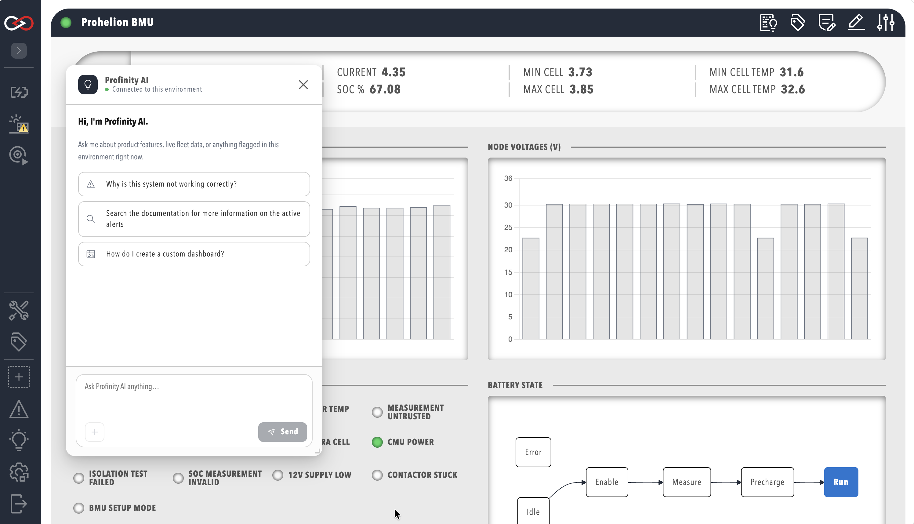
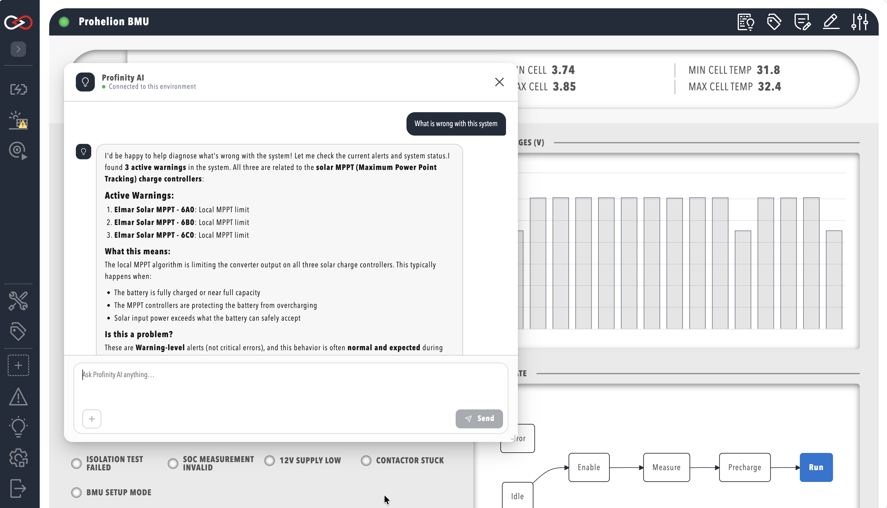

# AI Chat

AI Chat is the chat assistant of [Profinity AI](./index.md), built into Profinity.
It is available from the side menu once an administrator has configured it (refer to [Profinity AI settings](../Administration/System_Configuration/AI_Settings.md)).
It can answer questions about the live state of this Profinity instance and look up how-to and reference material from docs.prohelion.com.
If the administrator has enabled it, AI Chat can also search the web.

AI Chat requires the **AI** licensed feature, included in the **Server** and **Enterprise** editions.
Without it the feature is unavailable.
Refer to [Licensing](../Licensing.md) for what each edition includes.

!!! info "Your messages may leave this instance"
    An external AI provider answers Profinity AI unless your administrator has configured a local, self-hosted model.
    Ask your administrator which provider is configured before you discuss sensitive data with the assistant.

## Open Profinity AI

Users with the **Profinity AI** permission see a **Profinity AI** entry in the side menu.
Select it to open the chat window.
The built-in **Administrators** role has the permission by default.

If the entry is missing, one of these causes applies:

- The signed-in user lacks the permission.
- The instance lacks the **AI** licensed feature.
- The administrator has not enabled and configured Profinity AI under **ADMIN > System Configuration**.

## Ask a question

The chat window opens with a short greeting and three example prompts: a system-health question, a documentation search, and a how-to question.
Type a question of your own, and press **Enter** to send it.
Press **Shift+Enter** to add a new line without sending.

<figure markdown>

<figcaption>Profinity AI chat window with suggested prompts</figcaption>
</figure>

While Profinity AI is answering, the status indicator at the top of the window reads **Thinking…**.
Once a question has been answered, it reads **Connected to this environment**.
The response streams in as Profinity AI generates it, rather than appearing all at once.
Web search, when the administrator has enabled it, is available only with the Claude, OpenAI, and OpenRouter providers (refer to [Profinity AI settings](../Administration/System_Configuration/AI_Settings.md)).

<figure markdown>

<figcaption>A conversation in progress</figcaption>
</figure>

Profinity AI answers questions about this instance by querying live data with the same permissions you have.
It cannot see tags, alerts, or configuration that you could not otherwise see in Profinity.

You can send another question while Profinity AI is still answering the previous one.
Profinity AI queues it and answers it in turn.
Use **Stop** to cancel a response in progress, and **New chat** to clear the conversation and start again.

## When AI Chat reports an error

If the provider does not answer within the **Response timeout (seconds)** that the administrator set, the chat window shows a timeout message.
Send the question again, or ask the administrator to increase the timeout.

Any other failure shows **Something went wrong.** with a link to the logs, where Profinity records the cause.
Examples are an API key that the provider rejects and a provider that cannot be reached.
The administrator corrects the provider settings under **ADMIN > System Configuration**.

## Limitations for 2.3

- Profinity AI keeps conversation history only for the current browser tab, and clears it when you close the tab. It does not keep a record of past conversations across sessions or devices.
- Profinity AI uses one configuration for the whole instance, so there is no per-user choice of provider or model.
- The example prompts in the empty chat window are suggestions only, and Profinity AI is not limited to those topics.

To build dashboards and other configuration with your own AI coding assistant instead, refer to [AI Skills](./AI_Skills.md).
For the Model Context Protocol (MCP) connection that Profinity AI uses for live data, refer to [MCP Server](../Integrating_to_Profinity/MCP_Server/index.md).
