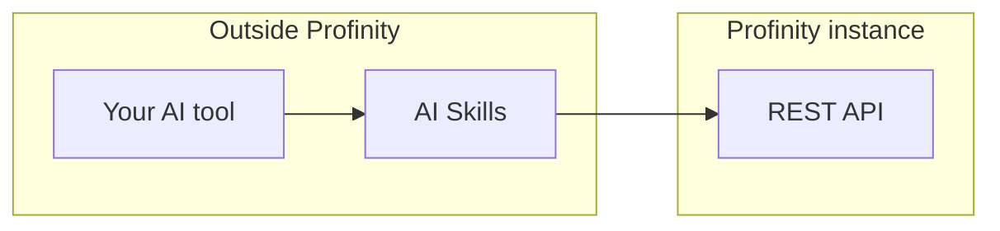

# AI Skills

AI Skills is a pack of seven skills for AI coding assistants such as Claude Code, Cursor, Codex, and ChatGPT that help you build Profinity [dashboards](../Customising_Profinity/Dashboards/index.md), rules, [collections](../Tags/Collections/index.md), [scripts](../Developing_with_Profinity/Scripting/index.md), [plugins](../Developing_with_Profinity/Plugins/index.md), [derived tags](../Tags/Derived_Tags/index.md), and example apps.
Every skill works from the live schema and API of your own Profinity instance and from curated examples drawn from Profinity's shipped content, so what it generates matches the conventions of your instance.
AI Skills runs in your own AI tool, outside Profinity, while [AI Chat](./AI_Chat.md) is the assistant built into the product that answers questions about a running instance.
To install the skills, refer to [Install AI Skills](./Install_AI_Skills.md).
For the list of skills, their requirements, and the tools they support, refer to [AI Skills reference](./AI_Skills_Reference.md).

## How it works

Each skill is self-contained.
Before it generates anything, it queries your instance's live schema (`GET /api/v2/UI/schema` for dashboards, and the matching live definitions for rules, collections, and derived tags), so it never relies on a schema remembered from a previous run.
It grounds generation in Profinity's own example content rather than invented output.
For skills that modify your instance (dashboards, rules, collections, and derived tags), the skill shows you the payload and asks for approval before any change goes live, while the read-only skills (script, plugin, and app) generate code and stop.

<figure markdown>

<figcaption>A skill in your AI tool reads the live schema from the REST API of your Profinity instance, and for skills that modify the instance it sends the generated configuration back after you approve</figcaption>
</figure>

## Use AI Skills instead of AI Chat

[AI Chat](./AI_Chat.md) is for everyone with the **Profinity AI** permission and needs no setup on their machine.
Power users can use their own AI tool for the same job, which suits people who want their own model or provider rather than the single provider configured for the whole instance, conversations that persist (AI Chat keeps history only for the current browser tab), or other work in the same session such as files, code, and other systems.
To do this, connect your tool to the [MCP Server](../Integrating_to_Profinity/MCP_Server/index.md) using [How to Connect Profinity to AI](../How_To_Guides/Connect_Profinity_to_AI.md), which gives it the same read-only live data AI Chat uses: tags and their history, alert rules, active alerts, and alert history.
Add AI Skills on top and the same tool can also build and change things, always showing you the payload before it saves.

Your own tool does not get AI Chat's built-in documentation lookup, so point it at [docs.prohelion.com](https://docs.prohelion.com) if you want it to cite the manuals.
It sees only what your sign-in is permitted to see, and your messages go to whichever provider that tool uses, so check that provider against your organisation's data-handling rules.

## Developing with Profinity

AI Skills also helps people who build on Profinity, because each skill reads the schema and API of your instance and generates what your Profinity version accepts.
Use the skill that matches what you are building:

- A dashboard or component dashboard: Dashboard Builder.
- Alert rules, tag collections, or derived tags: Tag Rules, Tag Collections, Derived Tags.
- An in-profile script, with simulation before you deploy: Script.
- A custom component plugin, packed for installation: Plugin.
- An application or integration against the REST API: App.

The Script and Plugin skills work beside the Profinity developer kit (`Profinity.Sdk`, `profinity-script`, and `profinity-component-pack`), which Prohelion supplies on request.
Refer to [Developing with Profinity](../Developing_with_Profinity/index.md) for the underlying SDK and plugin documentation.

For the next step, refer to [Install AI Skills](./Install_AI_Skills.md), to [Profinity AI](./index.md) for how AI Chat and AI Skills fit together, and to the [Profinity REST APIs](../Integrating_to_Profinity/APIs/index.md), which the skills use to fetch your live schema and push generated configuration.
