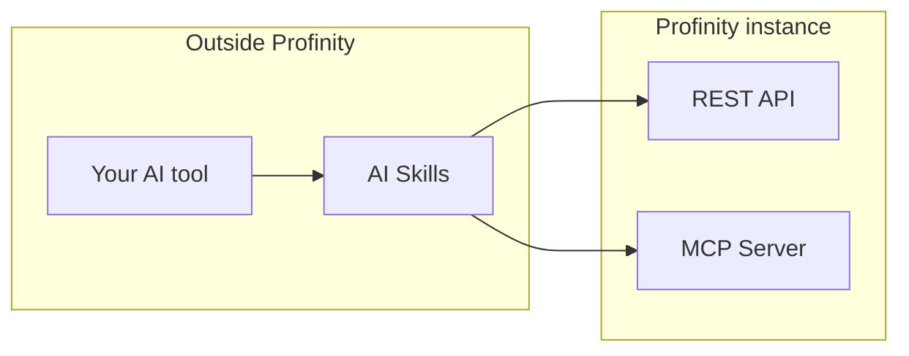

# AI Skills

AI Skills is a pack of seven skills for AI coding assistants such as [Claude Code](https://claude.com/product/claude-code), [Cursor](https://cursor.com), [Codex](https://openai.com/codex), and [ChatGPT](https://chatgpt.com).
The skills help you build Profinity [dashboards](../../Customising_Profinity/Dashboards/index.md), [rules](../../Tags/Rules/index.md), [collections](../../Tags/Collections/index.md), [scripts](../../Developing_with_Profinity/Scripting/index.md), [plugins](../../Developing_with_Profinity/SDK/Developing_Plugins.md), [derived tags](../../Tags/Derived_Tags/index.md), and example apps.
Every skill works from the live schema and API of your own Profinity instance, and from curated examples drawn from Profinity's shipped content.
What it generates therefore matches the conventions of your instance.
AI Skills runs in your own AI tool, outside Profinity.
[AI Chat](../AI_Chat.md) is the assistant built into the product, and it answers questions about a running instance.
To install the skills, refer to [Install AI Skills](./Install_AI_Skills.md).
For the list of skills, their requirements, and the tools they support, refer to [AI Skills reference](./AI_Skills_Reference.md).

## How it works

Each skill is self-contained.
Before it generates anything, it queries the live schema of your instance, so it never relies on a schema remembered from a previous run.
For dashboards, it reads the dashboard schema.
For rules, collections, and derived tags, it reads the matching live definitions.

A skill uses two connections to your instance:

- The Model Context Protocol (MCP) server of your instance (refer to [MCP Server](../../Integrating_to_Profinity/MCP_Server/index.md)), for live data such as tags and alerts.
- The Representational State Transfer (REST) API, for the schema and for saving configuration. The MCP server does not serve dashboard, rule, collection, or derived tag documents.

It grounds generation in Profinity's own example content rather than invented output.
The skills that modify your instance are dashboards, rules, collections, and derived tags.
They show you the payload and ask for approval before any change goes live.
The script, plugin, and app skills generate code and stop.

<figure markdown>

<figcaption>A skill in your AI tool reads live data from the MCP Server and the live schema from the REST API of your Profinity instance. A skill that modifies the instance sends the generated configuration back through the REST API after you approve</figcaption>
</figure>

## Use AI Skills instead of AI Chat

[AI Chat](../AI_Chat.md) is for everyone with the **Profinity AI** permission, and it needs no setup on their machine.
You can use your own AI tool for the same job instead.
This suits you if you want any of these:

- Your own model or provider, rather than the single provider configured for the whole instance.
- Conversations that persist, because AI Chat keeps history only for the current browser tab.
- Other work in the same session, such as files, code, and other systems.

To do this, connect your tool from [MCP Server](../../Integrating_to_Profinity/MCP_Server/index.md).
The connection gives Claude Code, Cursor, and Codex the same read-only live data that AI Chat uses: tags and their history, alert rules, active alerts, and alert history.
Add AI Skills on top, and the same tool can also build and change things.
It always shows you the payload before it saves.

Your own tool does not get the documentation lookup that AI Chat has built in.
Point it at [docs.prohelion.com](https://docs.prohelion.com) if you want it to cite the manuals.
It sees only what your sign-in is permitted to see.
Your messages go to whichever provider that tool uses, so check that provider against the data-handling rules of your organisation.

## Developing with Profinity

AI Skills also helps people who build on Profinity.
Each skill reads the schema and API of your instance, and generates what your Profinity version accepts.
Use the skill that matches what you are building:

- A [dashboard](../../Customising_Profinity/Dashboards/index.md) or [component dashboard](../../Developing_with_Profinity/Custom_Components/index.md): Dashboard Builder.
- [Alert rules](../../Tags/Rules/index.md), [tag collections](../../Tags/Collections/index.md), or [derived tags](../../Tags/Derived_Tags/index.md): Tag Rules, Tag Collections, Derived Tags.
- An in-profile [script](../../Developing_with_Profinity/Scripting/index.md), with simulation before you deploy: Script.
- A custom component [plugin](../../Developing_with_Profinity/SDK/Developing_Plugins.md), packed for installation with the command-line interface (CLI) described in [Component Pack CLI](../../Developing_with_Profinity/SDK/Component_Pack_CLI.md): Plugin.
- An application or integration against the [REST API](../../Integrating_to_Profinity/APIs/index.md): App.

The Script and Plugin skills work beside the Profinity software development kit (SDK), which Prohelion supplies on request.
The SDK comprises `Profinity.Sdk`, `profinity-script`, and `profinity-component-pack`.
Refer to [Developing with Profinity](../../Developing_with_Profinity/index.md) for the SDK and plugin documentation.

For the next step, refer to [Install AI Skills](./Install_AI_Skills.md).
[Profinity AI](../index.md) explains how AI Chat and AI Skills fit together.
The skills use the [Profinity REST APIs](../../Integrating_to_Profinity/APIs/index.md) to fetch your live schema and push generated configuration.
