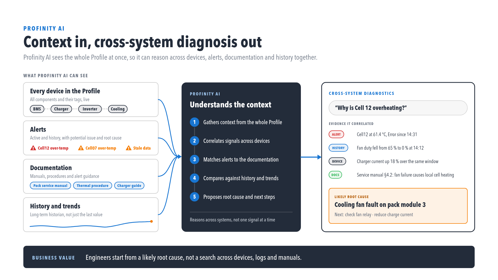

# Profinity AI

Profinity AI gives AI the context of a running Profinity system, so it can work across devices rather than one signal at a time.
It comes in two parts: [AI Chat](./AI_Chat.md), an assistant built into Profinity, and [AI Skills](./AI_Skills.md), a toolkit for your own AI coding assistant.

AI Chat and the built-in Model Context Protocol (MCP) server require the **AI** licensed feature, included in the **Server** and **Enterprise** editions.
Without it the feature is unavailable.
Refer to [Licensing](../Licensing.md) for what each edition includes.

<figure markdown>

<figcaption>Context in, cross-system diagnosis out</figcaption>
</figure>

## What Profinity AI can see

Profinity AI is connected to your running system and draws on four kinds of context:

- Live data: every component in the [profile](../Administration/Profiles.md) and its tags, with current values and data quality.
- Rules and alerts: the alert rules you have defined, the alerts that are active, and the alert history.
- History and trends: long-term values from the historian, not just the latest reading.
- Documentation: manuals, procedures, and how-to material from docs.prohelion.com.

Live data, rules, alerts, and history reach the assistant through the [MCP Server](../Integrating_to_Profinity/MCP_Server/index.md), which is read-only.
Profinity AI cannot change tags, alerts, or configuration through it.
Profinity AI sees only what the signed-in user could already see in Profinity, so tags and alerts you do not have permission to view are left out of its answers.

An administrator can also switch on web search for the Claude, OpenAI, and OpenRouter providers, which lets the assistant look beyond the documentation.
Questions and tool results are sent to the configured AI provider, so refer to [AI Chat](./AI_Chat.md) before you discuss sensitive data.

## From context to diagnosis

With that context in one place, Profinity AI can do these things:

- Gather context from the whole profile.
- Correlate signals across devices.
- Match alerts to the relevant documentation.
- Compare current readings against history and trends.
- Propose a likely root cause and next steps, with the evidence it used.

A question such as "Why is Cell 12 overheating?" can therefore be answered from the alert, the neighbouring cells, the cooling system, and the service manual together.

## Choose how to use it

- [AI Chat](./AI_Chat.md) runs inside Profinity, from the side menu. Use it to ask questions about this instance: system health, alert investigation, and how-to questions.
- [AI Skills](./AI_Skills.md) runs in your own AI tool (Claude Code, Cursor, Codex, ChatGPT), outside Profinity. Use it to build dashboards, rules, collections, scripts, plugins, derived tags, and example apps from your live schema.

AI Chat answers questions, and AI Skills helps you build things.
You can also pair AI Skills with the MCP server and use your own AI tool for the same questions.
The guides are listed in [Connect an AI tool to Profinity](../How_To_Guides/Connect_Profinity_to_AI.md).
Users need the **Profinity AI** permission to open AI Chat, and the built-in **Administrators** role has it by default.
[Roles and permissions](../Administration/Users_and_Access/Roles_and_Permissions.md) lists the **Profinity AI** and **MCP integration** permissions.
For administrator configuration, permissions, and data-handling notes, refer to [Profinity AI settings](../Administration/System_Configuration/AI_Settings.md).
