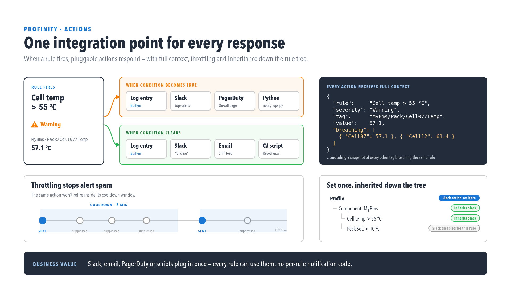

# Rule actions

A [tag rule](Rules.md) watches the tags in its scope and, when its condition changes, records an alert and runs the actions attached to it.
Profinity 2.3 offers two built-in actions, the Email, Slack, Webhook, and Message Queuing Telemetry Transport (MQTT) actions, and any [script](../Developing_with_Profinity/Scripting/Script_Types/Rule_Scripts.md) set to **Run On Alert** mode.
Every action receives the list of tags that caused the rule to fire, which is named `TriggeredTags` in a script and `triggeringTags` in the Webhook and MQTT JSON message.

!!! info "Licence required"
    Rules, the [Alerts Log](Alerts.md) and the built-in actions **Profinity Log** and **None** work on every edition.
    The Email, Slack, Webhook, and MQTT actions need the **Tag Rule Actions** licensed feature, included in the **Server** and **Enterprise** editions.
    A script set to **Run On Alert** needs both **Tag Rule Actions** and **Scripting** (included in the **Desktop**, **Server** and **Enterprise** editions).
    Without **Tag Rule Actions** the rule still evaluates and the alert is still recorded, and only the licensed actions are skipped.
    Refer to [Licensing](../Administration/Licensing.md) for what each edition includes.

<figure markdown>

<figcaption>A rule firing and the actions it runs</figcaption>
</figure>

## Action picker

When you edit a rule in the visual editor, you choose actions from the action picker, which lists the following:

- **Profinity Log**, which writes a message to the Profinity log at the action's `level` and otherwise the rule's level.
- **None**, which records the alert in the Alerts Log only and rejects `message`, `level` and `tagId`.
- Every Email, Slack, Webhook, and MQTT action that has been added to the profile, listed by the name of its component.
- Every **CSharp Script**, **Python Script** or **Lua Script** component whose mode is **Run On Alert**, as described in [Rule scripts](../Developing_with_Profinity/Scripting/Script_Types/Rule_Scripts.md).

In YAML the two built-in actions are written `ProfinityLog` and `None`.

### Making an action available

An Email, Slack, Webhook, or MQTT action does not appear in the picker until it exists as a component.
To add one:

1. [Add a new component](../Getting_Started/Adding_New_Components.md) from the **Rule Actions** group.
2. Choose **Email Rule Action**, **Slack Rule Action**, **Webhook Rule Action** or **MQTT Rule Action**.
3. Give the component a name.
4. Fill in its settings.

A rule can then select the action from the picker.
The component's name becomes the action id in the picker and in `rules.yaml`, so a component named `OpsSlack` is written `action: OpsSlack`, and renaming the component means updating the rules that use it.
Several components of the same type, for example one Slack action per channel, can exist side by side.

## Actions inherited down the rule tree

Actions written on the file or on a group are parent actions, and each one needs a `triggerLevel`.
A parent action runs for every rule beneath it whose alert level is at or above the `triggerLevel`, taking the level from the rule or, for a threshold rule, from the step that fired.
In the [complete rules.yaml example](Rules.md#a-complete-rulesyaml-example), a Warning on `pack_temperature` runs only **Profinity Log**, an Error runs **Profinity Log** and `OpsSlack`, and the Fatal step also runs `OpsEmail` from the group.
Actions written on a rule or on a threshold step are local, take no `triggerLevel` and always run when that rule or step fires.

The `clearActions` lists work the same way when the alert clears.
Each side can be switched off for one rule with `disableActions` and `disableClearActions`, which list an inherited action as the id of its parent, a slash and its name, as in `profile/ProfinityLog`.
For a rules file that belongs to a component, the parent id is the component name instead of `profile`, and for a group it is the group `id`.
Each parent can list a given action name only once, and a rule with `thresholds` cannot also have rule-level `actions` or `clearActions`, so its actions go on the steps.

An action entry may be a bare name or an object with `action` and optionally `message` and `level`, where `message` replaces the text sent for this rule and `level` sets the level that **Profinity Log** writes at.
The `tagId` and `value` fields substitute a different tag path and value for those reported to the action.
An action that is not found, or is not an action component, is reported as `references unknown component` when the rules file loads, and the rule file is not loaded until the name is corrected.

## `TriggeredTags`

Every rule action receives the same firing context, which includes `TriggeredTags`, the list of tags in the rule's scope that are currently evaluating true.
A script uses it to log, branch, or pass values on, and the Webhook and MQTT actions send the same list as the `triggeringTags` array of their JSON message, described under [Webhook and MQTT actions](#webhook-and-mqtt-actions).
The script version of the context is described in [Rule scripts](../Developing_with_Profinity/Scripting/Script_Types/Rule_Scripts.md).

## Message placeholders

The message of an action and the template settings of the Email and Slack actions can include the following placeholders, which Profinity replaces when the action fires: `{RuleId}`, `{TagId}`, `{Transition}`, `{Value}`, `{TagValue}`, `{Quality}`, `{MetaType}`, `{RuleLevel}`, `{TriggeredTagCount}`, `{TriggeredTagIds}`, `{ThresholdLevel}` and `{ThresholdMessage}`.
The `{Value}` and `{TagValue}` placeholders both give the value reported to the action, normally that of the tag that caused the transition.
`{TriggeredTagIds}` is a comma-separated list, and `{ThresholdLevel}` and `{ThresholdMessage}` are filled only for threshold rules.
Control characters in substituted values are removed so that a device value cannot split a notification across lines.

## Email action settings

The **Email Rule Action** sends a message over Simple Mail Transfer Protocol (SMTP) each time a rule transitions.

| Setting | Purpose |
|---|---|
| **SMTP host** | The mail server host name. Required, and defaults to `localhost`. |
| **SMTP port** | The mail server port, from 1 to 65535. Defaults to 587. |
| **Use SSL** | Enables TLS for the SMTP connection. Enabled by default. |
| **Username** / **Password** | Optional SMTP credentials. The password is stored encrypted. |
| **From address** | The sender address. Required, and defaults to `alerts@localhost`. |
| **To addresses** | One or more recipient addresses separated by commas or semicolons. Required. |
| **Subject template** | Optional subject line, which may use the [placeholders](#message-placeholders). A default subject is used when empty. |
| **Message prefix** | Optional text placed before the alert message in the body, which may use the placeholders. |

## Slack action settings

The **Slack Rule Action** posts a message to a Slack channel through an incoming webhook, and each Slack action can target a different workspace.

| Setting | Purpose |
|---|---|
| **Webhook URL** | The Slack incoming webhook URL. Required, must be an absolute URL, and is stored encrypted. |
| **Slack channel** | The channel name. Required, and defaults to `#alerts`. |
| **Title template** | Optional message title, which may use the [placeholders](#message-placeholders). A default title is used when empty. |
| **Message prefix** | Optional text placed before the alert message, which may use the placeholders. |

## Webhook and MQTT actions

A rule can fire a **Webhook** action or an **MQTT** action when it transitions, sending a notification to a generic HTTP destination or an MQTT broker.
Both send the same message, so a subscriber sees an identical structure whichever one a rule uses.
The JSON property names are camelCase, `transition` is one of `EnteredTrue`, `EnteredFalse`, `EnteredStep` or `ExitedStep`, and `triggeringTags` is the same list that a script receives as `TriggeredTags`:

```json
{
  "ruleId": "high-battery-temp",
  "ruleName": "High battery temperature",
  "transition": "EnteredTrue",
  "triggerTagId": "Vehicles/Car1/BatteryTemp",
  "message": "Battery temperature exceeded 60C",
  "triggeringTags": [
    { "tagId": "Vehicles/Car1/BatteryTemp", "value": 63.2, "quality": "Good" }
  ]
}
```

| Use the **Webhook** action when... | Use the **MQTT** action when... |
|---|---|
| The receiver is an ordinary HTTP service, such as an internal API, an integration platform, or a chat or incident tool with a generic webhook intake. | MQTT broker infrastructure is already in place, for example alongside an [MQTT Publisher](../Components/Publishers_and_Subscribers/MQTT_Publisher.md). |
| There is no MQTT broker to publish to. | Several systems need to subscribe to the same rule notifications through one broker topic. |

Each firing opens a connection, sends the message and closes the connection.
An action that has not finished within 10 seconds is cancelled and an error naming the action, the rule and the tag is written to the Profinity log, and the other rules and actions keep running.
When a Webhook destination or MQTT broker cannot be reached, the alert still appears in the Alerts Log and the failure appears only in the Profinity log.

### Webhook action settings

| Setting | Purpose |
|---|---|
| **Destination URL** | The HTTP or HTTPS endpoint the action posts to when the rule transitions. It may embed a token, for example `https://host/hooks/<secret>`, and is stored encrypted. |
| **Auth mode** | **None**, **Bearer token**, **API key header** or **Basic auth**, the same four modes as the [Webhook Publisher](../Components/Publishers_and_Subscribers/Webhook_Publisher.md). |
| **Bearer token** | Shown when **Auth mode** is **Bearer token**, and sent as `Authorization: Bearer <token>`. Saving without it reports "You must provide a bearer token when auth mode is Bearer token.", and the other modes report a matching message for their missing fields. |
| **API key header name** / **API key header value** | Shown when **Auth mode** is **API key header**. The header name and value sent on every request, for example `X-Api-Key`. |
| **Basic auth username** / **Basic auth password** | Shown when **Auth mode** is **Basic auth**. |

### MQTT action settings

| Setting | Purpose |
|---|---|
| **Broker URL** | The broker's connection URL, with a scheme of `mqtt`, `mqtts`, `http` or `https`. Use `mqtts://` to enable Transport Layer Security (TLS). |
| **Trust all server certificates** | Disables TLS server certificate validation for this action. Enable only when connecting to a trusted broker that uses a self-signed certificate. |
| **Username** / **Password** | Credentials for broker authentication. The password is required but may be empty, and is stored encrypted. |
| **Client ID** | Optional. Leave blank, and Profinity generates a new client identifier for every firing. |
| **Destination topic** | The topic the message is published to when the action fires. Required. |
| **Quality of service** | **At most once**, **At least once** (default) or **Exactly once**, the Quality of Service (QoS) level used for the publish. |

## Permissions

Actions are attached to rules, so the permissions that apply are those on the [Rules](Rules.md#permissions) page.

For the rest of the tag layer, refer to [Tag layer](index.md), [Tag expressions](Tag_Expressions.md), [Collections](Collections.md) and [Derived tags](Derived_Tags.md).
