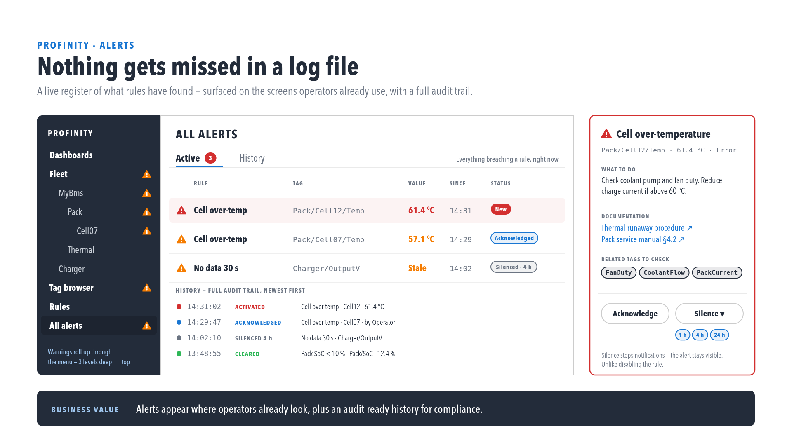
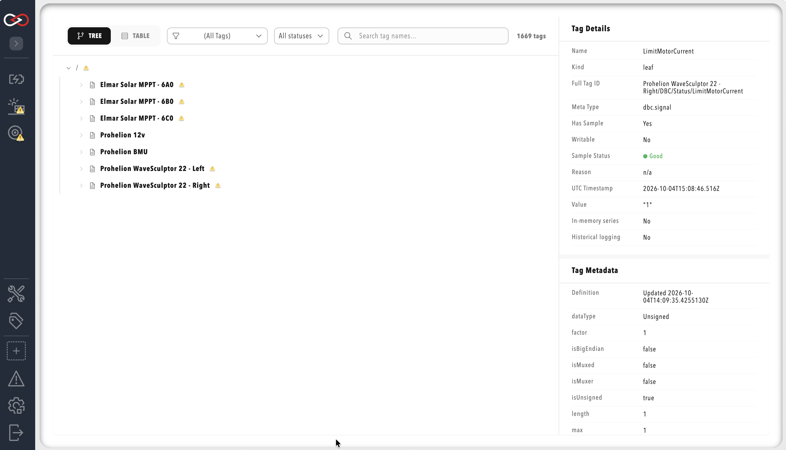
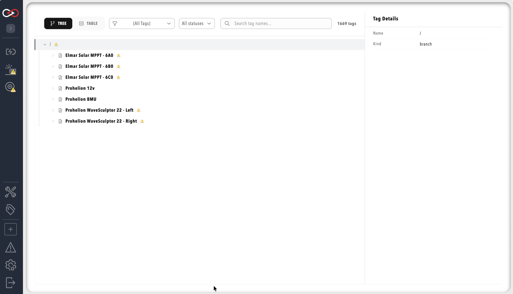

# Alerts Log

Profinity 2.3 surfaces rule-generated alerts in the **Alerts Log**, in live indicators across the UI, and through the [API](../Integrating_to_Profinity/APIs/Endpoint_Reference.md#alerts).
Operators with the **View alerts** permission can view and acknowledge alerts and silence their actions, and an alert's text, level, and links come from the [rule](./Rules.md) that raised it.

<figure markdown>

<figcaption>Alerts Log with Active and History tabs and the alert detail panel</figcaption>
</figure>

## Open Alerts Log

Select **ALL ALERTS** in the side menu to open the Alerts Log, which shows the page heading **ALERTS**.

<figure markdown>

<figcaption>ALL ALERTS in the side menu</figcaption>
</figure>

## Active and history tabs

The **Active** tab shows rule alerts currently firing, and the **History** tab shows a paginated history, newest first.
Both tabs show the time (labelled **Active Time** on the **Active** tab, which is when the current episode began), the component, the rule, the level, the status and an actions column.
Each row has a **More info** button that opens a detail dialog with the alert's message, tag, time, and status, followed by any `relatedTags` of the rule under **RELATED TAGS**, then the rule's `description`, which supports Markdown, and any `moreInformation` links under **DOCUMENTATION**.
Both tabs can be filtered by level, the **Active** tab can also be filtered by acknowledgement status, and the **History** tab has a date range.
Tables show 25, 50, 75 or 100 rows per page, and 25 by default.

<figure markdown>

<figcaption>Active alerts table</figcaption>
</figure>

<figure markdown>

<figcaption>Alert history</figcaption>
</figure>

## Alert levels

Set `level` on a rule, or on each threshold step, to classify alert severity, and the Alerts Log and the alert indicators combine the active rule state with that level.

The valid levels, from least to most severe, are `Trace`, `Debug`, `Info`, `Warning`, `Error` and `Fatal`.
Level names are not case-sensitive, `Information` is accepted as `Info` and `Warn` as `Warning`, and a rule with no level is treated as `Info`.
An unrecognised level on a rule, threshold step or `triggerLevel` stops the rules file loading and names the rule that holds it, so correct the spelling and save again.
The same names are used as the `triggerLevel` of an action configured on a parent rule file or group.

A script receives the level as the string `RuleLevel`, and the Webhook and MQTT JSON message does not include the level.
The level filter on the Active and History queries is not case-sensitive.

## Live indicators

The web client polls active alerts every four seconds and shows a yellow alert triangle at the bottom right of any [dashboard](../Customising_Profinity/Dashboards/index.md) widget bound to an alerting tag, an alert icon on tags in Tag Explorer that have an active alert, and a highlighted **ALL ALERTS** entry in the side menu while any alert is active.
Hovering over an indicator shows a summary of the alert, and selecting it opens the Alerts Log when the user holds the **View alerts** permission.
Stale data quality in Tag Explorer has its own icon, distinct from the alert triangle, so when both appear they indicate different conditions.

<figure markdown>

<figcaption>Dashboard alert indicator on a bound widget</figcaption>
</figure>

<figure markdown>

<figcaption>Rule alert on a tag in Tag Explorer</figcaption>
</figure>

## Acknowledge and silence

Acknowledging and silencing both need the **View alerts** permission, and both act on an alert that is currently active.
**Acknowledge** marks the alert as seen and handled, and does not clear it.
**Silence** suppresses the actions of the rule for that alert, so no Email, Slack, Webhook, MQTT, script, or log action runs, while the alert stays active and visible with a silence badge.

The **Acknowledge alert** button and the **Silence alert for 1 hour** button sit in the actions column of the **Active** tab, and an acknowledged alert shows an **Unacknowledge alert** button in place of Acknowledge.

How a rule is evaluated, including dwell, deadband, and the evaluation tick, is described under [Rule evaluation: dwell and deadband](./Rules.md#rule-evaluation-dwell-and-deadband).
The expression language is described in [Tag expressions](./Tag_Expressions.md), and the actions a rule runs are described in [Rules](./Rules.md) and [Actions](./Actions.md).
For the rest of the tag layer, refer to [Tag layer](index.md), [Collections](./Collections.md), and [Roles and permissions](../Administration/Users_and_Access/Roles_and_Permissions.md).
