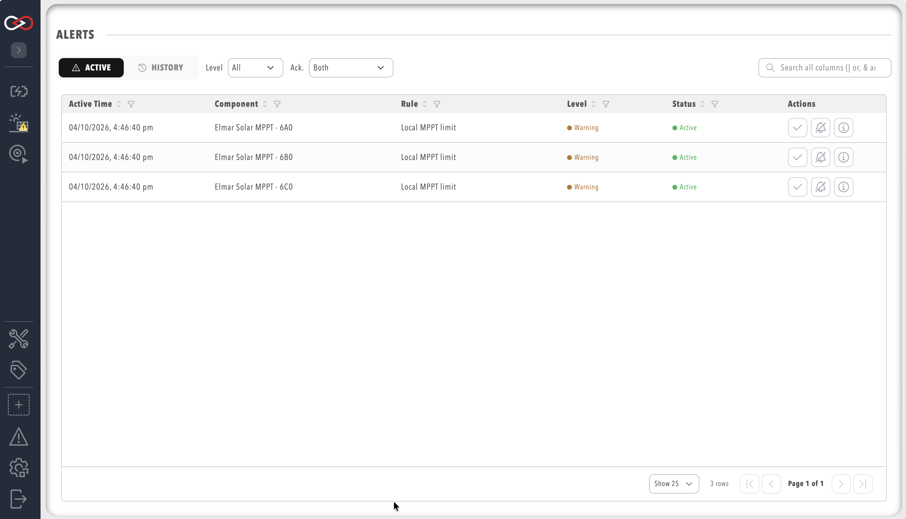
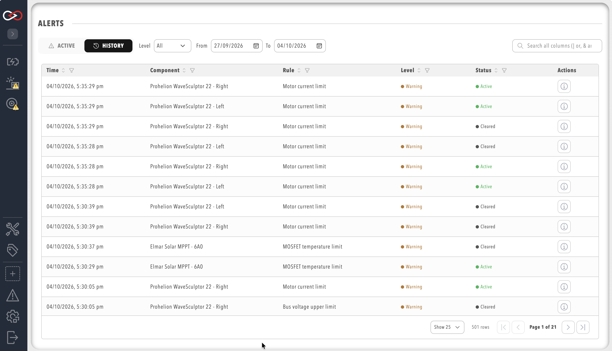
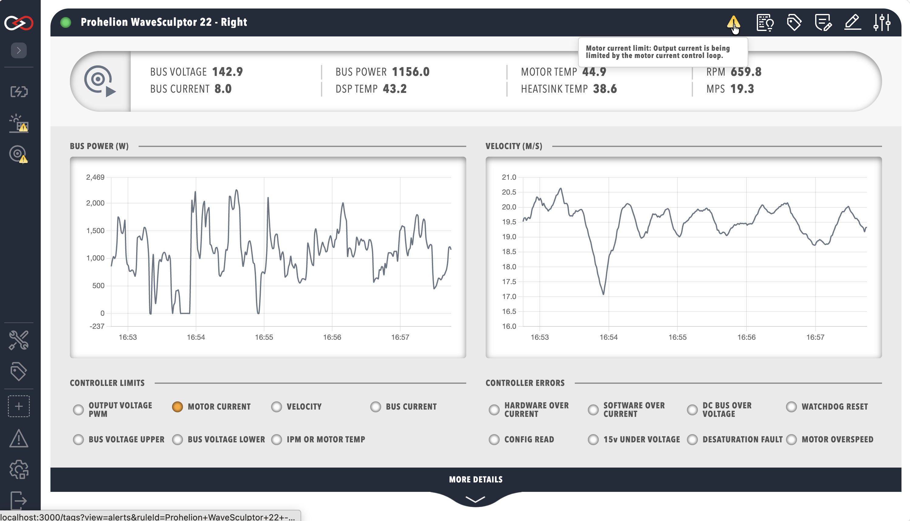

# Alerts Log

Profinity 2.3 surfaces rule-generated alerts in the **Alerts Log**, in live indicators across the UI, and through the [API](../Integrating_to_Profinity/APIs/Endpoint_Reference.md#alerts).
Users with the **View alerts** permission can view and acknowledge alerts and silence their actions.
An alert's text, level, and links come from the [rule](Rules/index.md) that raised it.

<figure markdown>

<figcaption>Alerts Log with Active and History tabs and the alert detail panel</figcaption>
</figure>

## Open Alerts Log

Select **ALL ALERTS** in the side menu to open the Alerts Log, which shows the page heading **ALERTS**.

<figure markdown>

<figcaption>ALL ALERTS in the side menu</figcaption>
</figure>

## Active and history tabs

The **Active** tab shows rule alerts currently firing, and the **History** tab shows a paginated history, newest first.
Both tabs show the time, the component, the rule, the level, the status, and an actions column.
On the **Active** tab the time is labelled **Active Time**, which is when the current episode began.

Each row has a **More info** button that opens a detail dialog.
The dialog shows the alert's message, tag, time, and status.
It then shows these items from the rule, when the rule defines them:

- Any `relatedTags` under **RELATED TAGS**.
- The `description`, which supports Markdown.
- Any `moreInformation` links under **DOCUMENTATION**.

Both tabs can be filtered by level.
The **Active** tab can also be filtered by acknowledgement status, and the **History** tab has a date range.
Tables show 25, 50, 75, or 100 rows per page, and 25 by default.

<figure markdown>

<figcaption>Active alerts table</figcaption>
</figure>

<figure markdown>

<figcaption>Alert history</figcaption>
</figure>

## Alert levels

Set `level` on a rule, or on each threshold step, to classify alert severity.
The Alerts Log and the alert indicators combine the active rule state with that level.

The valid levels, from least to most severe, are `Trace`, `Debug`, `Info`, `Warning`, `Error` and `Fatal`.
Level names are not case-sensitive.
`Information` is accepted as `Info` and `Warn` as `Warning`, and a rule with no level is treated as `Info`.
An unrecognised level on a rule, threshold step, or `triggerLevel` stops the rules file loading and names the rule that holds it.
Correct the spelling and save again.
The same names are used as the `triggerLevel` of an action configured on a parent rule file or group.

A script receives the level as the string `RuleLevel`.
The Webhook and MQTT JSON message has no level field, so add `{RuleLevel}` to the rule message if a receiver needs it.
The level filter on the Active and History queries is not case-sensitive.

## Live indicators

The web client polls active alerts every four seconds and shows three indicators:

- A yellow alert triangle at the bottom right of any [dashboard](../Customising_Profinity/Dashboards/index.md) widget bound to an alerting tag.
- An alert icon on tags in Tag Explorer that have an active alert.
- A highlighted **ALL ALERTS** entry in the side menu while any alert is active.

Hovering over an indicator shows a summary of the alert.
Selecting it opens the Alerts Log when the user holds the **View alerts** permission.
Stale data quality in Tag Explorer has its own icon, distinct from the alert triangle, so when both appear they indicate different conditions.

<figure markdown>

<figcaption>Dashboard alert indicator on a bound widget</figcaption>
</figure>

<figure markdown>

<figcaption>Rule alert on a tag in Tag Explorer</figcaption>
</figure>

## Acknowledge and silence

Acknowledging and silencing both need the **View alerts** permission, and both act on an alert that is currently active.
The **Acknowledge alert** and **Silence alert for 1 hour** buttons sit in the actions column of the **Active** tab.
An acknowledged alert shows an **Unacknowledge alert** button in place of **Acknowledge alert**.

**Acknowledge** marks the alert as seen and handled.
It does not clear the alert.

**Silence** suppresses the actions of the rule for that alert, and it has these effects:

- No Email, Slack, Webhook, Message Queuing Telemetry Transport (MQTT), script, or log action runs.
- The alert stays active and visible, with a silence badge.
- The silence lasts one hour, and a silence expired entry then appears in the history.
- Actions that would have run during the hour are skipped, not queued or replayed. Actions run again only the next time the rule fires or clears.
- The silence lasts the full hour even if the alert clears first, so clear actions inside the hour are skipped as well.
- A new occurrence of the same alert inside the hour is still silenced.

How a rule is evaluated, including dwell, deadband, and the evaluation tick, is described under [Rule settings](Rules/Rule_Settings.md#dwell-and-deadband).
The expression language is described in [Tag expressions](Selecting_Tags/Tag_Expressions.md), and the actions a rule runs are described in [Tag rules](Rules/index.md) and [Rule actions](Rules/Actions/index.md).
For the rest of the tag layer, refer to [Tag layer](index.md), [Tag collections](Collections/index.md), and [Roles and permissions](../Administration/Users_and_Access/Roles_and_Permissions.md).
