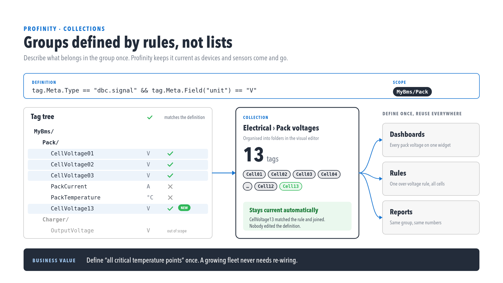
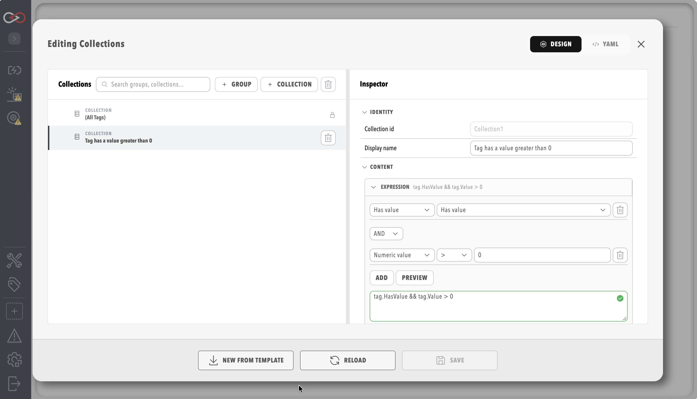

# Tag collections

**Collections** group tags for filtering, [dashboards](../Customising_Profinity/Dashboards/index.md), and [rules](./Rules.md).
You build and manage them in the visual editor, and [Create a collection](Create_a_Collection.md) walks through an example.

<figure markdown>

<figcaption>A collection matching tags in the tree by membership expression and scope</figcaption>
</figure>

## Open the collections editor

Select **COLLECTIONS** under **TAG UTILITIES** in the side menu, which opens the collections editor as a window over the current page.
The entry appears for users who hold the **View tags** and **View tag collections** permissions while a profile is loaded, and saving needs the **Modify tag collections** permission.

<figure markdown>

<figcaption>Collections visual editor</figcaption>
</figure>

## Groups and collections

The editor shows your collections as a tree on one side and the settings of the selected item on the other.
A group organises collections into a hierarchy and passes its scope down to every collection inside it.
A collection selects tags with a [membership expression](#membership-expression).

### Names and scope

Give each collection a display name, which you can change at any time.
Rules refer to a collection by its identifier, which stays the same when you rename it, so rules keep working after a rename.
Do not change an `id` in the YAML, because Profinity treats a changed `id` as a different collection and rules that use the old `id` stop resolving.

The **Scope prefix**, shown under **Binding**, limits a collection to the tags beneath a path in the tag tree.
A scope on a collection is added to the scope of its group, so a group scoped to `Vehicles/Car1` and a collection scoped to `Battery` together cover `Vehicles/Car1/Battery`.
To ignore the group's scope, start the collection's scope with `/`.

### Saving and security

A collection needs a display name and an expression before it can be saved.
A user who holds the **Security administration** permission can also limit who sees a collection, by choosing **Restricted** and listing the roles that are allowed to use it.
The built-in **(All Tags)** collection is read-only.

## Membership expression

Each collection filters candidate tags with a boolean expression over `tag`.
The guided builder emits the published spellings, and free text uses the same language.

Examples:

```text
tag.MatchesPath("Elmar Solar MPPT") && tag.MatchesName("OutputCurrent")
tag.Meta.Type == "dbc.signal" && tag.HasValue
tag.Value > 0
```

The full expression vocabulary, covering path matching, values, metadata and wildcards, is described in [Tag expressions](./Tag_Expressions.md).
For the rest of the tag layer, refer to [Tag layer](index.md), [Alerts Log](./Alerts.md) and [Derived tags](./Derived_Tags.md).
Integrators can use the [Endpoint reference](../Integrating_to_Profinity/APIs/Endpoint_Reference.md#collections-and-derived-tags).
