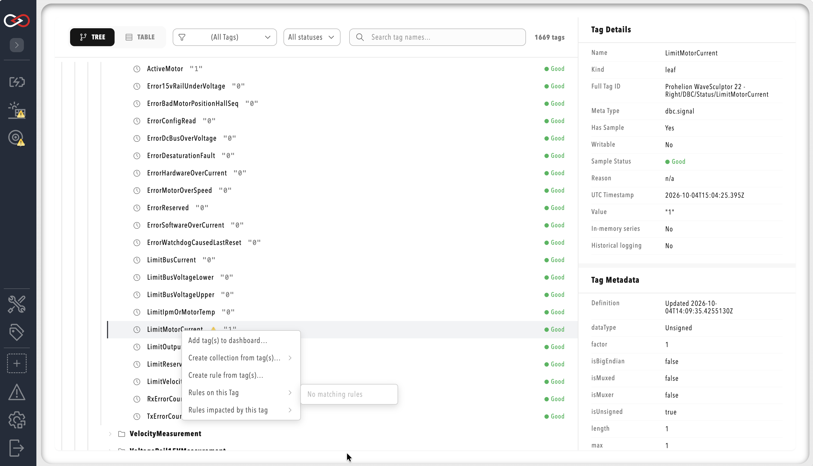

# Create collections, rules, and dashboard bindings from tags

The **Tag Explorer** context menu creates [collections](Collections/index.md), [rules](Rules/index.md), and [dashboard](../Customising_Profinity/Dashboards/index.md) bindings from selected tags, so you do not copy the selection into the visual editors by hand.
**Tag Explorer** itself requires the **View tags** permission.
Each context menu action then checks its own permission.
An action whose permission is missing is shown disabled, and the whole menu is hidden from a user who holds none of these permissions.
The permission for each action is listed under [Menu actions](#menu-actions).

To create one from selected tags:

1. Open **TAG EXPLORER** from the side menu.
2. Right-click a leaf tag or a branch to open the context menu. You can select several leaf tags and branches together. The table under [Menu actions](#menu-actions) shows which actions each kind of selection allows.
3. Choose an action from the menu.
4. Complete the configuration in the visual editor and save it. The new collection, rule, or binding then appears in that editor.

<figure markdown>

<figcaption>Tag Explorer context menu</figcaption>
</figure>

## Menu actions

| Action | Scope | Permission |
|--------|-------|------------|
| **Add tag(s) to dashboard…** | Leaf tags only | **Modify dashboards** |
| **Create collection from tag(s)…** | Branch, leaf, or root | **Modify tag collections** |
| **Create rule from tag(s)…** | Selected tags | **Modify tag rules** |
| **Rules on this Tag** | Selected tags | **View tag rules** |

The actions behave as follows:

- **Add tag(s) to dashboard…** opens a dashboard picker and creates a binding draft. Completing the bind still requires the dashboard editor.
- **Create collection from tag(s)…** opens a submenu for the primary filter (**Branch**, **Meta type**, **Unit**, **Value**, or **Quality**). It then opens an insert-location picker, and then the collections visual editor with a draft collection.
- **Create rule from tag(s)…** opens an insert-location picker, and then the rules visual editor with a draft rule.
- **Rules on this Tag** lists the rules that run on the selection and opens the rules editor with the chosen rule selected.

**Rules on this Tag** shows each rule as the rule source, a colon, and the rule name.
It is greyed out when no rule runs on the selection, so it is the check in **Tag Explorer** that a rule is attached to a tag.
The create actions open the editor with a draft, and nothing is created until you save it in the editor.

You can also start rules from two other places.
Right-click a dashboard element that is bound to tags to choose **Create rule from this element…**.
Right-click a collection in the collections editor to choose **Create rule from collection…**.

## Expressions the menu generates

The create-collection and create-rule flows generate the expressions automatically.
A selection of leaf tags becomes a set of `tag.Is("…")` matches.
A single selected branch becomes a scope prefix with the expression `tag.HasValue`.
Several selected branches become `tag.MatchesPath("…")` matches joined with `||` and combined with `tag.HasValue`.
For collections, a primary filter other than **Branch** replaces this with an expression built from the selected tags' metadata type, unit, value, or quality.
Refer to [Tag expressions](Selecting_Tags/Tag_Expressions.md) for the syntax.

For the next step, refer to [Tag collections](Collections/index.md), [Tag rules](Rules/index.md), [Rule actions](Rules/Actions/index.md), the [Visual Editor](../Customising_Profinity/Dashboards/Build_a_Dashboard.md), or [Tag layer](index.md).
