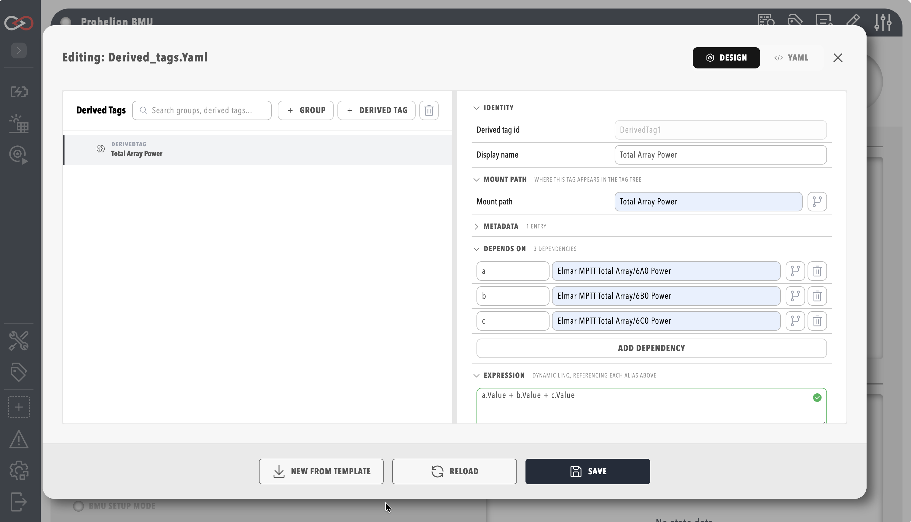

# Create a derived tag

This procedure creates a derived tag that converts a vehicle's speed from mph to km/h, grouped under that vehicle.
Open the derived tags editor first, as described in [Derived tags](Derived_Tags.md#open-the-derived-tags-editor), which lists the permissions it needs.

1. Create a group called **Vehicle unit conversions** with the mount path `Vehicles/Car1`.
2. Inside it, create a derived tag with the mount path `SpeedKmh`. Because the path is relative, it mounts beneath the group's mount path.
3. Add a dependency with the alias `a` that points at the tag `Vehicles/Car1/SpeedMph`.
4. Set the expression to `a.Value * 1.60934`.

When you save, the editor shows "Derived tags saved", and a failed save shows "Save failed:" followed by the validation error.
`Vehicles/Car1/SpeedKmh` is now a real tag that shows up in Tag Explorer at its mount path and in the rules engine, and history is available for it without further configuration.

<figure markdown>

<figcaption>Derived tag inspector with live preview</figcaption>
</figure>

For the formula rules, refer to [Expression-based derived tags](Derived_Tags.md#expression-based-derived-tags).
