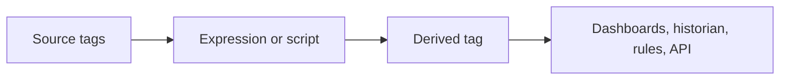
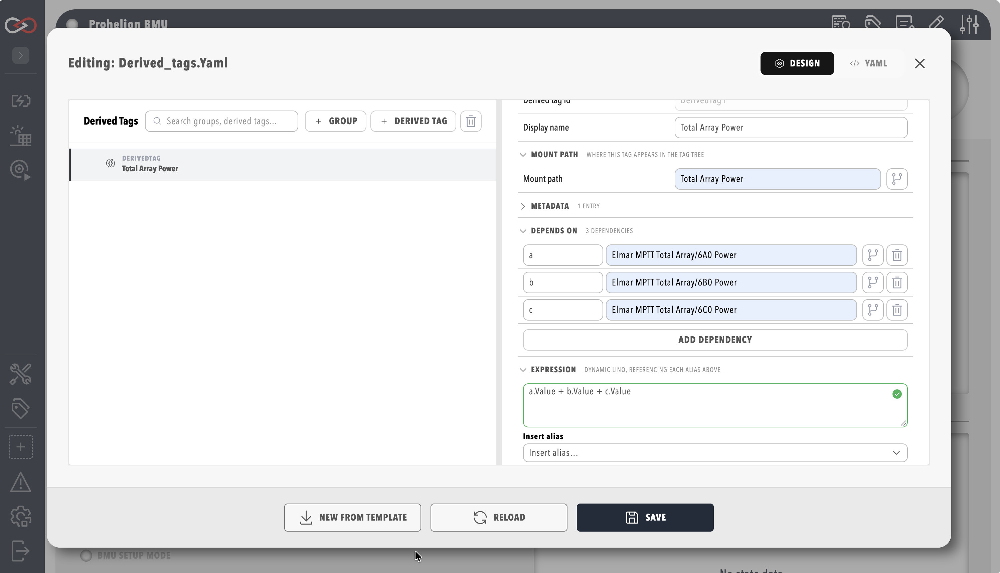

# Derived tags

A **derived tag**, also called a virtual tag, is a value that Profinity computes automatically and that then behaves exactly like a real tag to every consumer.
[Dashboards](../Customising_Profinity/Dashboards/index.md), the [historian](../Components/Historians/index.md), [rules](./Rules.md), and the API all see the same quality and timestamp envelope and can subscribe to it the same way, so the computation is configured once and Profinity keeps it current.
Profinity 2.3 computes a derived tag's value either from an expression, which recomputes whenever a source tag changes and needs no scripting, or from a script, which suits a computation that needs more than a single expression, and the table under [Expression vs script](#expression-vs-script) shows which one fits a given case.

<figure markdown>

<figcaption>Profinity computes a derived tag from source tags with an expression or a script, and dashboards, the historian, rules and the API then use it like any other tag</figcaption>
</figure>

## Open the derived tags editor

Select **DERIVED TAGS** under **TAG UTILITIES** in the side menu, which opens the editor as a window over the current page and needs the **View tag collections** permission and a loaded profile.
The file the editor works on is named by the **Derived tags YAML file (Optional)** setting in the **Tags** category of the profile settings.
Derived tags are organised into groups in a tree on the left of the editor, and selecting a group or derived tag opens its settings in an inspector on the right.

<figure markdown>

<figcaption>Derived Tags editor</figcaption>
</figure>

## Expression-based derived tags

An expression-based derived tag names one or more **dependencies**, which are short aliases mapped to source tag paths, and a formula that combines them, and it recomputes the moment any dependency changes.
To create one, refer to [Create a derived tag](Create_a_Derived_Tag.md).
Groups exist only for organisation, and a group can set a **mount path**: a derived tag with a relative mount path mounts underneath its group's mount path, a derived tag that gives its own absolute path mounts there instead, and a nested group's mount path narrows further under its parent's.

Each alias exposes only the reading members (`Value`, `Text`, `Bool`, `HasValue`, `Quality` and `IsStale`), and path methods such as `MatchesPath` belong in collections and rules, as described in [Tag expressions](./Tag_Expressions.md).
An expression can be up to 4096 characters long.

### Quality of a derived tag

A derived tag is only as trustworthy as its inputs, so by default its quality is the worst of its dependencies' qualities, from best to worst Good, Stale, Unavailable and Bad.
A derived tag built on a stale input is therefore stale (it still computes from the input's last value), and one built on an input with no value is unavailable.
To handle missing inputs yourself, for example with `a.HasValue`, set `inputQuality: ignore` on the derived tag in the YAML; it then evaluates whatever the input quality, and is Good when the expression succeeds.
The default is `inputQuality: propagate`.

### Deleting a derived tag that others depend on

If another derived tag lists the tag being deleted under its dependencies, the editor names those derived tags and asks for confirmation before the delete goes through.
Rule expressions are not checked.

## Expression vs script

When one expression is not enough, for example because the computation has several steps, carries state between runs or publishes several tags, write it as a script instead, as described in [Script-Driven Derived Tags](./Script_Driven_Derived_Tags.md).

| Use an **expression** when... | Use a **script** when... |
|---|---|
| The computation is simple real-time maths, a unit conversion, or combining a handful of tags | The logic needs multiple steps, branching, or state carried between runs |
| You want automatic history with no extra setup | You need a timed or on-demand trigger rather than pure tag-change reactivity |
| | You want to populate several tags from one computation |

A rule can publish its own current state to a tag, as described under [Rule state publishing](./Rules.md#rule-state-publishing).

## Permissions

The derived tags editor uses the same permission pair as collections: reading needs **View tag collections** and saving needs **Modify tag collections**.
Refer to [Roles and permissions](../Administration/Users_and_Access/Roles_and_Permissions.md) for how permissions are granted.
Integrators can also use the [API](../Integrating_to_Profinity/APIs/Endpoint_Reference.md#collections-and-derived-tags).

For the rest of the tag layer, refer to [Tag layer](index.md), [Collections](./Collections.md), and [Script Types](../Developing_with_Profinity/Scripting/Script_Types/index.md).
