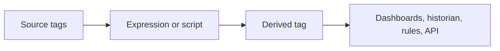

# Derived tags

A **derived tag**, also called a virtual tag, is a value that Profinity computes automatically and that then behaves exactly like a real tag to every consumer.
[Dashboards](../../Customising_Profinity/Dashboards/index.md), the [historian](../../Components/Historians/index.md), [rules](../Rules/index.md), and the API all use the same quality and timestamp and can subscribe to it the same way.
You configure the computation once, and Profinity keeps it current.

Profinity 2.3 computes a derived tag's value in one of two ways:

- An expression recomputes whenever a source tag changes and needs no scripting.
- A script suits a computation that needs more than a single expression.

The table under [Expression vs script](#expression-vs-script) shows which one fits a given case.

<figure markdown>

<figcaption>Profinity computes a derived tag from source tags with an expression or a script, and dashboards, the historian, rules and the API then use it like any other tag</figcaption>
</figure>

## Open the derived tags editor

Select **DERIVED TAGS** under **TAG UTILITIES** in the side menu.
The editor opens as a window over the current page.
It needs the **View tag collections** permission and a loaded profile.

The **Derived tags YAML file (Optional)** setting in the **Tags** category of the profile settings names the file the editor works on.
The editor shows derived tags in a tree of groups on its left side.
Select a group or derived tag to open its settings in the inspector on the right.

<figure markdown>

<figcaption>Derived Tags editor</figcaption>
</figure>

## Expression-based derived tags

An expression-based derived tag has two parts:

- One or more **dependencies**, which are short aliases mapped to source tag paths.
- A formula that combines the aliases.

It recomputes the moment any dependency changes.
To create one, refer to [Create a derived tag](Create_a_Derived_Tag.md).

Groups exist only for organisation, and a group can set a **mount path**:

- A derived tag with a relative mount path mounts underneath its group's mount path.
- A derived tag that gives its own absolute path mounts there instead.
- A nested group's mount path narrows further under its parent's.

Each alias exposes only the reading members: `Value`, `Text`, `Bool`, `HasValue`, `Quality`, and `IsStale`.
Path methods such as `MatchesPath` belong in collections and rules, as described in [Tag expressions](../Selecting_Tags/Tag_Expressions.md).
An expression can be up to 4096 characters long.

### Quality of a derived tag

A derived tag is only as trustworthy as its inputs.
By default its quality is the worst of its dependencies' qualities, ranked from best to worst as Good, Stale, Unavailable, and Bad.
A derived tag built on a stale input is therefore stale, and it still computes from the input's last value.
A derived tag built on an input with no value is unavailable.

To handle missing inputs yourself, for example with `a.HasValue`, set `inputQuality: ignore` on the derived tag in the YAML.
The YAML is `derived_tags.yaml` by default, in the `derived_tags` folder of the profile directory, which is inside the [artefacts directory](../../Installation/Artifacts_Directory.md#default-locations).
The tag then evaluates whatever the input quality, and is Good when the expression succeeds.
The default is `inputQuality: propagate`.

### Deleting a derived tag that others depend on

If another derived tag lists the tag being deleted under its dependencies, the editor names those derived tags and asks for confirmation before the delete goes through.
Rule expressions are not checked.

## Expression vs script

When one expression is not enough, write a script instead.
Examples are a computation with several steps, state carried between runs, or several published tags.
Refer to [Create a derived tag with a script](Create_a_Derived_Tag_with_a_Script.md).

| Use an **expression** when... | Use a **script** when... |
|---|---|
| The computation is simple real-time maths, a unit conversion, or combining a handful of tags | The logic needs multiple steps, branching, or state carried between runs |
| You want automatic history with no extra setup | You need a timed or on-demand trigger rather than pure tag-change reactivity |
| | You want to populate several tags from one computation |

## Permissions

The derived tags editor uses the same permission pair as collections.
Reading needs **View tag collections**, and saving needs **Modify tag collections**.
Refer to [Roles and permissions](../../Administration/Users_and_Access/Roles_and_Permissions.md) for how permissions are granted.
Integrators can also use the [API](../../Integrating_to_Profinity/APIs/Endpoint_Reference.md#collections-and-derived-tags).

For the rest of the tag layer, refer to [Tag layer](../index.md), [Tag collections](../Collections/index.md), and [Script types](../../Developing_with_Profinity/Scripting/Script_Types/index.md).
