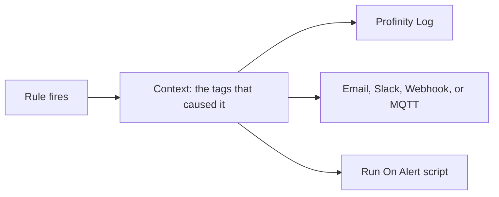

# Rule actions

A [tag rule](../index.md) watches the tags in its scope and, when its condition changes, records an alert and runs the actions attached to it.
Profinity 2.3 has two built-in actions, **Profinity Log** and **None**. It also offers the Email, Slack, Webhook, and Message Queuing Telemetry Transport (MQTT) actions as components, and any [script](../../../Developing_with_Profinity/Scripting/Script_Types/Rule_Scripts.md) set to **Run On Alert** mode.
Every action receives the list of tags that caused the rule to fire, which is named `TriggeredTags` in a script and `triggeringTags` in the Webhook and MQTT JSON message.

!!! info "Licence required"
    Rules, the [Alerts Log](../../Alerts.md) and the built-in actions **Profinity Log** and **None** work on every edition.
    The Email, Slack, Webhook, and MQTT actions need the **Tag Rule Actions** licensed feature, included in the **Server** and **Enterprise** editions.
    A script set to **Run On Alert** needs both **Tag Rule Actions** and **Scripting** (included in the **Desktop**, **Server** and **Enterprise** editions).
    Without **Tag Rule Actions** the rule still evaluates and the alert is still recorded, and only the licensed actions are skipped.
    Refer to [Licensing](../../../Licensing.md) for what each edition includes.

<figure markdown>

<figcaption>A rule firing passes the triggering tags to each action attached to it</figcaption>
</figure>

## Action picker

When you edit a rule in the visual editor, you choose actions from the action picker, which lists the following:

- **Profinity Log**, which writes a message to the Profinity log at the action's `level` and otherwise the rule's level.
- **None**, which records the alert in the Alerts Log only and rejects `message`, `level` and `tagId`.
- Every Email, Slack, Webhook, and MQTT action that has been added to the profile, listed by the name of its component.
- Every **CSharp Script**, **Python Script** or **Lua Script** component whose mode is **Run On Alert**, as described in [Rule scripts](../../../Developing_with_Profinity/Scripting/Script_Types/Rule_Scripts.md).

In YAML the two built-in actions are written `ProfinityLog` and `None`.

### Making an action available

An Email, Slack, Webhook, or MQTT action does not appear in the picker until it exists as a component.
To add one:

1. [Add a new component](../../../How_To_Guides/Add_Component_to_Profile.md) from the **Rule Actions** group.
2. Choose **Email Rule Action**, **Slack Rule Action**, **Webhook Rule Action** or **MQTT Rule Action**.
3. Give the component a name.
4. Fill in its settings.

A rule can then select the action from the picker.
The component's name becomes the action id in the picker and in `rules.yaml`, so a component named `OpsSlack` is written `action: OpsSlack`, and renaming the component means updating the rules that use it.
Several components of the same type, for example one Slack action per channel, can exist side by side.
The settings of each action are described in [Email and Slack rule actions](Email_and_Slack_Rule_Actions.md) and [Webhook and MQTT rule actions](Webhook_and_MQTT_Rule_Actions.md).

## Actions inherited down the rule tree

Actions written on the file or on a group are parent actions, and each one needs a `triggerLevel`.
A parent action runs for every rule beneath it whose alert level is at or above the `triggerLevel`, taking the level from the rule or, for a threshold rule, from the step that fired.
In the [complete rules.yaml example](../Rules_YAML_Example.md), a Warning on `pack_temperature` runs only **Profinity Log**, an Error runs **Profinity Log** and `OpsSlack`, and the Fatal step also runs `OpsEmail` from the group.
Actions written on a rule or on a threshold step are local, take no `triggerLevel` and always run when that rule or step fires.

The `clearActions` lists work the same way when the alert clears.
Each side can be switched off for one rule with `disableActions` and `disableClearActions`, which list an inherited action as the id of its parent, a slash and its name, as in `profile/ProfinityLog`.
For a rules file that belongs to a component, the parent id is the component name instead of `profile`, and for a group it is the group `id`.
Each parent can list a given action name only once, and a rule with `thresholds` cannot also have rule-level `actions` or `clearActions`, so its actions go on the steps.

An action entry may be a bare name or an object with `action` and optionally `message` and `level`, where `message` replaces the text sent for this rule and `level` sets the level that **Profinity Log** writes at.
The `tagId` and `value` fields substitute a different tag path and value for those reported to the action.
An action that is not found, or is not an action component, is reported as `references unknown component` when the rules file loads, and the rule file is not loaded until the name is corrected.

## `TriggeredTags`

Every rule action receives the same firing context, which includes `TriggeredTags`, the list of tags in the rule's scope that are currently evaluating true.
A script uses it to log, branch, or pass values on, and the Webhook and MQTT actions send the same list as the `triggeringTags` array of their JSON message, described in [Webhook and MQTT rule actions](Webhook_and_MQTT_Rule_Actions.md).
The script version of the context is described in [Rule scripts](../../../Developing_with_Profinity/Scripting/Script_Types/Rule_Scripts.md).

## Message placeholders

The message of an action and the template settings of the Email and Slack actions can include the following placeholders, which Profinity replaces when the action fires: `{RuleId}`, `{TagId}`, `{Transition}`, `{Value}`, `{TagValue}`, `{Quality}`, `{MetaType}`, `{RuleLevel}`, `{TriggeredTagCount}`, `{TriggeredTagIds}`, `{ThresholdLevel}` and `{ThresholdMessage}`.
The `{Value}` and `{TagValue}` placeholders both give the value reported to the action, normally that of the tag that caused the transition.
`{TriggeredTagIds}` is a comma-separated list, and `{ThresholdLevel}` and `{ThresholdMessage}` are filled only for threshold rules.
Control characters in substituted values are removed so that a device value cannot split a notification across lines.

## Permissions

Actions are attached to rules, so the permissions that apply are those on the [Tag rules](../index.md#permissions) page.

For the rest of the tag layer, refer to [Tag layer](../../index.md), [Tag expressions](../../Selecting_Tags/Tag_Expressions.md), [Collections](../../Collections/index.md), and [Derived tags](../../Derived_Tags/index.md).
