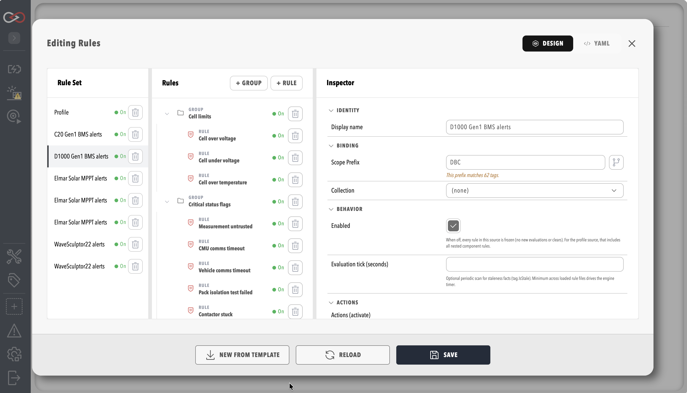
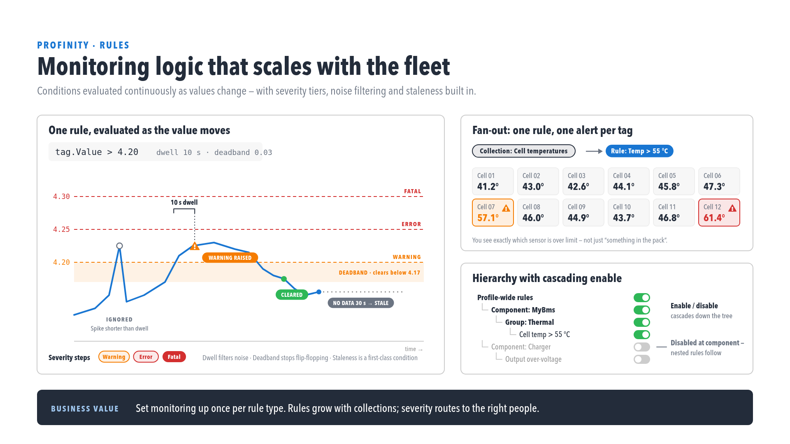

# Tag rules

A tag rule watches the tags in its scope and, when its condition changes, records an alert in the [Alerts Log](../Alerts.md) and runs the actions attached to it.
This page covers writing rules.
[Create a rule](Create_a_Rule.md) walks through an example, and [Complete rules.yaml example](Rules_YAML_Example.md) shows a full `rules.yaml` with every setting.
[Rule actions](Actions/index.md) covers the actions that a rule can run, such as Email, Slack, Webhook, and Message Queuing Telemetry Transport (MQTT).

!!! info "Licence required"
    Rules and the Alerts Log work on every edition.
    Without the **Tag Rule Actions** licensed feature a rule still evaluates and the alert is still recorded.
    Only the Email, Slack, Webhook, MQTT, and script actions are skipped.
    Refer to [Licensing](../../Licensing.md) for what each edition includes.

## Rules visual editor

Select **RULES & ACTIONS** under **TAG UTILITIES** in the side menu, which needs the **View tag rules** permission.
Alternatively, choose **Edit Rules** on a component that ships default rules, such as the Elmar Maximum Power Point Tracker (MPPT) and the C48 Gen2.
The editor lists the profile's rules first and then each component's rules.
It shows every rule with its level, scope, thresholds, and actions.

<figure markdown>

<figcaption>Rules visual editor with an expanded rule</figcaption>
</figure>

The editor writes the same `rules.yaml` document that can be edited directly.
It exposes the settings that control how a rule is evaluated:

- **Rule level** and **Rule type** for each rule.
- **Dwell seconds**, **Throttle minutes**, and the **More information links** for each rule.
- **Evaluation tick (seconds)** on the rules source.

The valid alert levels, their aliases and the default are described under [Alert levels](../Alerts.md#alert-levels).
Each rule also has a `description` that the Alerts Log shows to the user.
A rule has a condition written in the [tag expression](../Selecting_Tags/Tag_Expressions.md) language.
For example, `tag.Value > 4.2` trips the rule (raises the alert) and `tag.Value < 4.0` clears it, while `tag.IsStale` catches a sensor that has stopped reporting.

Setting **Publish state tag path** on a rule, in its **Rule State** group, mirrors the rule's current state to a read-only tag, as described under [Rule state publishing](#rule-state-publishing).

## Rule state publishing

A rule can publish its own current state to a tag.
Set **Publish state tag path** in the **Rule State** group of a rule in the Rules editor.
Profinity then mirrors the rule's state to that tag path whenever it changes:

- A boolean rule publishes `true` or `false`.
- A threshold rule publishes the zero-based index of its active step, or `-1` when no step is active.

The tag is read-only, so only the rule can write to it.
When the rules load, the tag takes the state the rule last had, which Profinity restores from the alert log.
If the rule has no history, the tag starts at `false` (`-1` for a threshold rule).

A rule has a single state tag, even when its scope matches many tags.
Every matching tag writes to the same state tag, so the value shown is that of whichever matching tag changed state most recently.
It is not a summary of all of them.
Where the state of each tag matters, define one rule per tag, each with its own **Publish state tag path**.
Do not give two rules the same path.
Profinity does not load the rules when two of them share a path, and the error names both rules.
Refer to [Rule actions](Actions/index.md) for the actions a rule runs.

## Rule evaluation: dwell and deadband

<figure markdown>

<figcaption>Dwell, deadband and severity levels on a rule</figcaption>
</figure>

Rules support two settings that stop an alert flickering on and off:

- **Dwell**: the condition must hold for a set time before the alert trips. Set it with `dwellSeconds` or `dwellMinutes`.
- **Deadband**: the alert clears at a different point from where it tripped. Set it with `clearValue` or `clearExpression` on a threshold step, and with `clearExpression` on a boolean rule.

Both are configured in the rules visual editor or in `rules.yaml`.
[Complete rules.yaml example](Rules_YAML_Example.md) shows a complete example of each.

The **Evaluation tick (seconds)** setting, `evaluationTickSeconds` in YAML, takes a whole number from 1 to 3600.
Rules evaluate whenever a tag in their scope changes.
The tick adds a periodic extra pass.
This is the only way a `tag.IsStale` rule can fire for a tag that has stopped changing.
A rule that tests for stale or missing data needs the tick to be set in at least one loaded rules file.
When several rules files set a tick, the smallest value applies to the whole profile.
A low value in one file therefore changes how often every file is evaluated.

Conditions use the same `tag` expression language as collections, so a numeric trip and clear pair is written as follows.
The first line trips the rule and the second line clears it:

```text
tag.Value > 4.2
tag.Value < 4.0
```

A no-data or stale sensor condition is written as follows.
The term `!tag.HasValue` catches a tag that has never had a value:

```text
!tag.HasValue || tag.IsStale
```

## Permissions

| Task | Permission |
|------|------------|
| View rules | **View tag rules** |
| Edit rules | **Modify tag rules** |
| View alerts | **View alerts** |

For the rest of the tag layer, refer to [Tag expressions](../Selecting_Tags/Tag_Expressions.md), [Collections](../Collections/index.md), [Derived tags](../Derived_Tags/index.md) and [Tag layer](../index.md).
