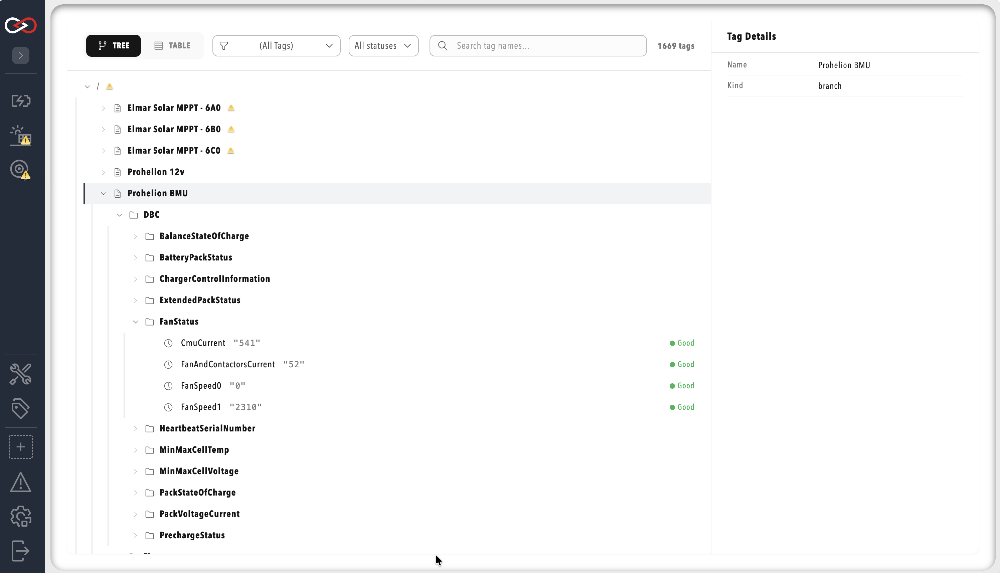

# Tag tree paths and dashboard binds

A component can be placed inside a folder of the tag tree rather than at its root.
By default each component mounts at the root under its own name.
The **Tag tree path** setting gives it a parent folder, so that its tags nest under that location instead.
The setting is stored as `tagTreeParentPath` in the component's YAML.

Nesting suits profiles that model physical or logical groupings.
Examples are several subsystems of one vehicle, or several instances of one component type that represent the bays, strings, or vehicles in a fleet.
The shared folder appears in the tag tree and in the **Tag Explorer**, so an integrator or user can navigate the tree the way the physical system is organised.

The following sketch shows the effect of giving two components a **Tag tree path** of `Vehicles/Car1`:

```text
Without a Tag tree path          With a Tag tree path of Vehicles/Car1
Charger/                         Vehicles/
Inverter/                          Car1/
                                     Charger/
                                     Inverter/
```

The **Tag Explorer** shows the same structure for a full profile.
In the **Tag Explorer** example, each component appears as a branch under the root of the tree, and its tags are grouped into folders such as `DBC`.
A component with a **Tag tree path** set appears in the same way, inside its parent folders instead of at the root.

<figure markdown>

<figcaption>Full Tag Explorer example with components mounted at the root, the default</figcaption>
</figure>

To set the path, refer to [Nest a component in the tag tree](Nest_a_Component_in_the_Tag_Tree.md).

## Scopes in collections and rules

In the profile's collections and rules, write a scope as the full path from the root of the tag tree.
For example, the tags of a `Charger` component with a **Tag tree path** of `Vehicles/Car1` are scoped with `Vehicles/Car1/Charger`.

A component's own `rules.yaml` is different, because its relative scopes start at where the component is mounted.
A `scope.prefix` of `DBC` in the `Charger` component's rules resolves to `Vehicles/Car1/Charger/DBC`.
A component at the root resolves it to `Charger/DBC`.

## Absolute and relative dashboard binds

Once a component is nested, the form of a `source:` value in a dashboard `bind:` entry decides whether it follows the component if it moves.

| | Relative bind | Absolute bind |
|---|---|---|
| Form | No leading slash | Leading slash |
| Example | `DBC/BMSInfo/Flag` | `/Vehicles/Car1/Charger/DBC/BMSInfo/Flag` |
| Resolved | Against the component's own mount point when the dashboard loads | Used exactly as written |
| Use for | A dashboard reading its own component's tags, which is the normal case | A dashboard reading another component's tags, such as the profile home dashboard |
| If the component moves | Continues to resolve | Stops resolving until updated |

On a dashboard belonging to that `Charger` component, the relative bind `DBC/BMSInfo/Flag` resolves to `Vehicles/Car1/Charger/DBC/BMSInfo/Flag`.

Dashboards that use the `{COMPONENT_NAME}` placeholder, documented in [Data binding](../../Customising_Profinity/Dashboards/Data_Binding/index.md), keep working.
Profinity replaces the placeholder with an explicit relative or absolute path the next time the dashboard is saved.

Every component has a **Tag tree path** setting, next to its **Name**, and its default is `/`.
For the dashboards that bind to these paths, refer to [Dashboards](../../Customising_Profinity/Dashboards/index.md).
[Tag layer](../index.md) lists the rest of the tag pages.
