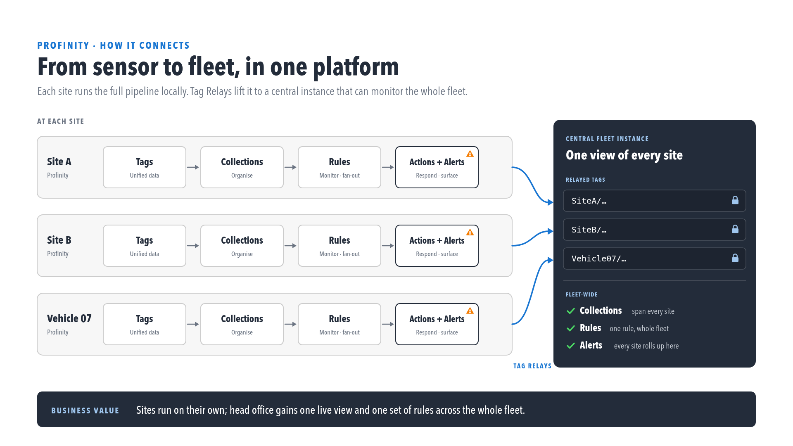
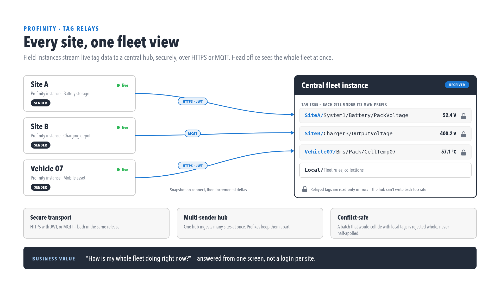

# Tag relay

Tag relay shares live tag data between two Profinity instances.
One instance runs as a sender, publishing periodic snapshots of the [tag collections](./Collections.md) it is set to export, and another runs as a receiver, ingesting those snapshots as remote, read-only tags under a prefix that identifies where they came from.
It supports a fleet or head-office view spanning multiple sites, vehicles, or installations.
Tag relay requires the **Data Relay** licensed feature on both the sending and receiving instance, and [Licensing](../Administration/Licensing.md) shows whether it is licensed and available on a given instance.
Tag relay has no field-level filtering: a sender exports every tag that belongs to its selected collections, so create a collection that contains only the tags a receiver should see.

<figure markdown>

<figcaption>Each site runs its own tag pipeline, and relay adds a shared view at the central instance</figcaption>
</figure>

Tag relay is Profinity-to-Profinity only, over its own snapshot format, and it does not speak Sparkplug.
If the other end is a third-party Sparkplug B source, such as an edge gateway or a platform such as Ignition, rather than another Profinity instance, use the [MQTT Subscriber](../Components/Publishers_and_Subscribers/MQTT_Subscriber.md) instead.
Refer to that page's own note for the reverse comparison.

## How it works

<figure markdown>

<figcaption>Sender and receiver roles, with per-site tag prefixes on the receiving instance</figcaption>
</figure>

A Profinity instance with a [Tag Relay Sender](../Components/Tag_Relays/Tag_Relay_Sender.md) component exports the member tags of the collections selected in the sender and sends them as a complete snapshot at a fixed interval, which defaults to 60 seconds.
The receiver therefore always holds the values from the most recent snapshot rather than a stream of individual changes, and tags outside the selected collections are never sent.
A [Tag Relay Receiver](../Components/Tag_Relays/Tag_Relay_Receiver.md) component connects to one or more senders and mounts each sender's tags under a prefix that identifies that site, for example `SiteA/…`, so a single receiving instance can ingest many senders without their tag trees colliding.
A sender is reached over HTTPS with a JSON Web Token (JWT) or over MQTT, and the choice is made per sender.

Relayed tags on the receiver are read-only, so the receiving instance cannot write back to a site through relay.
Local tags, [collections](./Collections.md), [rules](./Rules.md), and [alerts](./Alerts.md) on the receiver can reference relayed tags the same way they reference any other tag.

## Collision rules

The receiver checks a whole snapshot against its live tag tree before it changes anything, and a single collision rejects the entire snapshot so that nothing is partially applied.
A snapshot is rejected whole, with no tags created or updated, when any item in it meets one of these conditions:

- The path is already occupied by a tag that did not come from relay, such as a local device tag, a script register or a [derived tag](./Derived_Tags.md).
- A tag that came from relay already exists as a leaf where the snapshot needs a branch, or as a branch where the snapshot needs a leaf.
- The snapshot itself asks for both a branch and a leaf at the same path.

A relayed leaf that already exists where the snapshot carries a leaf is not a collision, and its sample is updated.
A path occupied by a tag that did not come from relay is never skipped on its own while the rest of the snapshot is applied.

### Troubleshooting a sender that stops updating

When the tags from one sender stop updating on the receiver, a path in that sender's latest snapshot clashes with a tag already on the receiver, and the receiver rejects the whole snapshot.
Over HTTPS the sender receives a `409 Conflict` response carrying the reason, and a malformed snapshot, for example an unsupported relay version, receives `400 Bad Request`.
Over MQTT the receiver writes a warning to the Profinity log and discards the snapshot.
Remove the local tag that occupies the path or change the receiver prefix, and the next snapshot from that sender is accepted.

For the settings of each role, refer to [Tag Relay Sender](../Components/Tag_Relays/Tag_Relay_Sender.md) and [Tag Relay Receiver](../Components/Tag_Relays/Tag_Relay_Receiver.md).
Refer to [Roles and permissions](../Administration/Users_and_Access/Roles_and_Permissions.md) for the permissions involved, and to the [Tag layer](./index.md) overview for the rest of the tag pipeline.
