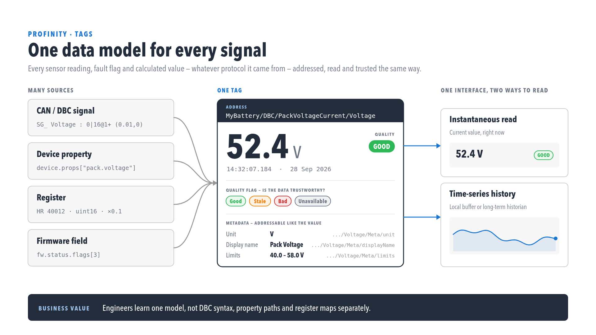

# Tag layer

The tag layer is Profinity's catalogue of live and configured tag values, and it is the foundation for Tag Explorer, [collections](./Collections.md), [rules](./Rules.md), and [alerts](./Alerts.md), which are new in Profinity 2.3.
Open **TAG EXPLORER** from the side menu, which requires the **View tags** permission, to browse the tag tree, switch to table views where available, and inspect the data quality indicator on each tag.
Stale quality has its own icon, separate from the rule alert triangle.
The **TAG UTILITIES** group in the side menu appears for users with the **View tags** permission.
The collections and derived tags editors also need a loaded profile, and saving needs **Modify tag collections** for collections and derived tags, or **Modify tag rules** for rules.

<figure markdown>

<figcaption>A tag combines an address, value, quality flag and metadata</figcaption>
</figure>

- [Create collections, rules, and dashboard bindings from tags](Create_Collections_Rules_and_Bindings_from_Tags.md): use the Tag Explorer context menu to start a collection, a rule, or a dashboard binding from selected tags.
- [Collections](Collections.md): group tags with a membership expression. Open **COLLECTIONS** under **TAG UTILITIES**, which opens an editor window and requires **View tag collections**.
- [Create a collection](Create_a_Collection.md): build a restricted collection of cell voltages in the collections editor.
- [Rules](Rules.md): evaluate tags and raise alerts. Open **RULES & ACTIONS** under **TAG UTILITIES**, which opens an editor window and requires **View tag rules**.
- [Complete rules.yaml example](Rules_YAML_Example.md): read a full rules file with every setting explained.
- [Actions](Actions.md): choose what a rule does when it fires.
- [Email and Slack rule actions](Email_and_Slack_Rule_Actions.md) and [Webhook and MQTT rule actions](Webhook_and_MQTT_Rule_Actions.md): settings for each notification action.
- [Alerts Log](Alerts.md): review, acknowledge, and silence alerts. Open **ALL ALERTS** in the side menu, which requires **View alerts**.
- [Derived tags](Derived_Tags.md): compute a tag from other tags. Open **DERIVED TAGS** under **TAG UTILITIES**, which opens an editor window and requires **View tag collections**.
- [Create a derived tag](Create_a_Derived_Tag.md): convert speed from mph to km/h with an expression.
- [Script-driven derived tags](Script_Driven_Derived_Tags.md): publish a derived tag from a script.
- [Tag expressions](Tag_Expressions.md): the expression language shared by collections, rules, and derived tags.
- [Tag tree paths and dashboard binds](Tag_Tree_Path.md): how nesting a component in a folder of the tag tree affects scopes and binds.
- [Nest a component in the tag tree](Nest_a_Component_in_the_Tag_Tree.md): mount a component inside a folder of the tag tree.
- [Log tags to a file](Log_Tags_to_a_File.md): record tag values to a file with the TAG File Logger.
- [Replay a tag log](Replay_a_Tag_Log.md): play a recording back onto your live tags from **TAG LOG REPLAY** under **TAG UTILITIES**, which requires **Replay tag changes**.
- [Tag relay](./Tag_Relay.md): share live tags between Profinity instances. One instance publishes periodic snapshots of selected collections, and another ingests them as remote, read-only tags under that site's own prefix.

Integrations can work with tags, tag collections, tag rules and alerts through the Representational State Transfer (REST) [API](../Integrating_to_Profinity/APIs/index.md) under `/api/v2`.
The Swagger page on your Profinity instance lists every endpoint and the parameters it accepts.
The older data endpoint is not part of `/api/v2`, so use the tag endpoints for new integrations.
All endpoints require the appropriate permissions, which are listed in [Roles and permissions](../Administration/Users_and_Access/Roles_and_Permissions.md).
