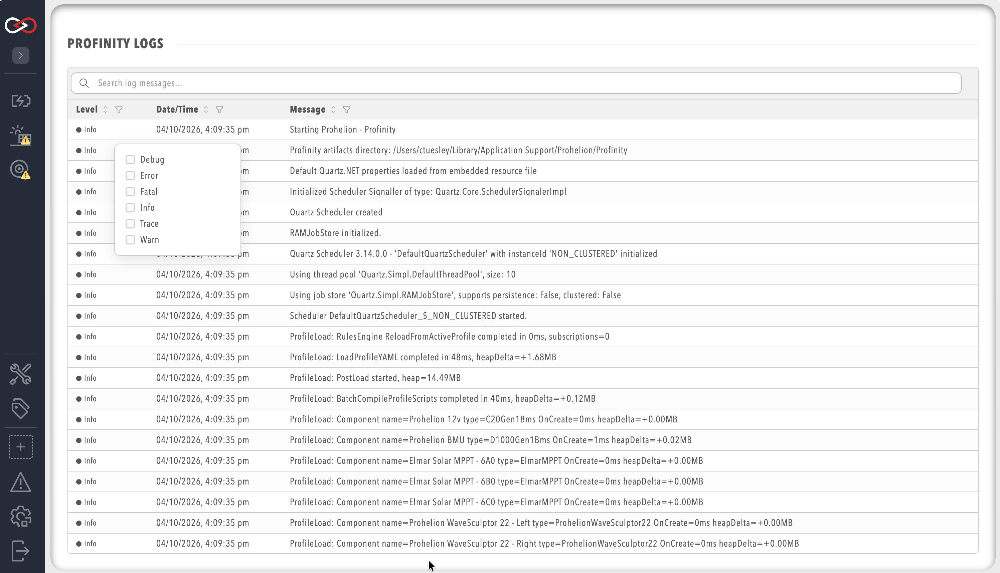

# Logs

Profinity has a built-in logging mechanism that captures information about the operation of the system and is designed to assist in diagnosing system issues.
To view the system logs, select **ADMIN** in the side menu, then the **Logs** pill.
Viewing and changing the logs needs the **Security administration** permission. No licence feature is needed.
If a log line is too long to fit on the page, select the line to expand that log message.

<figure markdown>

<figcaption>Profinity System Logs</figcaption>
</figure>

Each log entry contains a timestamp, a message level (for example `Info`, `Warn`, or `Error`), and a message description.
**Log level** on the **Logging** tab of **System Configuration** sets which levels are recorded.
Limiting the logs to particular message levels helps diagnose particular issues.

A higher level records fewer messages. The viewer shows entries at or above the selected level, so raising the level hides earlier lower-level entries, and lowering it does not bring back entries that were never recorded.
**Log rollover size (MB)** and **Retained logs** are set on the same tab.
[Logging](System_Configuration/Logging.md) describes the log levels and these settings.
