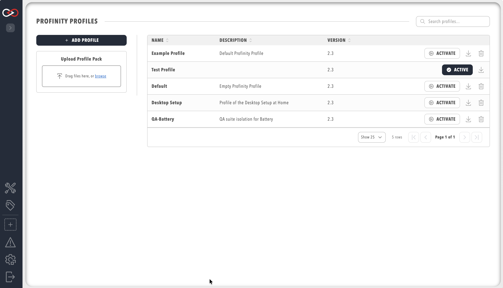

# Manage profiles

Use the **Profile** pill on the **ADMIN** page to activate, rename, import, and download profiles.
You need the **Modify profiles** permission, as described in [Roles and permissions](./Users_and_Access/Roles_and_Permissions.md).
To create a profile, refer to [How to create a new profile](../How_To_Guides/Create_New_Profile.md), which covers the steps from **Add profile** to adding components.

<figure markdown>

<figcaption>Profinity Profiles Menu</figcaption>
</figure>

## Change the active profile

Only one profile can be active at a time.
To change the active profile:

1. Select **ADMIN** in the side menu and open the **Profile** pill.
2. On the row of the profile you want, select **ACTIVATE**.

The profile becomes active immediately and Profinity loads the configuration associated with it.
The active profile carries the **ACTIVE** marker on its row.

## Edit profile settings

**Profile Settings** has three tabs.

| Tab | What it holds |
| --- | --- |
| **Profile** | **Profile Name**, **Description**, and **More information** |
| **Home** | **Kiosk Mode**, **Kiosk Mode User**, **Custom Home Dashboard**, and the dashboard file |
| **Tags** | The collections file, the rules file, and the derived tags file |

**Kiosk Mode User** appears when **Kiosk Mode** is on.
The dashboard file appears when **Custom Home Dashboard** is on.

To edit them:

1. Select **ADMIN** in the side menu and open the **Profile** pill.
2. Select the name of the profile, which opens **Profile Settings** on the **Profile** tab.
3. Edit the fields and select **Save**.

**Profile Name** must be unique across all profiles.
**Description** is optional.
It is shown when you choose a profile, and it is given to a Model Context Protocol (MCP) client when that client connects.
Each **More information** link needs a label and an `https://` address.
A client that is already connected keeps the text from when it connected.
Save the profile, then connect the client again, to give it the new description and links.

You can rename the active profile in the same way.
Profinity saves the profile, reloads it under the new name and keeps it active, so its components restart briefly.

## Import a profile pack

To import a profile pack prepared on another instance of Profinity:

1. Open the **Profile** pill.
2. Select **UPLOAD PROFILE PACK**.
3. Choose the ZIP file.

Profinity imports the profile with all its associated configuration, and it appears in the table of profiles.

| What you see | Cause | What to do |
|---|---|---|
| Profinity shows "Failed to unpack the Profile Pack. The file may be corrupted or invalid. Check the logs for more details." and imports nothing | The pack's `profile.yaml` is invalid, for example it has an unrecognised setting name or cannot be read as YAML. The log names the reason. | Correct the file in the pack and upload it again. |
| Profinity shows "Profile pack contains script content, which requires Scripting on the license." and rejects the upload | The licence does not include the **Scripting** feature | Refer to [Licensing](../Licensing.md). |

## Download a profile pack

To download a profile pack, open the **Profile** pill and select the download icon beside the profile.
Profinity saves a ZIP file containing the profile and its related files.

Refer to [Profiles](./Profiles.md) for what a profile pack contains and the roles it can carry from another site.
For the files a profile holds on disk, refer to [Profile folders](./Profile_Folders.md).
