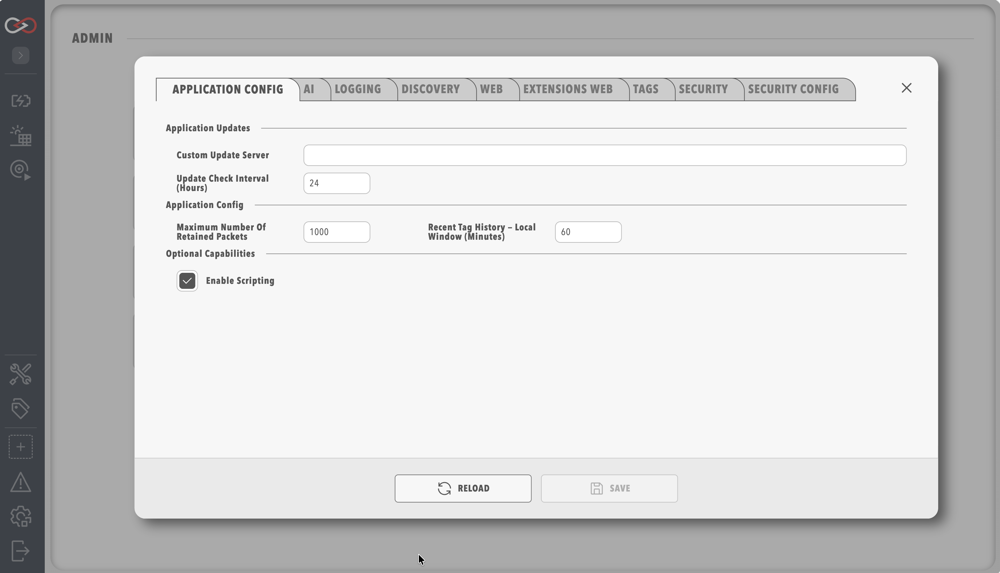

# Application Config

The Application config tab of [System Configuration](index.md) holds packet retention, update checks, the recent tag history window and scripting.

Saving changes on any System Configuration tab restarts Profinity.
Refer to [System Configuration](index.md) for what to expect.

| Parameter | Type | Default | Range | Description |
|-----------|------|---------|-------|-------------|
| **Maximum number of retained packets** | Whole number | 1000 | 1 to 10000 | The number of CAN packets Profinity retains for the CAN utilities. |
| **Custom update server** | Text | Blank (standard Prohelion update service) | - | The address of your own update server. Leave it blank to use the standard Prohelion update service. |
| **Update check interval (hours)** | Whole number | 24 | 1 to 168 (one week), or 0 | How often Profinity checks for updates. 0 disables scheduled checks. |
| **Recent tag history — local window (minutes)** | Whole number | 60 | 1 to 10080 | How far back dashboard bindings read from the in-memory [tag buffer](Tags.md). |
| **Enable C# scripting** | On or off | Off | - | In the **Optional capabilities** section. Turns on C# script components and the C# script engine. |
| **Enable Python scripting** | On or off | Off | - | In the **Optional capabilities** section. Turns on Python script components and the Python script engine. |
| **Enable Lua scripting** | On or off | Off | - | In the **Optional capabilities** section. Turns on Lua script components and the Lua script engine. |

For the recent tag history window, a dashboard binding that queries a time range starting within the window is served entirely from the in-memory tag buffer.
A range that starts earlier uses the designated InfluxDB reader for the whole window, when one is configured. To set the reader, turn on **Designated tag historian reader** on one InfluxDB or SQL historian component in the profile.

Scripts run code on the host, so turning on a scripting language is a security decision.
Each language toggle is available only when the licence includes the **Scripting** feature (**Desktop**, **Server**, and **Enterprise** editions).
An unlicensed instance does not include scripting.

When a language is off, that script type is hidden under Add Component, and scripts in that language are skipped, including scripts attached to custom components.

<figure markdown>

<figcaption>Profinity System Configuration</figcaption>
</figure>
