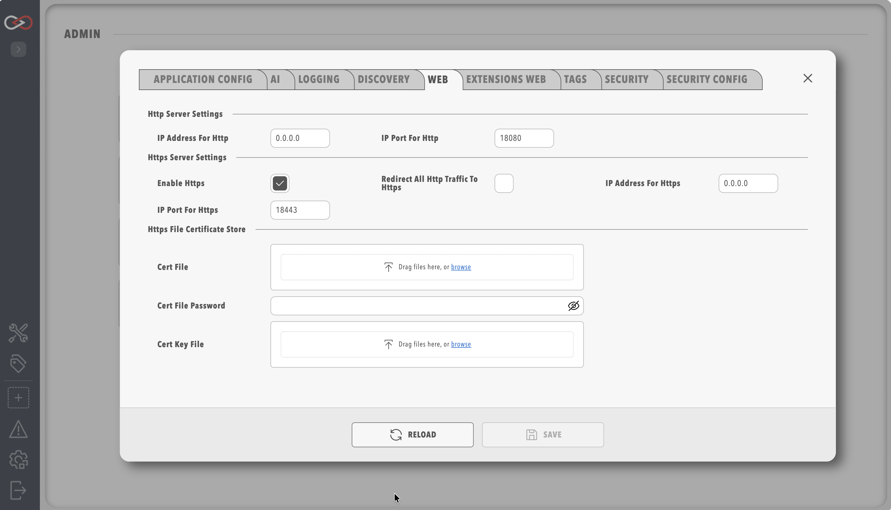

# Profinity Web

The **Web** tab holds the parameters that control how Profinity offers its web server connections to users.
Profinity supports HTTP and HTTPS connections, and custom HTTPS certificates.

Saving changes on any System Configuration tab restarts Profinity.
Refer to [System Configuration](index.md) for what to expect.

<figure markdown>

<figcaption>Profinity Web Menu</figcaption>
</figure>

| Parameter | Type | Default | Description |
|-----------|------|---------|-------------|
| **IP Address for Http** | IP address | All IP addresses (0.0.0.0) | The IP address Profinity runs on for HTTP. You can set localhost (127.0.0.1) or a specific IP address instead. With a Server licence this setting is shown. A desktop installation without a Server licence always uses 127.0.0.1. |
| **IP Port for Http** | Whole number | 18080 | The port used for HTTP. Setting this below 1024 requires administrator permissions on the host. |
| **Enable Https** | On or off | Enabled | Enable or disable the HTTPS server. |
| **IP Address for Https** | IP address | All IP addresses (0.0.0.0) | Same as the HTTP address but for HTTPS, and hidden under the same licence restriction. |
| **IP Port for Https** | Whole number | 18443 | Same as the HTTP port but for HTTPS. |
| **Redirect all Http traffic to Https** | On or off | Off | Forces the system to use HTTPS for all traffic. It can be enabled only when HTTPS is enabled. |

The certificate options are shared with the **Extensions Web** tab and are described in [HTTPS certificates](#https-certificates).

With a Server licence, the IP address settings are shown on this tab on every installation.
They are shown only with a Server licence.
A desktop installation without a Server licence uses `127.0.0.1` for both the HTTP and the HTTPS address, even if `config.yaml` holds another value.

The web interface can then be reached only from the same computer.
Profinity records a warning in the log, "Remote web access requires a Server license", when it replaces another address.
An [archive installation](../../Installation/Linux_and_macOS_Archive_Installation.md) on Linux or macOS, or a Docker installation, binds to the address in `config.yaml`, whether or not it has a Server licence. The IP address settings are shown only with a Server licence.
The full rule is in the remote web access warning on [Licensing](../../Licensing.md).

## Troubleshooting

| What you see | Cause | What to do |
|--------------|-------|------------|
| Profinity cannot be reached from another computer. | The licence is not a Server licence. Only with a Server licence can Profinity use addresses other than `127.0.0.1`. | Check the licence on the **License** page. |
| Profinity cannot be reached from another computer, with a Server licence. | The address is not `0.0.0.0` or the host's own address. | Check that the address is `0.0.0.0` or the host's own address. |
| Profinity cannot be reached from another computer, with a Server licence. | The host firewall does not allow the HTTP and HTTPS ports. | Allow the HTTP and HTTPS ports through the host firewall. |
| Profinity cannot be reached from another computer, with a Server licence. | Another program already uses the port. | Enter a different port on this tab. |

## HTTPS certificates

These options apply to both the **Web** and [Extensions Web](Extensions_Web.md) tabs.
Each server has its own copy of them.

| Parameter | Default | Description |
|-----------|---------|-------------|
| **Windows Cert Store** | Empty | Selects a certificate from the Windows Certificate Store for HTTPS on Windows. Enter the store name that Windows uses, for example **My**, which is the Personal store. Then set **Windows Cert Store Location** and **Windows Cert Store Subject** to identify the certificate. Use it when the certificate is installed in the system's certificate store. |
| **Windows Cert Store Location** | None | The location of the certificate store. The location is `CurrentUser` for user-specific certificates or `LocalMachine` for system-wide certificates. |
| **Windows Cert Store Subject** | Empty | The subject name of the certificate as it appears in the Windows Certificate Store. It must match the certificate's subject name exactly. |
| **Cert File** | Empty | An alternative to the Windows Certificate Store: a certificate file, normally in `.pfx` or `.p12` format, for HTTPS. |
| **Cert File Password** | Empty | When a certificate file is used, the password used to protect the certificate file. |
| **Cert Key File** | Empty | The private key file (`.pem` or `.key`) when the certificate is in Privacy-Enhanced Mail (PEM) format. It is optional. When it is empty, Profinity looks for a file named `privkey.pem` in the same folder as the certificate. |

When **Windows Cert Store** and **Cert File** are empty, Profinity creates its own certificate the first time HTTPS starts.
The file is `profinity_generated.pfx` in the `certificates` folder of the [artefacts directory](../../Installation/Artifacts_Directory.md), and it has no password.

Profinity also creates this file in place of a **Cert File** that is missing, cannot be read, or has a wrong password.
When you set **Cert File** and find `profinity_generated.pfx` in the folder, check **Cert File** and **Cert File Password**.
To export and trust the generated certificate, or to create a new one, refer to [Trust the HTTPS certificate](../../Integrating_to_Profinity/MCP_Server/Trust_HTTPS_Certificate.md).

To find the certificate store location and subject name on Windows:

1. Open Windows Certificate Manager (`certmgr.msc`).
2. Go to the appropriate store, such as Personal or Trusted Root.
3. Double-click your certificate.
4. Read the subject name in the "Subject" field.
   The certificate manager's navigation tree shows the store location.
