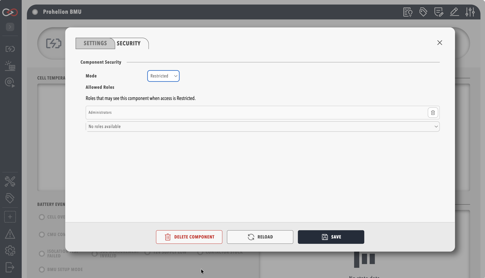
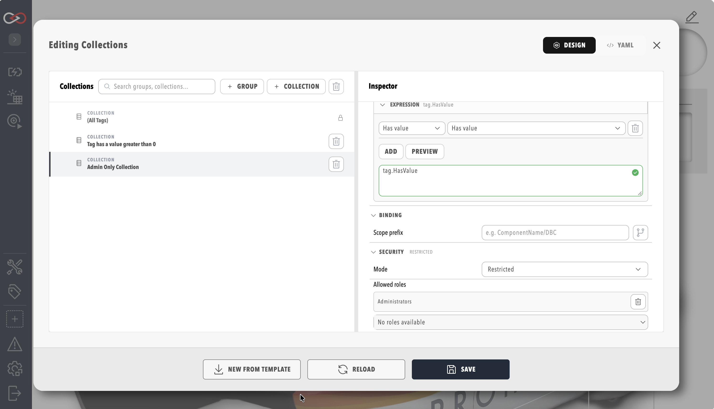

# Restrict a component or collection

Restrict a profile component or a tag collection so that only users holding certain roles can see it.
You need the **Security administration** permission, and the roles you want to allow must already exist. Restricting needs no licence feature of its own, but creating a role does (see [Create a role](../Create_a_Role.md)).
Any other user, including one with **Modify components**, does not see the **Security** tab or panel at all.

[Component and collection security](./index.md) explains what a restriction hides, who bypasses it, and what **Mode** and **Allowed roles** mean.
To create a role first, refer to [Create a role](../Create_a_Role.md).

## Restrict a component

To restrict a component:

1. Open the component's settings dialog from the profile menu or the component list.
2. Select the **Security** tab, which sits beside **Settings** and **Firmware** (when present).
3. Set **Mode** to **Restricted**.
4. In **Allowed roles**, open the dropdown that reads **Add role…** and choose each role to allow.
5. Select **SAVE** in the dialog footer to save the **Security** tab.

The component is now visible only to users who hold one of the allowed roles, plus the users described in [Who bypasses a restriction](./index.md#who-bypasses-a-restriction).
To check, sign in as a user without an allowed role and confirm the component no longer appears.
Setting **Mode** back to **All** removes the restriction.

<figure markdown>

<figcaption>Security tab on a component settings dialog</figcaption>
</figure>

## Restrict a collection

To restrict a collection:

1. Select **TAG UTILITIES** in the side menu, then select **COLLECTIONS** to open the Collections editor.
2. Select the collection in the tree.
3. Open the **Security** panel in the inspector.
4. Set **Mode** to **Restricted**.
5. Add one or more roles to **Allowed roles**.

The panel is the same for the built-in **(All Tags)** collection and for every custom collection.
Select **SAVE** in the Collections editor footer to save the collection's **Security** settings.

<figure markdown>

<figcaption>Security panel on a collection in the Collections editor</figcaption>
</figure>

To see what happens when **Allowed roles** is empty or names a role that no longer exists, refer to [Fail-closed behaviour](./index.md#fail-closed-behaviour).
