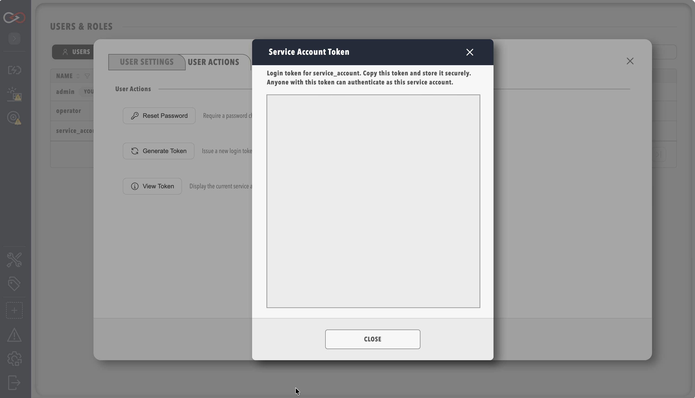

# Service accounts

Create a service account so that an integration or a Model Context Protocol (MCP) client signs in with an API token instead of a password.
A service account is a user record for automation rather than a person, and its token stays valid until an administrator generates a new one or disables the account.
Changing the account's roles keeps the same token.

You need the **Security administration** permission and the **Profinity Server** licensed feature, which **Users & Groups** uses.
MCP access also needs the **AI** licensed feature, which the Server and Enterprise editions include.
Refer to [Licensing](../../Licensing.md).

Treat the token like a password: store it in a secrets manager, and give the account only the permissions its integration needs.

## Create a service account

1. Select **ADMIN** in the side menu, then **Users & Groups**.
2. Select **+ Add user**, or select the row of an existing automation user.
3. Turn on **Service Account**.
4. Under **Assigned roles**, choose the roles the account needs, as described in [Choose the permissions](#choose-the-permissions).
5. Select **ADD USER** for a new account, or **SAVE** for an existing one. The account appears in the user list.
6. Select the account's row, then select the **User Actions** tab.
7. Select **Generate Token**, then confirm. The **Service Account Token** dialog shows the token in the **Token** box.
8. Select **Copy**, which reads **Copied** for a moment, and store the token in a secrets manager.
9. Select **Close**.

<figure markdown>

<figcaption>The Service Account Token dialog</figcaption>
</figure>

To check the token, send it to Profinity from the computer that runs the integration, replacing `<token>` with the token:

```bash
curl -H "Authorization: Bearer <token>" http://localhost:18080/api/v2/Users/Current
```

The response has status `200` and holds the account's details, with `isServiceAccount` set to `true`.
For an instance on another computer, use its address, as described in [Profinity Web](../System_Configuration/Profinity_Web.md).

On an account that already has a token, **View Token** shows the current token again.

## Replace a token

!!! danger "Generating a token stops the old one at once"
    **Generate Token** issues a new token, and every integration that uses the old one fails until you give it the new one.
    Copy the current token with **View Token** first if you need it, and update each integration straight after you generate the new token.

To replace a token, select **Generate Token** on the account's **User Actions** tab, then update each integration with the new token.
The account keeps its roles and its access.

## Choose the permissions

A service account takes roles in the same way as a person's account.

| Use | Permissions |
|---|---|
| Read-only monitoring | A role that holds view permissions only, as suggested in [Create a role](Create_a_Role.md#which-roles-to-create) |
| Tag and query automation | **View tags**, and any other view permission the integration reads |
| MCP client | **MCP integration**, **View tags**, and **View alerts**. The **Profinity AI** permission includes **MCP integration**, and the default **Administrators** role holds both. |

Restricted components and collections apply to a service account in the same way as to any user, as described in [Component and collection security](./Component_And_Collection_Security/index.md).

## Use the token

Send the token as a bearer token on every `/api/v2` request:

```http
Authorization: Bearer <token>
```

Replace `<token>` with the token from **Generate Token** or **View Token**.
For an MCP client, refer to [Prepare Profinity for an MCP client](../../Integrating_to_Profinity/MCP_Server/Prepare_Profinity.md).

## Run an AI technician {#run-an-ai-technician}

An [AI technician](../../Profinity_AI/AI_Technicians/index.md) runs as the user named in its **Run as** setting, and a service account is the usual choice, because its roles can be limited to reading.
Give the account a role with **MCP integration**, **View tags**, **View alerts**, and **View tag rules**, and with no permission that changes anything.
The technician then sees only the components and collections that the account can see.

Each round signs in with its own session, so the account's token is not used, and **Generate Token** has no effect on the technician.
The session lasts for the technician's **Round timeout (seconds)** plus two minutes from the start of the round, and then expires.

## Revoke access

To stop the account signing in, turn off **Is the user currently enabled** for the account in **Users & Groups**, and select **SAVE**.
Profinity then refuses every request with its token, and an AI technician that runs as the account stops.

## Troubleshooting

| What you see | Cause | What to do |
|---|---|---|
| "Service account token is no longer valid. Please log in again or request a new token from an administrator." on requests that worked before | Someone selected **Generate Token** on the account, so the old token stopped working. | Select **View Token** on the account's **User Actions** tab, copy the current token, and update the integration with it. |
| "User account is disabled. Please contact an administrator." | The account is disabled. | Turn on **Is the user currently enabled** for the account in **Users & Groups**, and select **SAVE**. |
| The AI technician's `Outcome` findings tag reads `blocked` after every round | The account named in **Run as** is disabled. | Enable the account in **Users & Groups**. |

To manage the other accounts on the instance, refer to [Managing users](Manage_Users.md).
