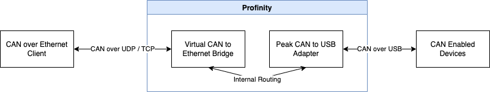

# Prohelion Virtual CAN Bus Adapter

The Prohelion Virtual CAN Bus Adapter is added to a [Profile](../../Getting_Started/Profiles.md) as the **Prohelion Virtual CAN to Ethernet Bridge** component. It is in the **Adapters** group.
It relays Controller Area Network (CAN) traffic between the other CAN adapters in the Profile and any client that connects to it.
To those clients, it looks like a Tritium or Prohelion [CAN to Ethernet bridge](../../../../Solar_Car_Racing/CAN_Ethernet_Bridge/index.md).
Use it to run tools that were developed for the Tritium and Prohelion bridges, such as the bridge configuration and firmware tools, when no physical bridge is present.

In the Virtual Adapter topology, a client connects to the Virtual Adapter, which works together with a Peak USB adapter to reach the physical CAN network.
Traffic is routed in both directions.

<figure markdown>

<figcaption>Virtual Adapter</figcaption>
</figure>

A different CAN adapter, such as a SocketCAN or Peak USB adapter, connects Profinity to the CAN network.
The Virtual Adapter has no setting that selects its partner adapter.
It forwards traffic between itself and every other active CAN adapter in the Profile.
Add the [Peak or SocketCAN adapter](CAN_Bus_Adapters/index.md) to the same Profile first.

The adapter publishes eight tags under its component path: `Properties/IsDesiredConnected`, `Properties/Settings/Name`, `Properties/State/Controller/CurrentStateName`, `Properties/Status`, `Properties/StatusColourText`, `Properties/StatusMessage`, `Properties/TotalMessagesReceived` and `Properties/TotalMessagesSent`.

## Quick start

You need a Peak or SocketCAN adapter in the same profile, added first, so the bridge has a CAN network to relay.

1. Select **ADD COMPONENT**, then select **Prohelion Virtual CAN to Ethernet Bridge** in the **Adapters** group.
2. Check that **Network Adapter** shows the interface that your clients can reach. Profinity selects the first available multicast interface by default.
3. Check that **Bus Number** is not used by another bridge in the profile. The default is 13.
4. Select **ADD COMPONENT** at the bottom of the dialog. **Auto Connect** is on by default, so the adapter starts when the profile loads.
5. Check that the adapter's status reads **Connected** while CAN traffic flows, or **No CAN traffic** if no CAN packet has arrived for 5 seconds.

## Virtual adapter settings

To relay traffic, add a Virtual Adapter to the Profile after the adapter for the physical CAN network, and set the parameters in the following table.

| Parameter | Type | Description | Default |
|-----------|----|-------------|---------|
| **Network Protocol** | Choice | `TCP` or `UDP`. UDP is always available, even when TCP is running. | `TCP` |
| **Bridge Protocol Version** | Choice | `V1` or `V2` matches the bridge firmware release, as described in [Virtual CAN adapter protocol and client support](Virtual_CAN_Adapter_Protocols.md). `All` speaks both protocols. | `All` |
| **Network Adapter** | Choice | The network interface on which the Virtual Bridge runs. | The first available multicast interface |
| **Bus Number** | Whole number | The bus number of the bridge. Profinity limits it to 0 to 13 for `V1` or `All`, because the version 1 protocol allows only a 4-bit bus number. For `V2` it accepts 0 to 32767. | 13 |
| **UDP TTL** | Whole number | The time to live of the UDP packets that Profinity transmits, from 1 to 1024. | 128 |
| **Auto Connect** | On or off | Enables the adapter when the profile loads. Refer to [Connections and reconnecting](../Connections_and_Reconnecting.md). | On |

The Virtual CAN Bridge runs inside Profinity, so the operating system of that machine sets its IP address.
The bridge configuration tools and Profinity cannot change the address remotely.
Profinity can only select the network interface.

!!! warning "Two bridges with the same bus number relay data between each other"
    Two bridges with the same bus number on one network relay data from one bridge to the other.
    This joins two separate CAN bus networks into one virtual bus over Ethernet.
    Two bridges on the same CAN bus that are also on the same Ethernet network form a cyclic network.
    In a cyclic network, every message is resent indefinitely until the CAN bus is overloaded.
    Give each bridge a unique bus number unless you are joining two buses deliberately.
    Refer to [Network Topologies](../../../../Solar_Car_Racing/CAN_Ethernet_Bridge/User_Manual/Network_Topologies.md) and the [bus number guidance](CAN_Bus_Adapters/CAN_Bus_Adapter_Settings.md#tritium-can-to-ethernet-bridge) for the physical bridge.

## Example

This example is a Virtual CAN Bridge for a Profile that already has an adapter for the physical CAN network.
In the product, add it with **ADD COMPONENT** by choosing **Prohelion Virtual CAN to Ethernet Bridge**, as described in [How to add a component to your profile](../../How_To_Guides/Add_Component_to_Profile.md). To add it in the file instead, follow the next step.
Add this list item under the existing `components:` key in the `profile.yaml` file of the Profile, in the folder named after the Profile inside the `profiles` folder of the [artefacts directory](../../Installation/Artifacts_Directory.md), with the same indentation as the other items.

```yaml
- component:
    type: ProhelionVirtualAdapter
    name: Prohelion Virtual CAN to Ethernet Bridge
    protocol: TCP
    tritiumProtocolVersion: All
    networkInterface: YOUR_NETWORK_INTERFACE
    busNo: 5
    udpTTL: 128
    autoConnect: true
```

Replace `YOUR_NETWORK_INTERFACE` with the name of the network interface that the clients can reach, as listed in the **Network Adapter** setting.
The bus number `5` is an example, so choose a number that no other bridge on the network uses. When the adapter runs, its status reads **Connected**, or **No CAN traffic** if no CAN packet has arrived for 5 seconds.

If a client cannot connect, check these things:

| What you see | Cause | What to do |
|---|---|---|
| A client cannot connect to the Virtual Adapter | The **Network Adapter** is not the interface that the client can reach. | Check that the **Network Adapter** is the interface that the client can reach. |
| A client cannot connect to the Virtual Adapter | The client speaks a protocol version that the **Bridge Protocol Version** does not cover. | Check that the client's protocol version is covered by the **Bridge Protocol Version**. |

For how the Virtual Bridge speaks both the V1 and V2 bridge protocols and serves several clients at once, refer to [Virtual CAN adapter protocol and client support](Virtual_CAN_Adapter_Protocols.md).

For the physical adapters that the Virtual Adapter relays to, refer to [CAN bus adapters](CAN_Bus_Adapters/index.md).
For the bridge that the Virtual Adapter imitates, refer to the [CAN to Ethernet bridge documentation](../../../../Solar_Car_Racing/CAN_Ethernet_Bridge/User_Manual/index.md).
