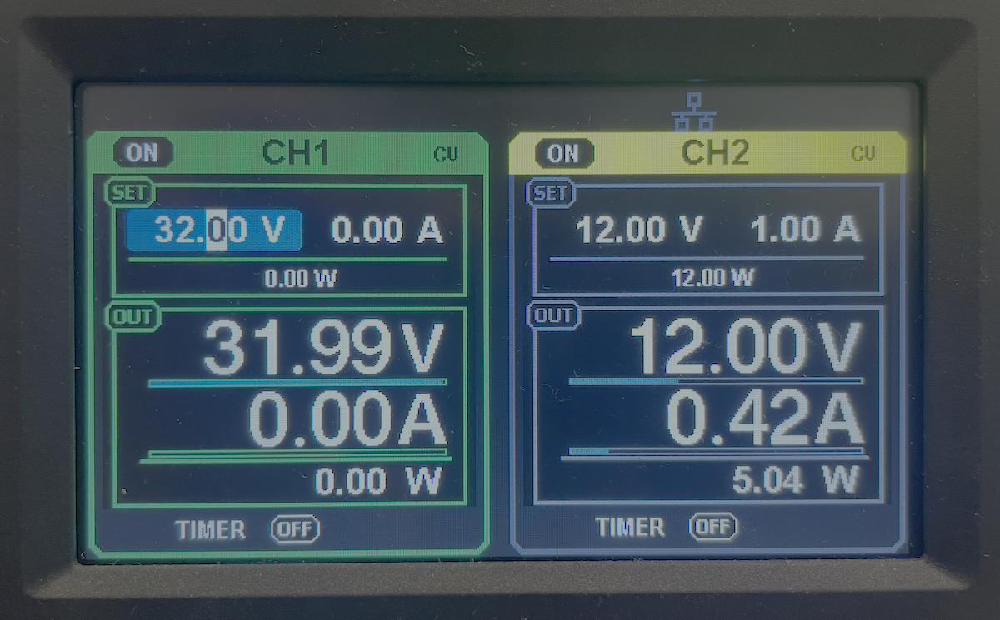
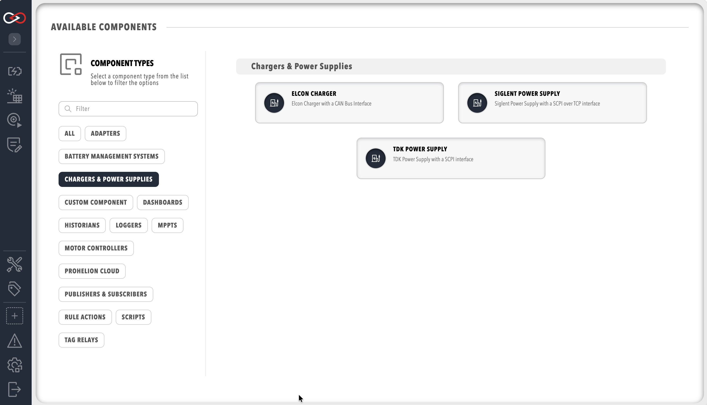

# Charger components

A charger component lets Profinity control a charger or programmable power supply, so that a Prohelion Battery Management Unit (BMU) in the same [Profile](../../Getting_Started/Profiles.md) can charge the pack.
The components sit in the **Chargers & Power Supplies** group.
How the BMU balances the cells while it charges is described in the hardware documentation, such as [D1000 Gen1 Charger Control](../../../../Battery_Management_Systems/Prohelion_BMS_D1000_Gen1/Operation/Charging.md).
On a D1000 Gen2 the BMU hardware manages charging, as described in the [D1000 Gen2 documentation](../../../../Battery_Management_Systems/Prohelion_BMS_D1000_Gen2/index.md).

<figure markdown>

<figcaption>A Prohelion BMU in the Profile supplies the pack data, and the charger component controls the charger, over TCP for a TDK or Siglent supply and over CAN for an Elcon charger</figcaption>
</figure>

## Supported chargers

| Component | Controls | Connection |
|---|---|---|
| **Elcon Charger** | Elcon chargers | Controller Area Network (CAN), through a CAN adapter that is already in the Profile |
| **Siglent Power Supply** | Siglent programmable power supplies that accept Standard Commands for Programmable Instruments (SCPI) commands, such as the SPD3303X-E, which suits desktop testing | Transmission Control Protocol (TCP) over the network |
| **TDK Power Supply** | TDK programmable power supplies, such as the Genesys family, using SCPI commands | TCP over the network. A supply with only a serial port needs a TCP to serial converter between it and the network. |

<figure markdown>

<figcaption>A Siglent SPD3303X-E power supply</figcaption>
</figure>

## Quick start

This quick start adds a TDK or Siglent supply. For an Elcon charger, refer to [Charger settings](Charger_Settings.md).

You need:

- A Prohelion BMU in the Profile with **Control Pack** on, because Profinity can engage and disengage the pack for a charge only when it is on. **Control Pack** is off by default, and it is described in [Prohelion BMU](../Battery_Management_Systems/Prohelion_BMU/index.md).
- The IP address and TCP port of the supply, and for a TDK supply the charger ID that the supply is set to.
- The **Control charging** permission to use the charging controls, as described in [Roles and permissions](../../Administration/Users_and_Access/Roles_and_Permissions.md).

1. Select **ADD COMPONENT**, then select **TDK Power Supply** or **Siglent Power Supply** in the **Chargers & Power Supplies** group.
2. Set **Charger IP Address** to the IP address of the supply.
3. Set **Charger Port** to the port the supply listens on. The default is `5025`.
4. For a TDK supply, set **Charger ID** to the ID the supply is set to.
5. Set **Charger Voltage Limit**, **Charger Current Limit**, and **Charger Power Limit** to the maximum output of your supply. The defaults are listed in [Charger settings](Charger_Settings.md).
6. Select **ADD COMPONENT**.
7. Select **Connect / Disconnect** from the charger's menu. **Auto Connect** is off by default.
8. In **TAG EXPLORER**, check that the charger's `IsConnected` tag is true.

<figure markdown>

<figcaption>The three charger components in the Chargers & Power Supplies group</figcaption>
</figure>

The charger then appears under **Chargers & Power Supplies** in the main menu, with its own dashboard.
To run a charge, refer to [Start a charge](Start_a_Charge.md).

## Settings

Every charger asks for its output limits and the limits of the supply that feeds it, and the TDK and Siglent supplies also ask for their network address.
[Charger settings](Charger_Settings.md) lists every setting, with its type, default for each charger, and effect.

## Tags

Every charger publishes these tags:

| Tag | Contents |
|---|---|
| `ActualCurrent` | The current the charger is delivering |
| `HardwareStatusColourText`, `TempStatusColourText`, `CommsStatusColourText`, `ACStatusColourText`, `DCStatusColourText` | The status colour of the hardware, temperature, communications, AC input, and DC output indicators on the dashboard |

The TDK, Siglent, and Elcon chargers also publish `ChargeController`, `BatteryManagementSystem`, and `IsConnected`.

## Example

This example adds a TDK supply at a network address you supply.
Add it under `components:` in the `profile.yaml` file of the profile.

```yaml
- component:
    type: TDKPowerSupply
    id: TDKPowerSupply1
    name: TDK Power Supply
    tagTreeParentPath: /
    chargerIpAddress: <supply IP address>
    chargerPort: 5025
    chargerId: <charger ID>
    chargerVoltageLimit: 300
    chargerCurrentLimit: 10
    chargerPowerLimit: 3000
    supplyVoltageLimit: 240
    supplyCurrentLimit: 10
    autoConnect: false
```

Replace `<supply IP address>` with the IP address of the supply and `<charger ID>` with the ID it is set to, and set the limits to match your supply.

## Troubleshooting

| What you see | Cause | What to do |
|---|---|---|
| "You must provide a charger Id for your charger" when you add a TDK supply | **Charger ID** is empty. | Set **Charger ID** to the ID the supply is set to. |
| The `IsConnected` tag stays false after **Connect / Disconnect** | Profinity cannot reach the supply at **Charger IP Address** and **Charger Port**. | Check the address and port against the supply's network settings, and check that the supply is on the same network as the computer running Profinity. |
| A charge does not start | **Control Pack** is off on the BMU, so Profinity cannot engage the pack. | Turn on **Control Pack** on the BMU, as described in [Prohelion BMU](../Battery_Management_Systems/Prohelion_BMU/index.md), then start the charge again. For the other causes, refer to [Start a charge](Start_a_Charge.md). |

Related components: [Prohelion BMU](../Battery_Management_Systems/Prohelion_BMU/index.md) and the [CAN bus adapters](../CAN_Bus_Protocols/CAN_Bus_Adapters/index.md) that an Elcon charger uses.
