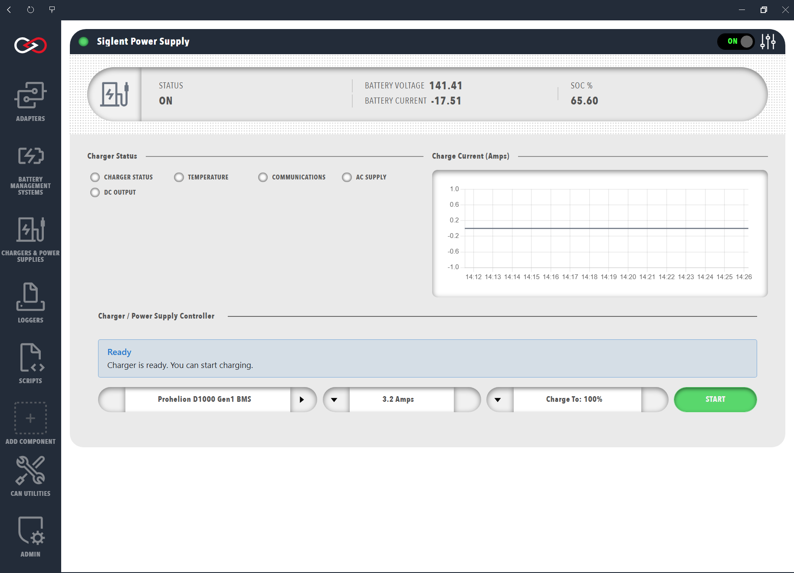

# Start a charge

Start a charge from the dashboard of a charger component.
The charger must be in the same Profile as a Prohelion Battery Management Unit (BMU) with **Control pack** switched on (refer to [Charger components](Charger_Components.md)).

Open the charger from **Chargers & Power Supplies**.
The dashboard shows:

- The **Charger status** lamps (**CHARGER STATUS**, **TEMPERATURE**, **COMMUNICATIONS**, **AC SUPPLY**, and **DC OUTPUT**).
- The **Charge Current (Amps)** chart.
- The **Charger / Power Supply Controller** panel, for a user with the **Control charging** permission.

With **Auto connect** off on a TDK or Siglent supply, connect the charger first (refer to [Connections and reconnecting](../Connections_and_Reconnecting.md)).
Once it is connected, the message in the **Charger / Power Supply Controller** panel shows **Ready** with the text "Charger is ready. You can start charging."

The panel has four controls:

- The battery selector, which shows the battery's ID between two arrows, chooses which Prohelion BMU to charge when the Profile has more than one.
- The current control sets the charge current in amps, in steps of 0.5 A, up to the maximum the screen allows.
- **Charge To** sets the state of charge, in percent, at which charging stops.
- **START** begins the charge and becomes **STOP** while charging is running.

<figure markdown>

<figcaption>Start the Charge</figcaption>
</figure>

Set the supply and charge limits before a first charge, because a **Supply current limit** higher than the rating of the wall circuit can overload that circuit.
Refer to [Charger settings](Charger_Settings.md) for the limits and the risks of setting them wrongly.

To start a charge, follow these steps.

1. Select the battery to charge.
2. Set the maximum charge current, at or below the cell manufacturer's charge limit.
3. Set **Charge To** to the state of charge at which charging stops.
4. Select **START**.
   The button changes to **STOP**.
5. Check that the charge has started.
   The message in the panel shows **Charging status** with the charging current and voltage, for example "Charging at 5.0A • 280.4V • On".
   The **DC OUTPUT** lamp is green and the message ends with On, and the **Charge Current (Amps)** chart rises above zero.
   If the message stays on **Ready** or **START** returns, the charge has not started.

Selecting **START** engages the pack itself, so there is no separate step to close the contactors.
Profinity runs these stages in order:

1. Set the charger to the estimated pack voltage.
2. Check that the charger is ready for precharge.
3. Engage the pack through the BMU.
4. Start the charge.

Selecting **STOP** stops the charger and disengages the pack.

## Troubleshooting

| What you see | Cause | What to do |
|---|---|---|
| The message stays on **Ready**, or **START** returns | Profinity did not start the charge, because a start stage failed or the charger did not provide current within five seconds. | Read the Profinity log for the error that names the failed stage, fix that cause, then select **START** again. |
| The charge stops and the pack disengages without you selecting **STOP** | The battery management system or the charger goes into an error state, or stops reporting normally, during the charge. | Check the status of the battery management system and the charger, correct the fault, then select **START** again. Profinity stops the charge and disengages the pack. |
